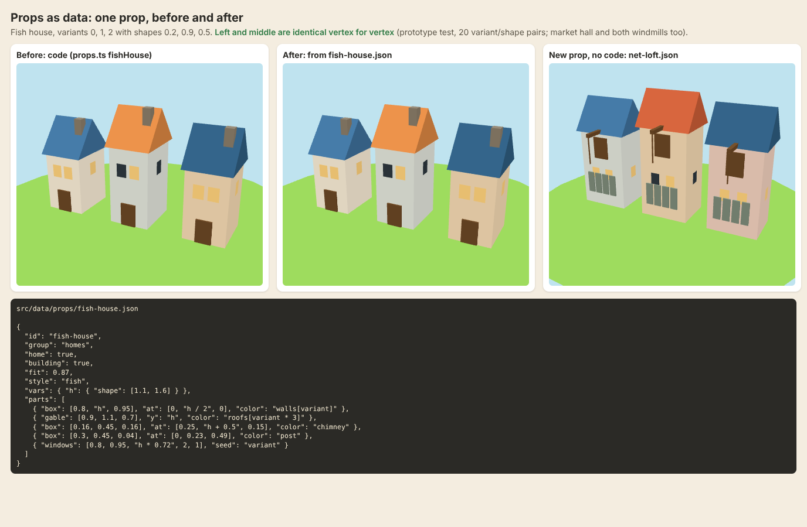

# Buildings and props as data: review

**Date:** 2026-10-24. **Asked by:** Guillaume ("there's also a list of buildings somewhere with each building geometry, colour etc? … check the best way to do that first and propose it to me"). **Decision:** [0135](../../decisions/0135-props-as-data.md) (accepted 2026-10-24: Guillaume chose the hybrid). Nothing in the game is changed by this review.



_Left: the fish house as built today by `fishHouse()` in TypeScript. Middle: the same three houses built from `fish-house.json` by a small prototype; they are identical vertex for vertex. Right: a new prop (`net-loft.json`) made by writing a file, no code._

## What there is today

- **The prop catalogue** is code: `src/render/models/props.ts` (704 lines) holds **43 prop types** (`PROP_TYPES`): 5 kinds of home, town pieces (warehouse, market hall, bakery, church…), timber, fish, farm and stone pieces, trees, rocks, and 4 landmarks (`landmarks.ts`). Each is a TypeScript function that stacks boxes, cylinders, cones, gable and hip roofs and window panes.
- **Colours** are TypeScript constants in the same file: a named palette (`C`: sand, post, plank, chimney, pine greens…) and walls and roofs per island style (`STYLE`: fish, timber, grain, stone, yard).
- **Where props stand** is already data: the island files (`src/data/islands/*.json`, decision [0101](../../decisions/0101-island-files-built.md)) place props by type id with `variant`, `shape`, `size`, `length` and `tags`. The island builder lists the types from `PROP_TYPES`.
- **The home island's buildings** (`src/data/buildings.json`, decision [0126](../../decisions/0126-home-island-build-spots.md)) hold only id, pair, price and effect. How a building looks is a group of ordinary props tagged `home:<building>` in `skerry.json`. So there is no "building geometry" list anywhere: it is all in `props.ts`.
- **How it is drawn:** every prop of an island is merged into one flat-shaded, vertex-coloured mesh (one draw call), with lit windows in a second mesh. Props are tiny: 2 to 384 triangles (fish house 56, sawmill 260, slipway with hull 384). An island must stay under 6,000 triangles at its top level (`islandChecks.ts`, an error in the builder).
- **Guards:** golden hashes of every shipped island at every level (`tests/island-files.test.ts`) fail if any vertex or colour moves.
- **Not props:** docks, piers, ramps, stairs, lanes, the quarry and terrain are drawn from the island's layout in `towns.ts`. They are shapes computed from the coast, not models, and stay code.

## Options compared

| | A. Recipe file per prop (primitives + palette) | B. Ship pattern (numbers into one builder + named code parts) | C. glTF (`.glb`) per prop | D. Hybrid: A, with named code parts, and glTF possible later |
|---|---|---|---|---|
| Standard practice | Data-defined kit pieces: Minecraft block models (JSON boxes + texture refs), prefab files in most engines | Fine when all models share one shape (all ships are hulls + masts) | The standard for **artist-made** meshes (Blender → engine) | What most small engines do: data recipes for kit pieces, imported meshes for hero assets |
| New prop without code | **Yes**, for anything made of the shapes we use | No: props differ too much for one builder; each new kind is code | Yes, but only with a 3D tool and someone to use it | **Yes**; a genuinely new shape is one named code part, once |
| Variants and shape | `variant` picks colours and options, `shape` (0 to 1) sets sizes, as island files already do | Yes | Hard: per-style palettes, random heights, lit/dark windows, bare windmill need conventions or several files | Yes |
| Palette per island style | One `palette.json`, colours by name | Same | Baked into materials; restyling = re-export | Yes |
| Triangle budget, old tablet | Same geometry as today, so the same cost; budget checked per prop | Same | Easy to overshoot; needs a check on import | Same as A |
| Golden hashes | **Unchanged** if ported exactly (proven in the prototype for 4 props) | Unchanged | All change | Unchanged |
| Island builder / `?tune` | Builder lists types from the files; colours can go in `?tune`; a recipe can get live sliders later | Same | Builder can place, not edit | Same as A |
| Loading | Small JSON (about 1 KB each, ~30 KB for all), compiled once at start | Same | glTF loader (~15 KB gz) and async loading per model | Same as A |
| Diff and review in GitHub | Readable | Readable | Binary | Readable |

**glTF is the standard answer when artists model in Blender.** This project has no 3D artist: every asset is built in code and art is chosen from renders (memory: "assets built in code"). glTF would bring a tool chain nobody uses, break every golden hash, and make palettes and variants harder. It stays possible later as one more shape kind (`"mesh": "props/x.glb"`, baked to vertex colours at load) if an artist or a kit ever comes along.

**The ship pattern alone does not fit**: ships are one shape with different numbers; props are 43 different shapes. But its escape hatch does: a **named code part** for the few shapes numbers cannot describe (the lofted hull on the slipway), exactly like `shipParts.ts`.

## Recommendation: D, the hybrid

**One file per prop, `src/data/props/<id>.json`, loaded with `import.meta.glob`** (adding a file adds the prop, as ships do), plus **`src/data/palette.json`** for colours.

```json
{
  "id": "fish-house",
  "group": "homes",
  "home": true,
  "building": true,
  "fit": 0.87,
  "style": "fish",
  "vars": { "h": { "shape": [1.1, 1.6] } },
  "parts": [
    { "box": [0.8, "h", 0.95], "at": [0, "h / 2", 0], "color": "walls[variant]" },
    { "gable": [0.9, 1.1, 0.7], "y": "h", "color": "roofs[variant * 3]" },
    { "box": [0.16, 0.45, 0.16], "at": [0.25, "h + 0.5", 0.15], "color": "chimney" },
    { "box": [0.3, 0.45, 0.04], "at": [0, 0.23, 0.49], "color": "post" },
    { "windows": [0.8, 0.95, "h * 0.72", 2, 1], "seed": "variant" }
  ]
}
```

What a recipe holds:

- **Catalogue flags**, moved from `PROP_TYPES`: `group`, `home`, `building`, `water`, `edge`, `sizedInModel`, `fit`, `fitRadius`.
- **Shapes**: `box`, `cyl` (a cone when one radius is 0), `gable`, `hip`, `dome`, `ico`, `dodeca`, `torus`, `plane`, `windows` (lit and dark panes, as now), `use` (another prop, e.g. the lumber store uses `lumber`) and `part` (a named code part).
- **Placement**: `at` for a plain move; `ops` for ordered steps (`move`, `turnX/Y/Z`, `scale`) when a piece pivots, like windmill sails.
- **Colour**: a palette name (`post`, `chimney`), a style list with an index (`walls[variant]`, `roofs[variant * 3]`, taken from the island's style unless the recipe fixes `style`), or a literal `#a8432f`.
- **Variety**: `vars` (numbers, or a range set by `shape`), `if` (`"variant % 3 == 2"` adds the stone house's tower), `repeat` (`{ "x": [-1.1, 0, 1.1], "z": [-0.6, 0.6] }` for posts, `{ "count": 4 }` for sails).
- **Named variants** without copying: `windmill-bare.json` = `{ "extends": "windmill", "vars": { "bare": 1 } }`.
- **Game hooks**: `glow` (lights at night), `solid` (the moored boat's hull), and the existing tag hooks stay in code.
- **Expressions** (`"h / 2"`, `"k * pi / 2 + 0.4"`) are a tiny safe reader (numbers, names, `+ - * / %`, comparisons, brackets): no `eval`, compiled once when the files load.

What stays code: the layout-driven pieces (docks, piers, ramps, stairs, lanes, terrain); the slipway's lofted hull as the code part `slip-hull`; the geometry helpers. Trees keep their lazy building ([0112](../../decisions/0112-lazy-woodland-geometry.md)): the reader draws a recipe's `vars` first and builds geometry only when the scatter keeps the tree, for every prop.

### Triangle budget (old tablet)

Recipes make **the same triangles** as the code, so performance does not move. New guards: each prop file gets a budget by group (homes 120, other buildings 400, small props 160, trees 60; today's largest fit), a test fails a file over it, and the model sheet shows each prop's count. The island's 6,000-triangle check stays as it is.

### Golden hashes

The port must leave `GOLDEN` in `tests/island-files.test.ts` **unchanged**: that proves no island moved by a vertex or a colour. The prototype already matches the code exactly (positions and colours to 4 decimals) for the fish house over 20 variant/shape pairs, the market hall, the windmill and the bare windmill.

### Island builder, model sheet and `?tune`

- The island builder already lists `PROP_TYPES`; it will be built from the files, so a new file shows in its prop list at once, with its `variant` and `shape` controls.
- The model sheet (`models.html`) gets a prop view: every prop, its variants and its triangle count, like the ship sheet.
- `palette.json` goes into the `?tune` panel as a Colours section (walls and roofs per style), so a colour can be tried live and shared.
- Later, optional: a recipe editor in the island builder (pick a prop, nudge its numbers with sliders, export the file), like the ship rig editor idea in [0109](../../decisions/0109-one-file-per-ship.md).

### Home buildings

Home buildings stay as they are (props tagged `home:<id>` on Skerry, 0126). With recipes, a building can be its own prop file that `use`s others (e.g. a `home-warehouse` = warehouse + crates + a crane), and `buildings.json` can name it as `model` for the picture on the build card. That is a later, small step and is left out of the first PR so as not to clash with the warehouse and weather-glass work in progress.

### Adding a prop without code

1. Copy a close prop file to `src/data/props/<new-id>.json`, change `id` and the parts.
2. Open the model sheet to look at it and its triangle count; the checks name any unknown colour, var or shape.
3. Place it in the island builder.

## Plan

1. **PR 1, the port** (after the home island thread merges): the reader, `palette.json`, the 43 prop files and the landmarks, `PROP_TYPES` built from the files, `props.ts` reduced to helpers and code parts; checks for the files; budget test; `GOLDEN` unchanged; how-to in `docs/content/README.md`.
2. **PR 2**: model sheet prop view and the `?tune` Colours section.
3. **Later, if wanted**: the recipe editor in the island builder; `model` on home buildings; glTF as a shape kind.

## Prototype

`src/` here: `recipe.ts` (the reader, ~150 lines), `palette.json`, `props/*.json` (fish house, market hall, windmill, net loft), `same.test.ts` (identical-geometry test) and `before-after.html` + `render.ts` (the picture above). It is not wired into the game; to run the test, copy the folder to `tests/props-proto/`, change `../../../../src/` to `../../src/` in the imports and run `npx vitest run tests/props-proto`.
