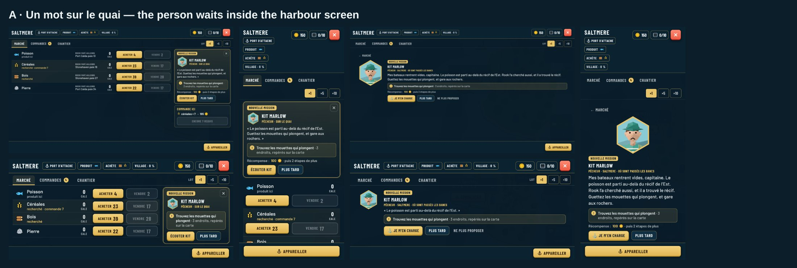
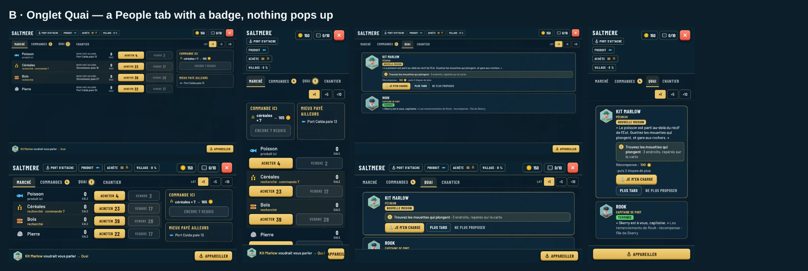
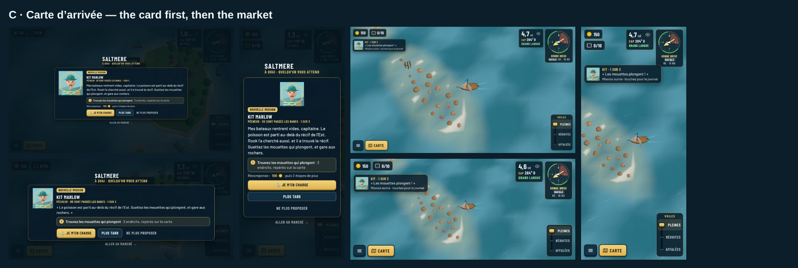

# Quest cards: clearer, ignorable, not on top of the harbour (proposal)

Guillaume's playtest (2026-10-24): when you dock, the person's card opens **on top of the harbour
screen** and players don't understand why. A second quest card popped up straight after with no
explanation. Quest cards should be clearer and should be possible to ignore.

The bug fixes are already in [0139](../../decisions/0139-gentler-prologue-and-quest-cards.md): one card per
harbour call, no "come and see me" card when docking already finishes it. This review is about the card
itself. Mockups are the live game in French, docked at Saltmere with Kit's offer, with the new UI
injected (`src/capture.cjs`, run against `npx vite --port 5199`). Each option is shown at desktop
1280x720, phone landscape 915x412 and phone portrait 412x915.

## Common to all three options

- **The card says what kind of message it is**: a tag `NOUVELLE MISSION`, `SUITE` (a step
  moved on) or `TERMINÉE`, so a card is never a mystery.
- **What to do, boxed**: the step's ask with where it happens ("3 places, marked on the chart"),
  and the **reward** on its own line.
- **Three answers**: `Je m'en charge` (accept), `Plus tard` (comes back next call), and
  `Ne plus proposer` (ignore this job: no more cards. It stays in the journal under "Ignorées"
  and can be taken up from there).
- **At sea, no cards**: a step that moves on at sea shows a small note under the gold (face, "Kit ·
  1 of 3", one line) that fades by itself; tapping it opens the journal
  ([S-sea-note](mockups/S-sea-note-desktop.jpg)). The objective arrow (0139) shows where to go.
- **Data first**: how a step speaks is step data, the same for every quest and the tutorial:
  `notify` = the option's harbour form (default in a harbour), `card` (a full card, for the few
  big story moments), `note` (the small note, default at sea) or `none`. A Settings switch
  "People's jobs: ask me / journal only" turns every offer into the journal only.

## A · "Un mot sur le quai": the person waits inside the harbour screen (recommended)

The person stands at the top of the harbour screen's side column (above the market in portrait):
face, tag, the ask, what to do, reward, `Écouter Kit` and `Plus tard`, and a ✕ to ignore. The market
works as usual next to it. `Écouter` opens the full conversation **inside** the harbour screen in
place of the market (a `← Marché` link takes you back). Nothing ever covers the screen.

- Pro: the person is part of the harbour, so it's obvious why they are there; nothing to dismiss
  before trading; works the same on all three screens.
- Con: a little less room for the side cards (the "best elsewhere" card moves under it, or is
  dropped on phones while someone is waiting).

## B · "Onglet Quai": a people tab, nothing pops up

A new tab `QUAI` next to Market, Orders and Shipyard, with a badge when someone has something to
say, and a line in the footer "Kit Marlow voudrait vous parler → Quai". The tab lists everyone in
this harbour: new jobs, steps, and thanks.

- Pro: the calmest. All people of a port in one place, and room for more later (outposts, Phase 4).
- Con: easy to miss: a player who never opens the tab never meets Kit. The prologue and the epilogue
  would still need a card.

## C · "Carte d'arrivée": the card first, then the market

The card stays a modal but it shows **before** the harbour screen, on the dimmed harbour, titled
"Saltmere · à quai · quelqu'un vous attend", with "Aller au marché →" under it. The harbour screen
opens after it.

- Pro: the smallest change, and the story moments keep their weight.
- Con: still something to close before trading, on every call with a message.

## Recommendation

**A**, with the common changes. It answers both complaints (no card on top of the harbour screen,
and you can ignore it by simply trading or with ✕) and keeps people visible. C's arrival card stays
for the few big story moments (Rook's island, the epilogue) through `notify: "card"`.
