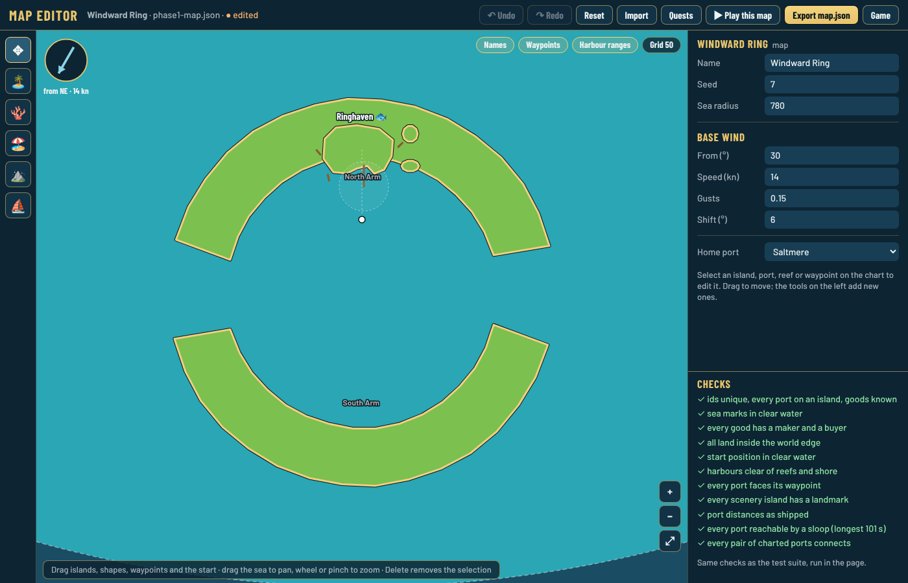
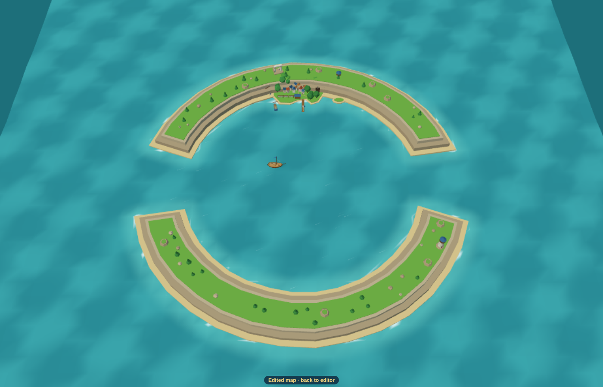
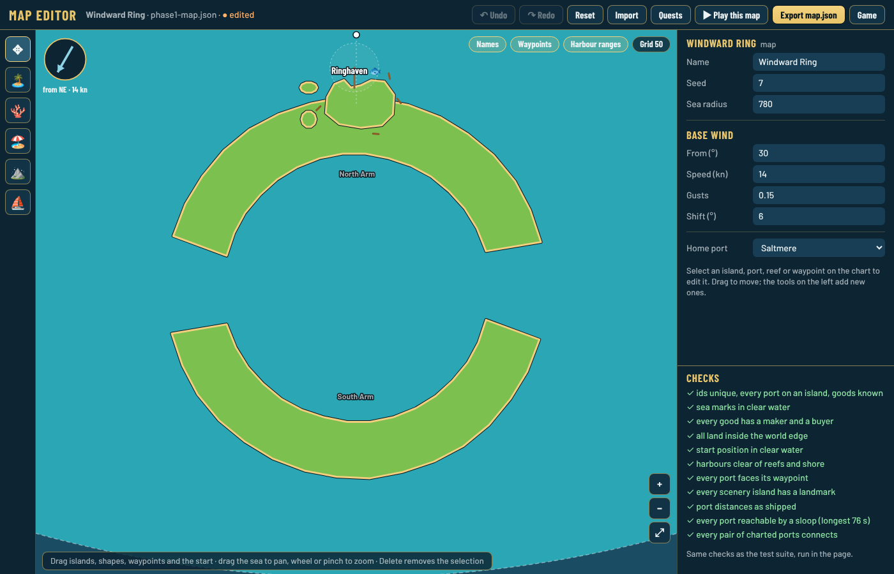
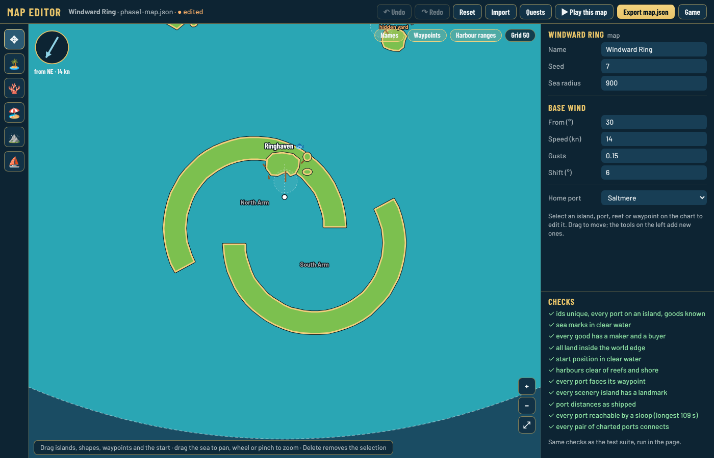
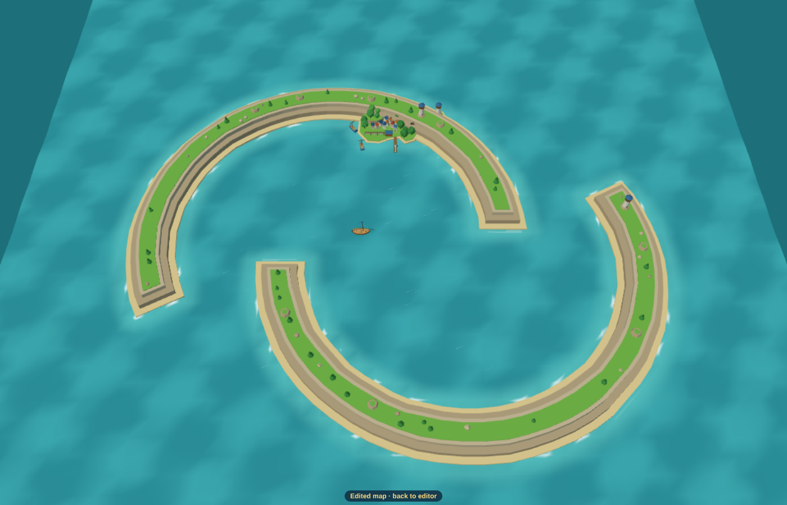

# Ring island with an inner lagoon

*Guillaume, 2026-10-24: "with what we currently have is it [possible] to make: a circle island with one opening on the east and another on the west. The middle is sea. Port is at the north. The wind is reduced in the whole middle. Wind can only flow E->W or W->E." Proposal for the wind part: [0143](../../decisions/0143-lagoon-wind-axis.md).*

## Short answer

The island, the openings, the lagoon and the port all work **today**, built in `editor.html` with the existing tools. Every map check passes, including the sailing routes. The **wind part does not work yet**. The middle keeps the full sea wind from any direction. It needs one more wind zone kind on top of [0140](../../decisions/0140-wind-zones-and-currents.md), which is not built yet.

## What I built

I built it in the editor on a copy of the Windward Ring, with the sea radius raised to 780 so it sits south of everything, centred at (0, −590). The pieces are in [ring-lagoon-snippet.json](ring-lagoon-snippet.json), and [make-draft.py](make-draft.py) writes the full draft:

- **North Arm** and **South Arm**: two barrier islands (`terrain`, kind `island`). Each is a C-shaped outline, 125 units outside and 88 inside. The two gaps are ±14° around due east and due west, about 43 units wide on the inside and 60 on the outside.
- **Ringhaven**: a small port island (radius 16) that sits against the North Arm, with a fish port. Its harbour faces the waypoint named after it.

Port facing **in** (waypoint inside the lagoon, pier pointing south):





*(The game camera is pulled out further than players can zoom here, so the whole ring fits.)*

Port facing **out** (waypoint north, pier into the open sea):



## What works today

| Wish | Today | How |
| --- | --- | --- |
| Ring with openings E and W | ✓ | Two barrier-island arms. One outline can't have a hole (coasts are simple polygons), but the two openings mean you never need one: each arm is its own C-shaped outline. |
| Middle is sea | ✓ | Ordinary sea between the arms. Collision against the arms works, concave inner shore included. |
| Port in the north | ✓ | A port island placed against the North Arm. Facing in or out is just where its waypoint sits. The harbour check passes both ways. |
| Sailing in and out | ✓ | Route checks pass: every port reachable, every pair connects. A sloop sails straight through the two gaps west to east when the wind is from the north or south. |
| Looks right in 3D | ✓ | Cliffs, beaches, trees and the landmark are generated on both arms, and the town and pier on Ringhaven. Both arms can be opened in the island builder (Edit island makes their file, [0110](../../decisions/0110-every-island-has-a-file.md)). |
| Wind reduced in the whole middle | ✗ | Island shelter ([0027](../../decisions/0027-islands-shape-the-wind.md)) only reaches `shadowLength` = 70 units downwind and fades over that distance. Measured at 14 kn: the centre stays **14.0 kn** for wind from N, E, S and W. Only the strip near the upwind arm drops to about 9 to 11 kn. A wind from E or W comes straight through the gaps and isn't reduced at all. |
| Wind only E→W or W→E | ✗ | Nothing turns the wind locally. Wind zones ([0140](../../decisions/0140-wind-zones-and-currents.md)) are accepted but not built, and their `trade-belt` pulls towards **one** heading, not either end of a line. |

Smaller things to know:

- **In or out matters for play, not for the code.** Facing **in** makes the lagoon and its gaps the way in, so the lagoon wind becomes part of every visit: you come in through the gap with or against it. Facing **out**, the harbour is on open sea and the lagoon is optional scenery. My recommendation is **in**.
- **The ring is big.** The lagoon has to be roughly 2 × the port island radius + 22 units deep in front of an inward-facing harbour (the harbour check). Each gap needs about 30 units of clear water for the route check. In the game, the camera never shows the whole ring at once, but the chart does.
- **Where to put it.** Today's ring (sea radius 440) has no free space this size. It fits in a Phase 4 biome, or after the map grows ([0115](../../decisions/0115-bigger-map-engine-rules.md)).
- **Route checks would ignore the zone.** `sailRoute` uses the map's base wind and its opposite. Once the lagoon zone exists, it should ask the zone's wind too. Otherwise the check believes you can sail north–south across the lagoon at full speed.

## Smallest change for the wind (proposal, [0143](../../decisions/0143-lagoon-wind-axis.md))

This is data first and uses the 0140 format. The "Build wind zones" thread is adding a `sheltered` kind for this lagoon: `strength` 0.55, `gusts` 0.6, `pull` 0.9 and `axis: true`, where `headingDeg` is read as a line and the wind pulls to whichever end is nearer the sea wind. The lagoon is then one zone:

```json
"windZones": [
  {
    "id": "ring-lagoon",
    "name": "Ringhaven Sound",
    "kind": "sheltered",
    "headingDeg": 90,
    "outline": [[-130, -590], [-90, -505], [0, -478], [90, -505], [130, -590], [90, -675], [0, -702], [-90, -675]]
  }
]
```

- **Direction:** inside the zone the wind blows along the E–W line, from whichever end is nearer the sea wind. A sea wind from NE gives an E→W wind, and a sea wind from SW gives W→E.
- **Strength:** × 0.55 across the whole middle, with gusts softened.
- **Edges:** it fades in over the shared `fadeUnits` (40) like every zone, so sailing in through a gap you feel the wind swing round.
- **Editor:** the 0140 "Add wind zone" tool. The panel lists the kind's numbers as per-zone overrides, so nothing new is needed there.

Two additions, agreed with the wind zones thread (built into `sheltered`, ADR 0144):

1. **`acrossFloor` 0.3:** the speed is also × max(`acrossFloor`, |cos(sea wind − axis)|). When the sea wind blows straight across the line (from N or S), the lagoon is at its lightest (0.55 × 0.3 of the sea wind), and the pull eases by the same |cos|, so the flip from E→W to W→E happens in a near-calm, never as a sudden 180° swing at full strength.
2. **Route checks sample zone wind**, so they don't assume full-speed sailing across the lagoon.

Zone first, island shelter second, with the shelter rays using the zone's direction: the arms still add their lee near the shore, and the gaps funnel a little, as they do today.

## Staggered entrances (the tropical main island)

Guillaume, 2026-10-24, with a reference picture: he wants this kind of island for the tropical main port, harbour facing in, and asked for a review of the suggestion "slightly stagger the two halves so the headlands overlap, creating gentle bends at both entrances. Keep enough space for boats to tack and turn."

**Verdict: good idea, with a minimum slot width.** The arcs below are a geometry test drawn by a script (Guillaume: "ugly, not thick enough, no personality, too geometric"). The real island is hand-drawn in the island builder, keeping only the layout: two arms, harbour facing in, staggered entrances, slot at least 50 units. [make-staggered.py](make-staggered.py) builds it: two equal arms (radius 110, 30 wide) whose centres sit 42 units apart, each running 28° past the other's start. At the west, the north arm's headland passes outside the south arm's tip, and at the east the reverse.





Time for a sloop to reach the harbour from 280 units outside the west or east entrance (route check, base wind only, no zone yet), in seconds:

| Wind from | N | NE | E | SE | S | SW | W | NW |
| --- | --- | --- | --- | --- | --- | --- | --- | --- |
| Straight gaps, from W | 26 | 62 | **100** | 43 | 22 | 26 | 28 | 23 |
| Straight gaps, from E | 26 | 23 | 28 | 26 | 22 | 43 | **101** | 62 |
| Staggered, 52-unit slot, from W | 71 | 65 | 60 | 55 | 33 | 31 | 31 | 72 |
| Staggered, 52-unit slot, from E | 40 | 30 | 32 | 53 | 64 | 53 | 59 | 72 |
| Staggered, 28-unit slot | no route in any wind | | | | | | | |

- **The bend evens it out.** With straight gaps the wind blowing straight out of the entrance makes it a long beat (100 s), and every other wind makes it a free run (22 to 28 s). Staggered, every wind takes 30 to 72 s. You always have a turn to make but are never stuck dead upwind in a narrow cut. That suits the south, which opens first and should sail gently.
- **Width is what matters.** At 52 units every map check passes. At 28 units no sloop route exists at all, because the hull plus turning room doesn't fit through the bend. Keep the slot at **50 units or more**, and wider for the bigger ships if the reef passage of 0137 isn't meant to be here.
- **It looks better too.** The lagoon reads as a closed harbour from most angles, as in the reference picture, and the two headlands are natural places for the two lighthouses.
- **To do when the tropical port is built:** the arms use the generated look. Shaping their coasts (bays, rocks, sand spits) and spreading the town along the inner shore, as in the picture, is island builder work on the port's file.

