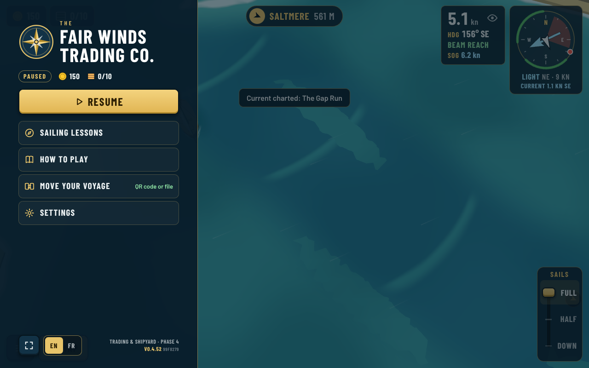
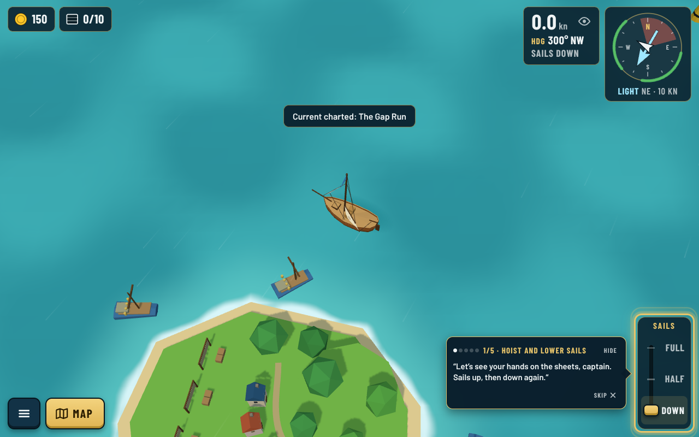
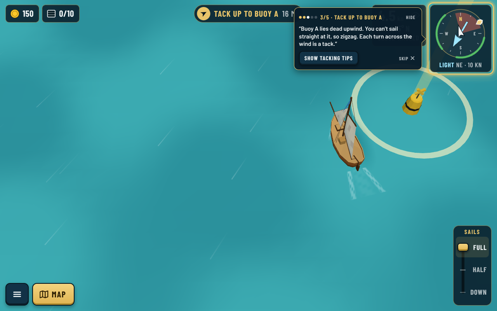
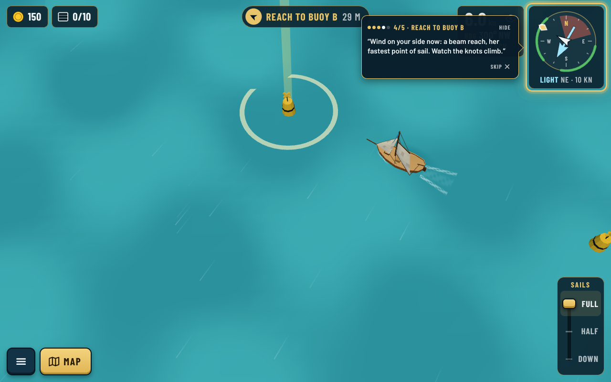
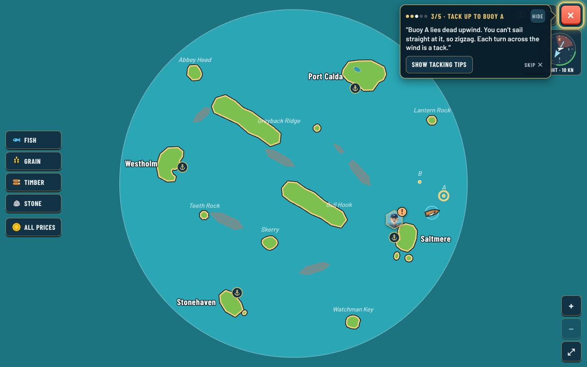
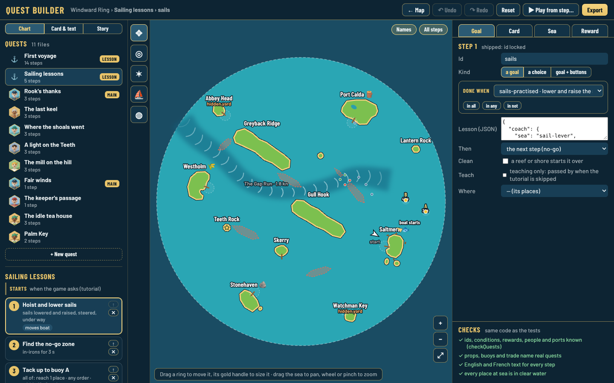
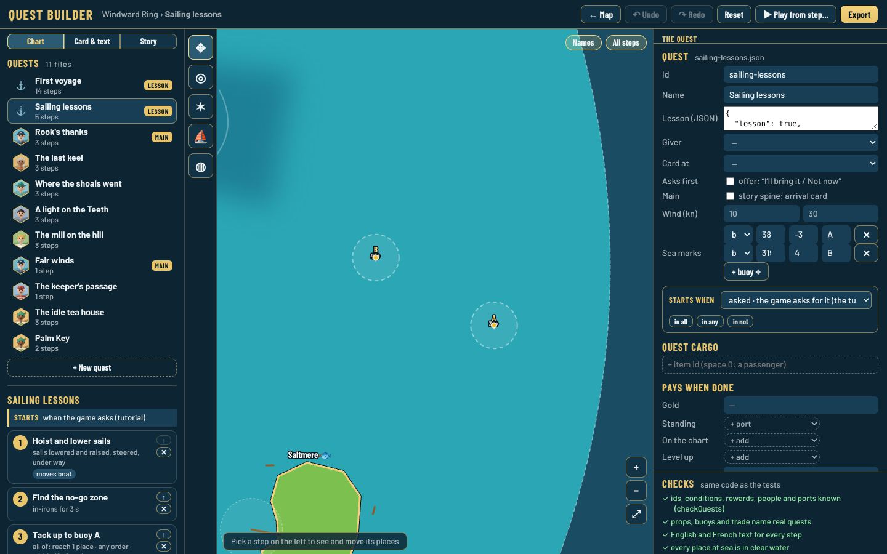

# Sailing lessons: screenshots

Decision [0164](../../decisions/0164-sailing-lessons-quest.md). Taken with `npm run shots` (the list is below) and the quest builder.

| | |
|---|---|
|  The menu line, once the tutorial is seen |  Started from the far west: the boat is taken to Rook's course off Saltmere, sails down |
|  Tacking up to buoy A, the yellow practice buoy |  Beam reach to buoy B |
|  Both buoys on the chart while the lessons run |  Quest builder: the boat start (⛵) and the buoys (◍) |
|  Quest builder: the quest's wind and sea marks | |

Shots list (`npm run shots -- --list list.json`): `{ "at": [-250, 120], "click": "#menu-btn;#menu-tutorial", "storage": { "fwt.tutorial.v1.Windward Ring": "{\"status\":\"completed\"}" } }`, then `"quest": "sailing-lessons:<step>"` with `at` near each buoy.
