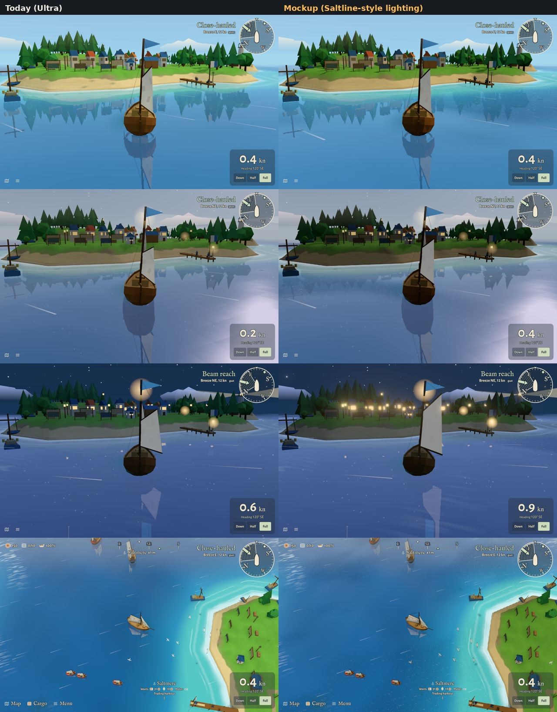

# Saltline-style lighting mockup (2026-11-11)

Guillaume asked whether Fair Winds can look as good as "Saltline", a browser FPS made by Claude
Fable (artifact "Saltline (Copy)"). Saltline is three.js r180 on WebGL2, like us; its look comes
from lighting, atmosphere and post-processing (PCSS shadows, half-res AO and volumetric fog, a
procedural sky used as image-based light, PBR wet materials, bloom, eye adaptation, filmic grade).
Advice given: upgrade Fair Winds rather than start a second game; its gritty PBR look and dark
grade would break the art bible.

This mockup tries the parts that fit our budgets, drawn in the real game on Ultra.

| Part | What it does | What the shots show |
|---|---|---|
| Bloom | `UnrealBloomPass` before the grade; threshold per time of day (1.05 day, 0.7 night) | The clearest win at night: windows and lanterns glow warmly. Nothing at day. |
| Soft contact shadows (PCSS) | Patched PCF `getShadow`: blocker depth estimated with extra compares on our depth-compare map, 8 + 16 taps | Hard to see from our cameras; worth it only with the lower Ultra camera. |
| Sky probe | Sky and sea captured in a 32 px cube, turned into a light probe, 65% of the hemisphere light replaced at the same brightness | Moodier: land darker at dusk and night. Fights "storybook, never grim" unless the sky colours are retuned. |
| Sea gusts | Cat's-paw patches running downwind: darker, broken reflections, small flecks; calm slicks between | Visible from the classic camera, subtle in the chase view. Fits a sailing game; cheap on every level. |
| Render-pixel cap | Not drawn: a speed and memory lever (Saltline caps Ultra at 3.7 Mpx) | — |

Picks and rejections: waiting for Guillaume.

Re-run: `npm run shots -- --quality ultra --chase --script docs/reviews/saltline-lighting/src/run.js`
(`run-night.js` for `--night`, `wait.js` for the same moment without the mockup). The first run
can reload the page while Vite bundles the two new three.js helpers; run it again.
