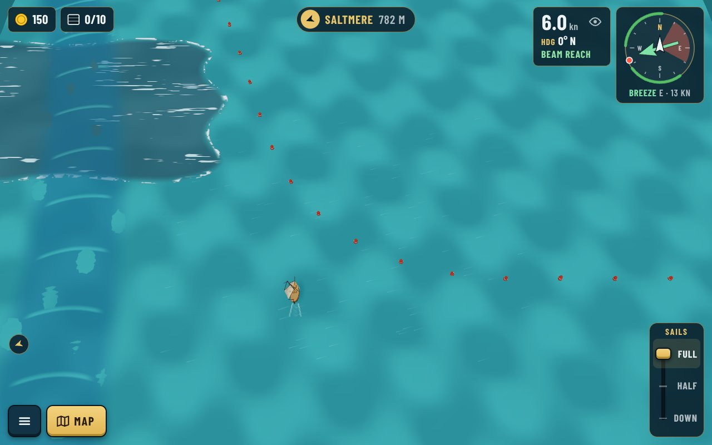
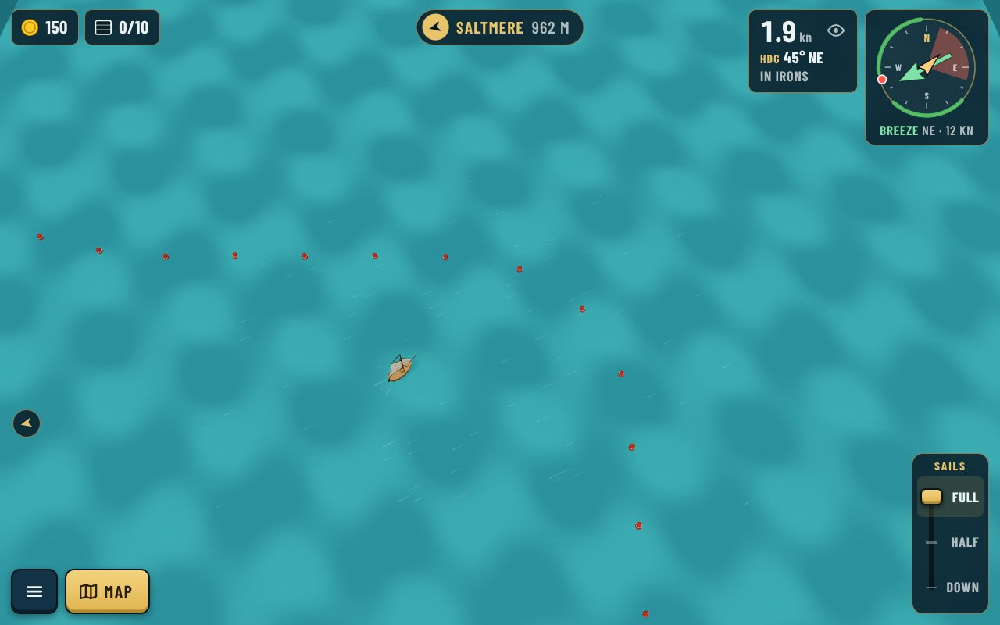
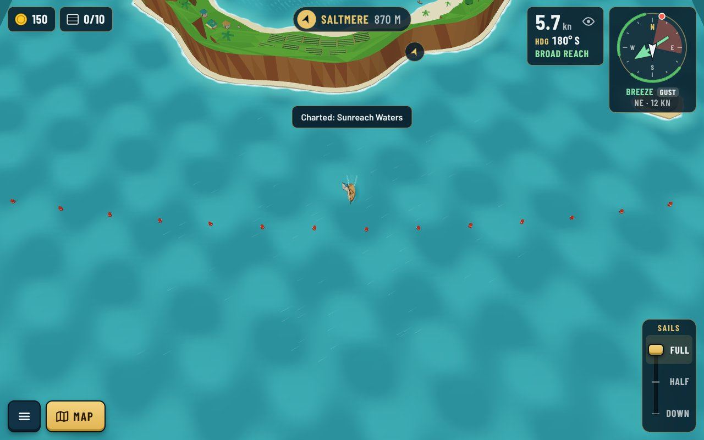
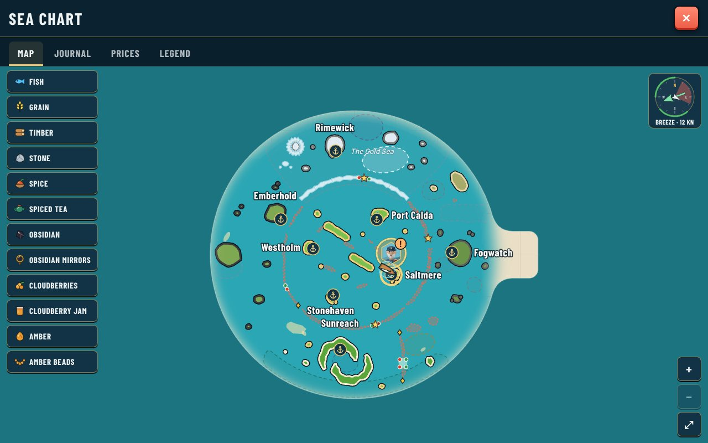
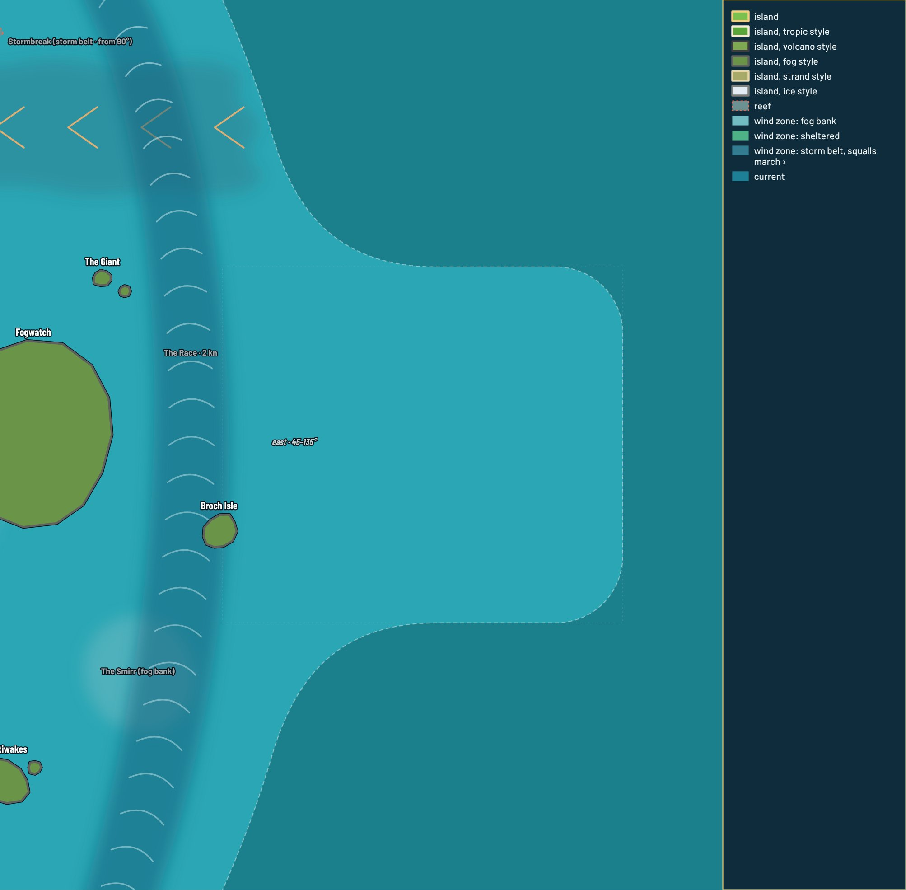

# Sea edge follows any outline (decision 0202): test section

A test section, a 360×320 rectangle sticking out east (`test-section.diff`, **not shipped**), added with
`npm run sea -- add edge --sea east --outline "900,-160 1260,-160 1260,160 900,160"`.

| Shot | What |
|---|---|
|  | The north seam from the sailing camera: the buoy line curves out of the old rim into the section |
|  | The section's far corner, rounded |
|  | Today's rim, unchanged |
|  | In-game chart: the section is new water, fogged |
|  | `npm run chart`: the rim is one line, no trace of the join (the faint dotted box is the edge's own outline, editor only) |
