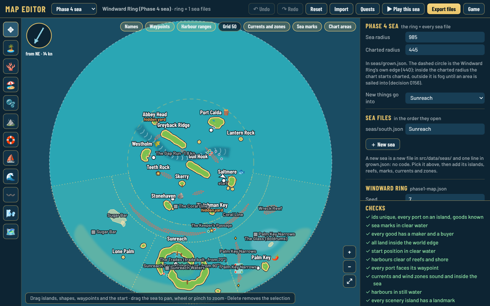
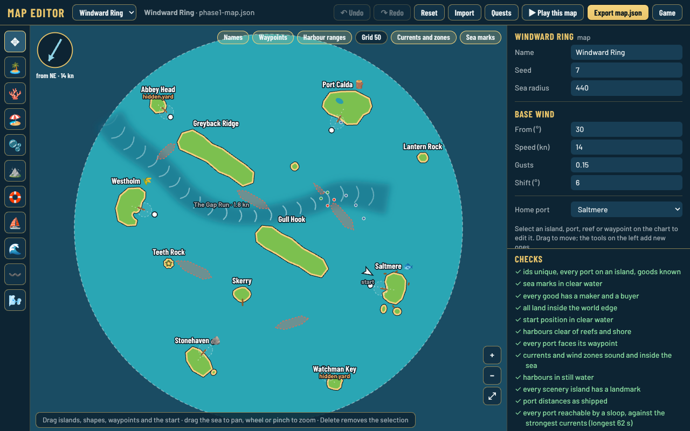
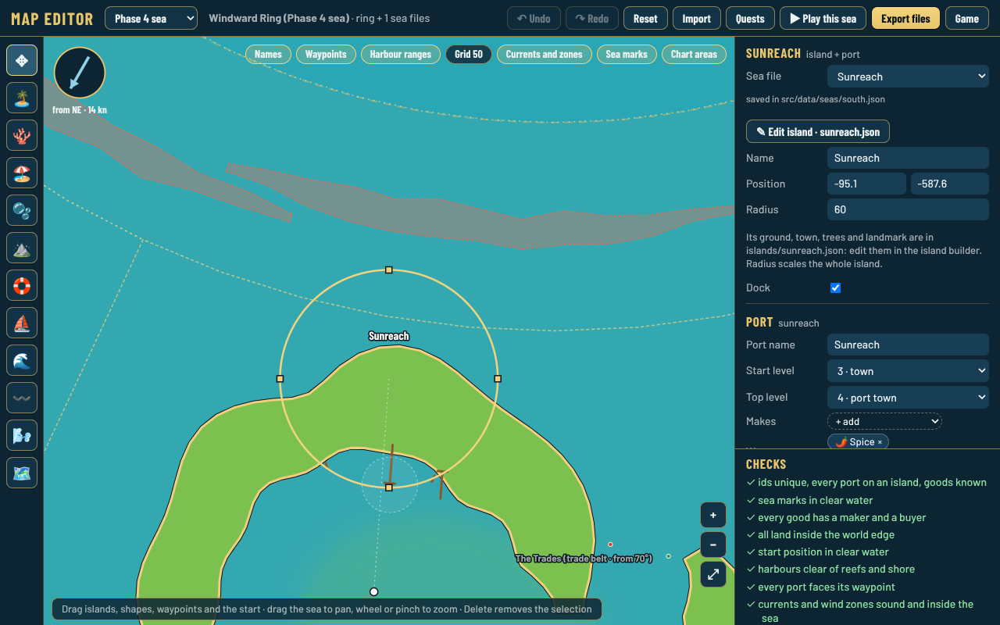
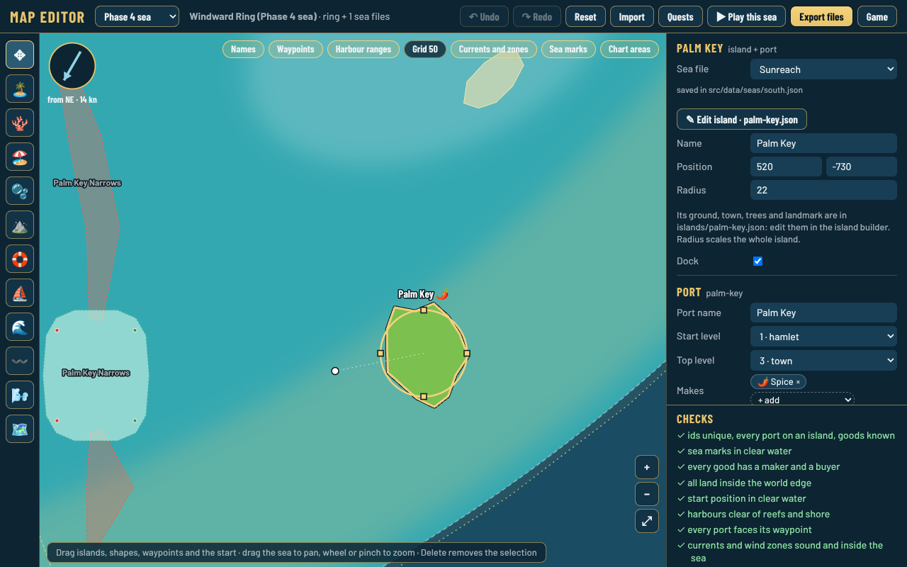
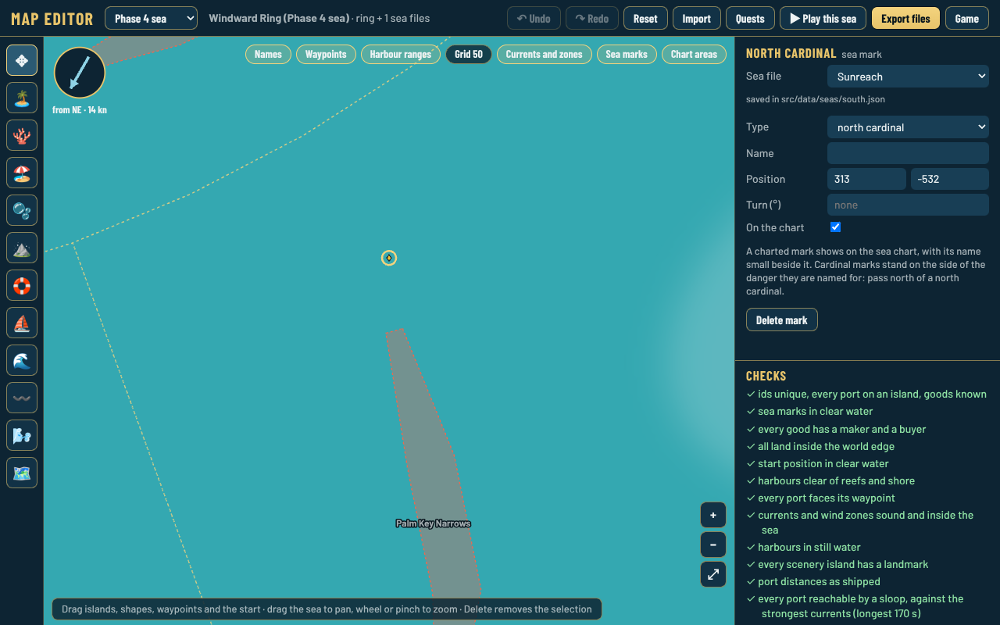
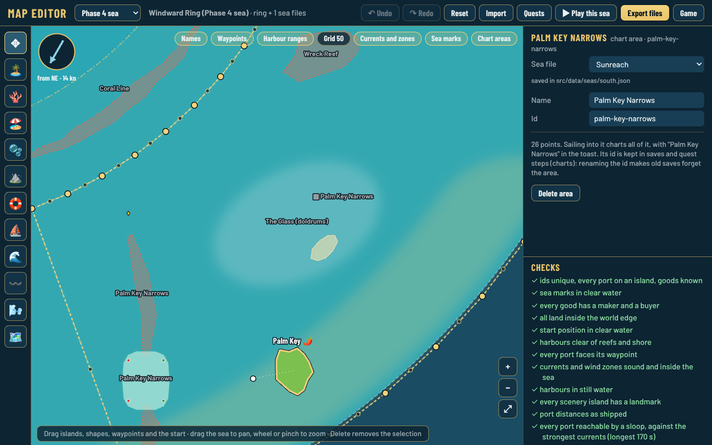
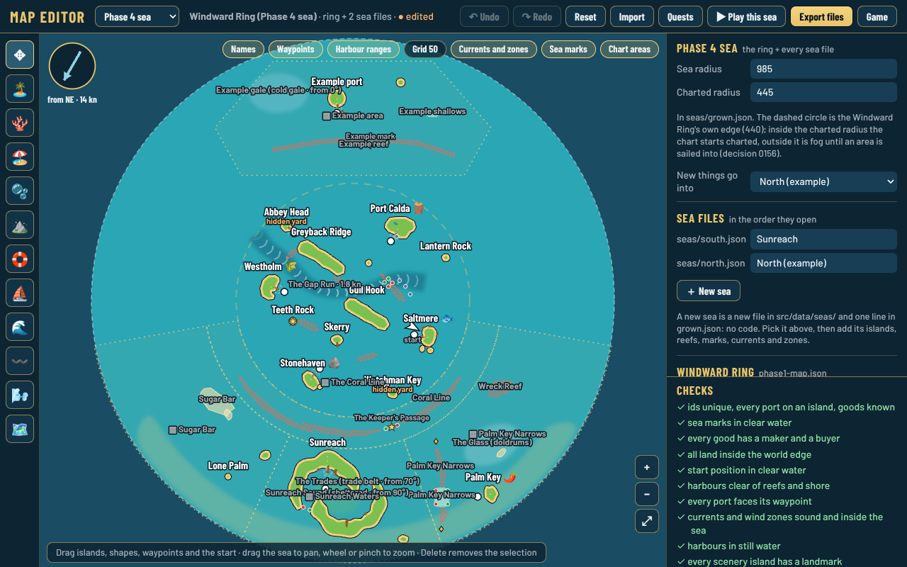
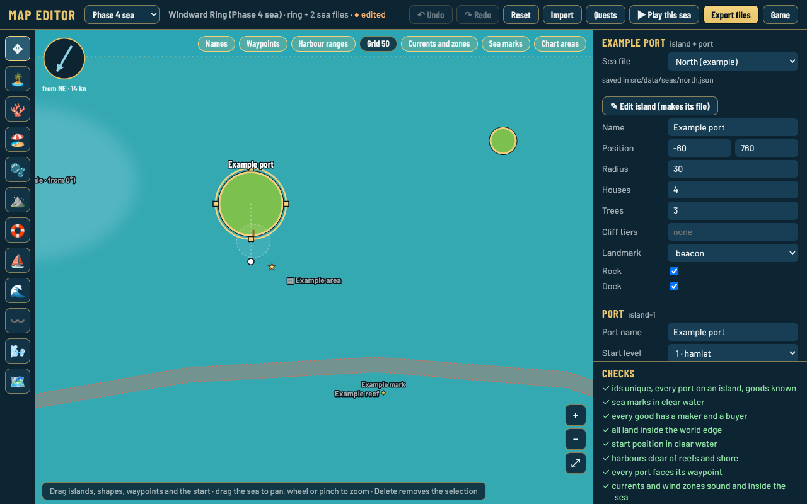
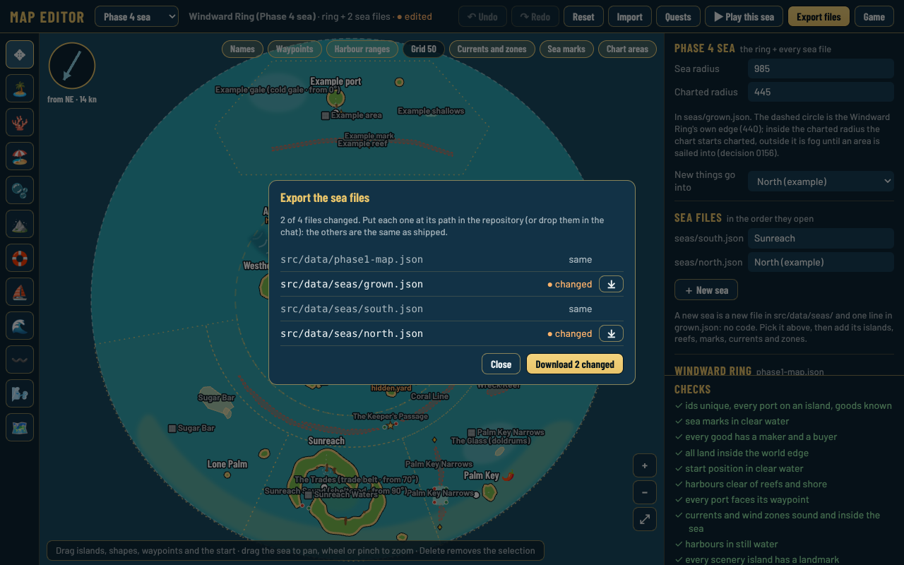

# Sea editor: screenshots for review

*Decision [0161](../../decisions/0161-sea-editor-every-sea-file-in-the-map-editor.md).* Taken with `npm run shots -- --list docs/reviews/sea-editor/shots.json --out docs/reviews/sea-editor`. The "north (example)" sea in shots 7 to 9 is a made-up draft (`draft-north.json`, written with `npm run sea`'s steps) to show a new sea: none of its names or places are proposals.

1. The Phase 4 sea: ring + south sea, the sea panel (sea radius, charted radius, new things go into, sea files, ＋ New sea), the new tools on the left, the chart areas dotted.
   
   Landscape and portrait: [landscape](1-sea-landscape.png), [portrait](1-sea-portrait.png).
2. The ring alone, as before, with the sea picker: 
3. Sunreach selected: **Sea file** says it is in `seas/south.json`. 
4. Palm Key, the founding site (the **Founding site** box is further down the port panel). 
5. A north cardinal mark: type, name, turn, on the chart. 
6. The Palm Key Narrows chart area: name, id, its points. 
7. A new sea drawn in the editor (example):  [portrait](7-new-sea-portrait.png)
8. Its port, saved in `seas/north.json`: 
9. Export: every file, changed or same; only the changed ones download. 
