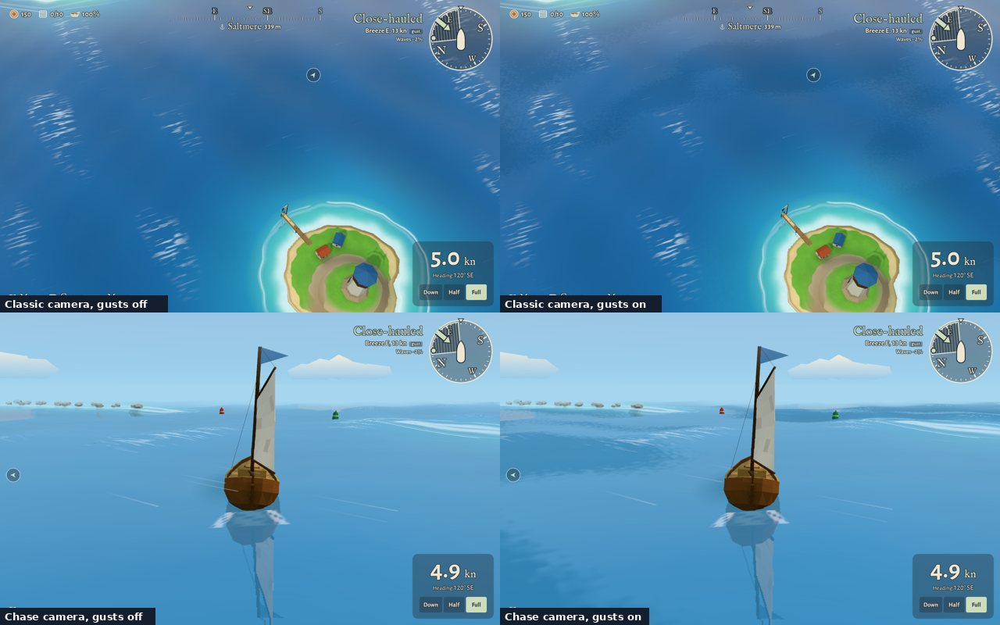
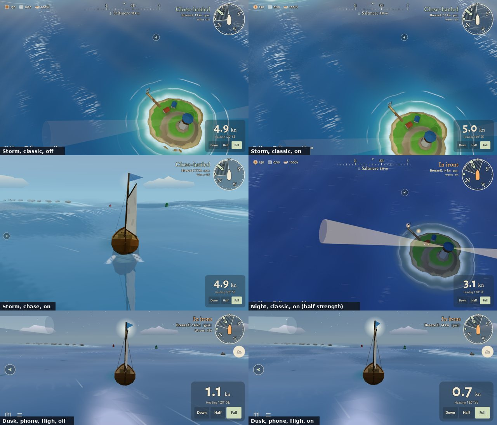
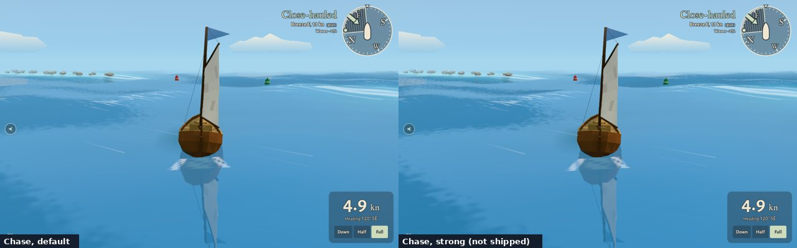

# Gusts on the sea (issue #498, decision 0295)

Soft darker patches run downwind with lighter slicks between, on High and Ultra with the waves on.
Before and after from the same camera, for the v1.8 end-of-release review.

| Round | Shown | Picks | Rejections |
|---|---|---|---|
| 1 (`day.jpg`, `storm-night-dusk.jpg`) | The shipped numbers (`waves.json › gusts`), inside the art director's limits | waiting for Guillaume (end of v1.8) | |
| 1 (`strong.jpg`) | A stronger variant (`strong.json`: harder edge, 8% darker, less sky kept) | waiting for Guillaume | |

Re-run (Ultra, boat at 60,-420 heading 120; add `&off=gusts` to the query for the "off" shot):

- Classic: `npm run shots -- --quality ultra --at 60,-420 --heading 120 --zoom 1.3 --query waves=wind --sizes desktop --wait 4000`
- Chase: the same with `--chase` instead of `--zoom 1.3`; strong: add `--tune docs/reviews/sea-gusts/strong.json`
- Storm: `--query waves=storm`; night: `--night`; dusk on a phone: `--quality high --sizes landscape --chase --time 450`
