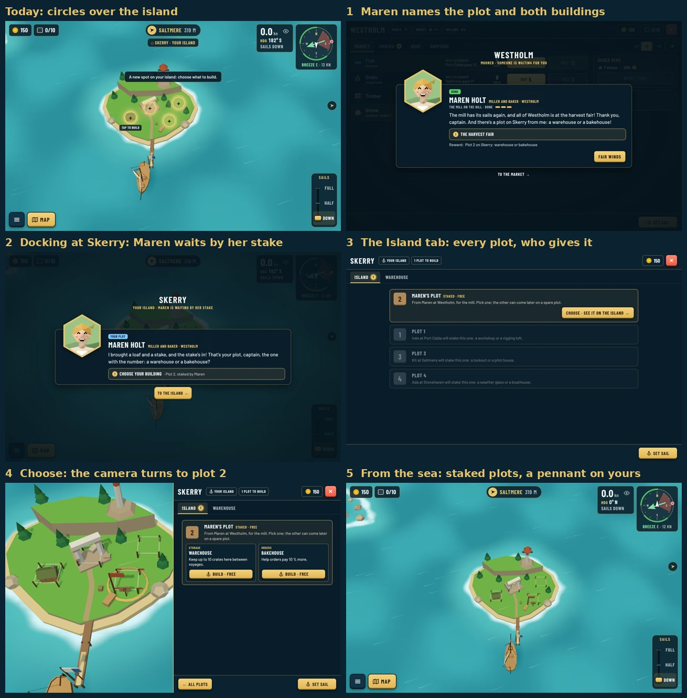

# Skerry's build choice: mockups (Phase 5, part 1)

Guillaume, 2026-10-25: players don't understand Skerry's special build view (floating numbered
circles over the island, "Tap to build", a card over a frozen sea). The [Phase 5
brief](../../phase-5/brief.md) part 1 replaces it. Words from the head storyteller
(project files `plan/story/phase5-words.md`, section A), look agreed with the art director (one round).

All frames are drawn in the real game with `npm run shots` (decision 0163): the mockup's parts are
[`mockup/mockup.css`](mockup/mockup.css) and the scripts beside it, the staked plots are the real
`plot-stakes` recipes on a copy of Skerry's island file.

```
npm run shots -- --list docs/reviews/skerry-build/mockup/shots.json \
  --style docs/reviews/skerry-build/mockup/mockup.css --sizes desktop,landscape,portrait \
  --out docs/reviews/skerry-build/mockup/shots
```



| # | What | Shots |
|---|---|---|
| 0 | Today, for comparison | [desktop](mockup/shots/0-today-desktop.jpg), [portrait](mockup/shots/0-today-portrait.jpg) |
| 1 | The arc's done card names the plot and both buildings (Maren: "a warehouse or a bakehouse") | [desktop](mockup/shots/1-done-card-desktop.jpg), [landscape](mockup/shots/1-done-card-landscape.jpg), [portrait](mockup/shots/1-done-card-portrait.jpg) |
| 2 | First docking at Skerry with the plot not chosen: the giver's arrival card, "To the island" | [desktop](mockup/shots/2-arrival-card-desktop.jpg), [landscape](mockup/shots/2-arrival-card-landscape.jpg), [portrait](mockup/shots/2-arrival-card-portrait.jpg) |
| 3 | Skerry's harbour screen, Island tab: every plot, the free one first, who gives the others | [desktop](mockup/shots/3-island-tab-desktop.jpg), [landscape](mockup/shots/3-island-tab-landscape.jpg), [portrait](mockup/shots/3-island-tab-portrait.jpg) |
| 4 | Choosing: the screen halves, the camera turns to the plot, a brass ring on the ground | [desktop](mockup/shots/4-plot-chosen-desktop.jpg), [landscape](mockup/shots/4-plot-chosen-landscape.jpg), [portrait](mockup/shots/4-plot-chosen-portrait.jpg) |
| 5, 6 | From the sea, day and night: staked plots replace the circles; the free plot has a pennant and a numbered sign | [day](mockup/shots/5-staked-from-sea-desktop.jpg), [night](mockup/shots/6-staked-night-desktop.jpg) |
