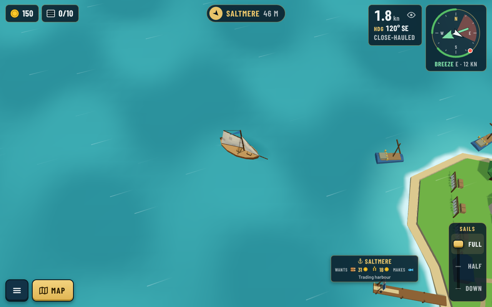
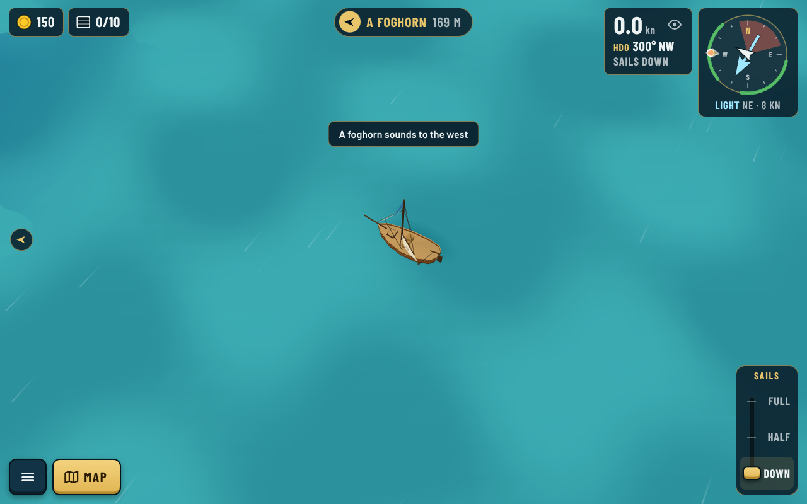
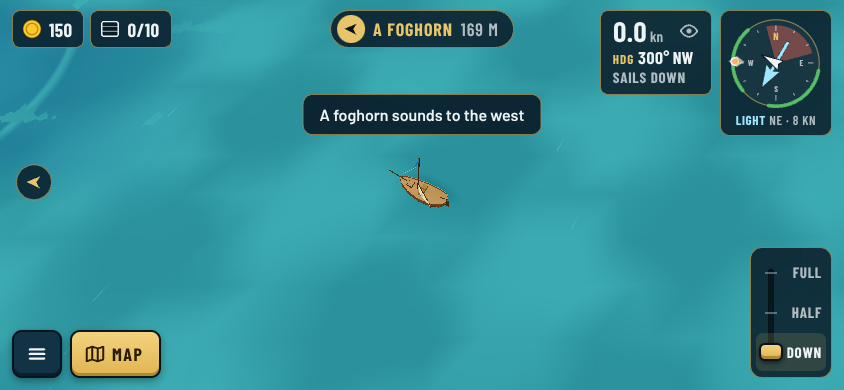
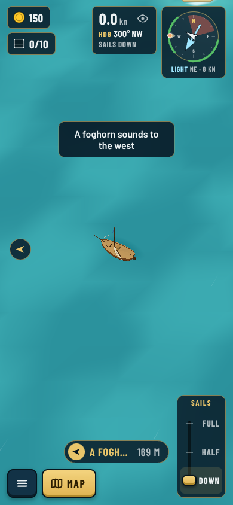
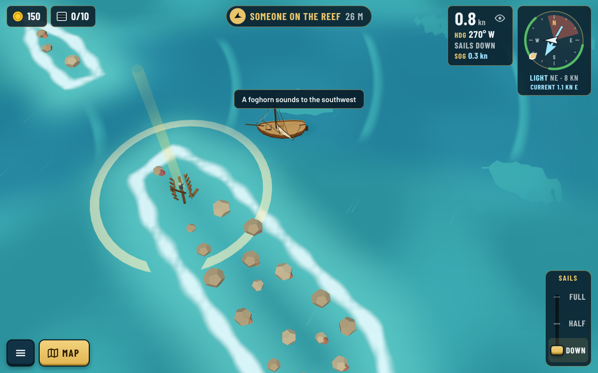
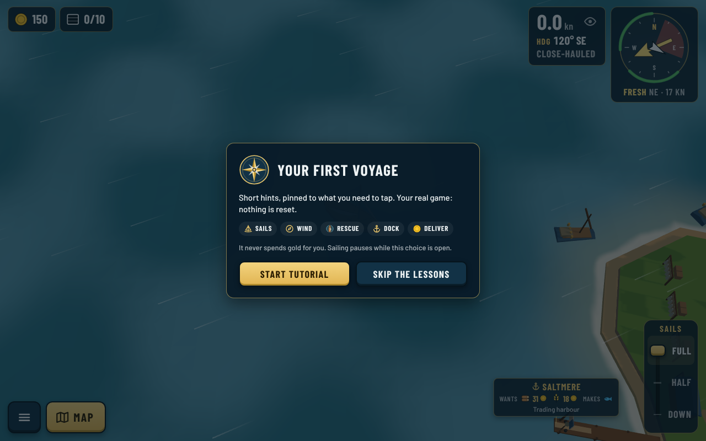
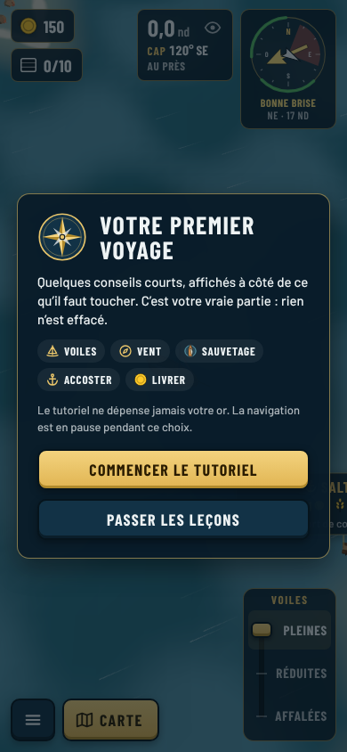

# Skipping the tutorial keeps its story (decision 0160)

Taken with `npm run shots -- --prologue --sizes desktop,landscape,portrait` (new start) and
`npm run shots -- --prologue --at 172,62 --heading 270 --sail 0 --speed 1` (the wreck).

| | |
| --- | --- |
| Before: Free sailing started beside Saltmere, sails full, no rescue |  |
| Now: alone at sea, sails down, the foghorn and its arrow, no coach bubble |  |
| Landscape |  |
| Portrait |  |
| The wreck: its ring and beam, the arrow says "Someone on the reef" |  |
| The offer: "Skip the lessons" (EN desktop) |  |
| The offer in French, portrait |  |
