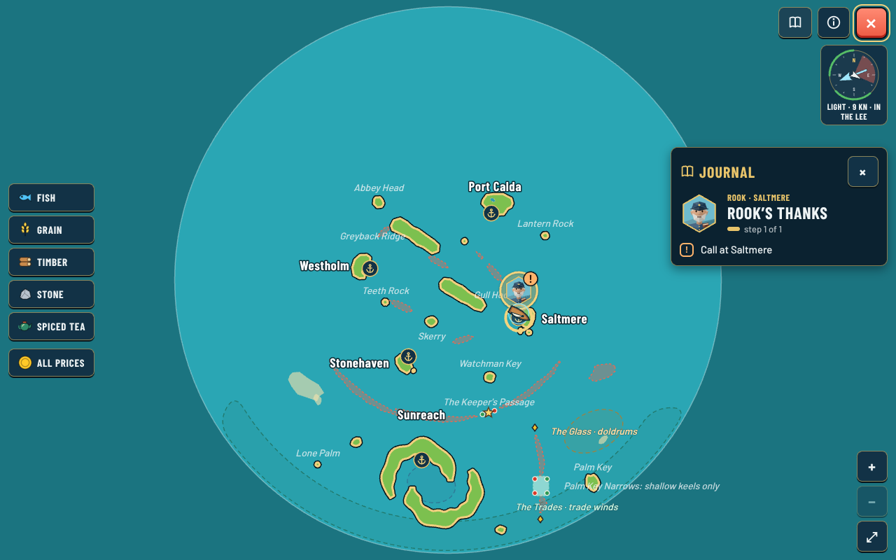
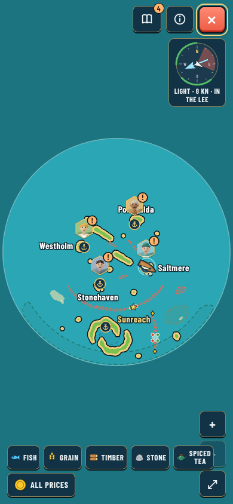
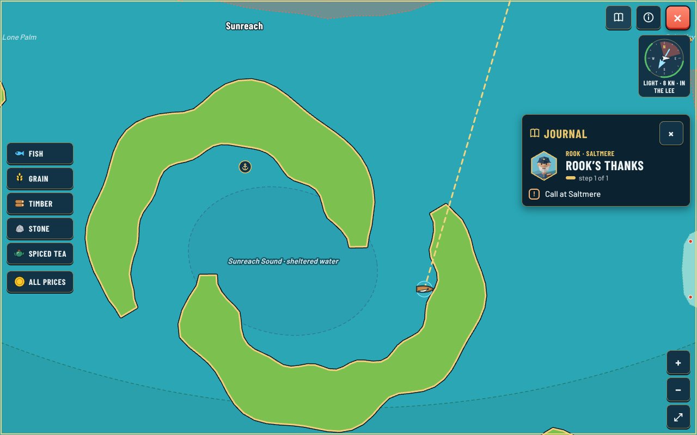
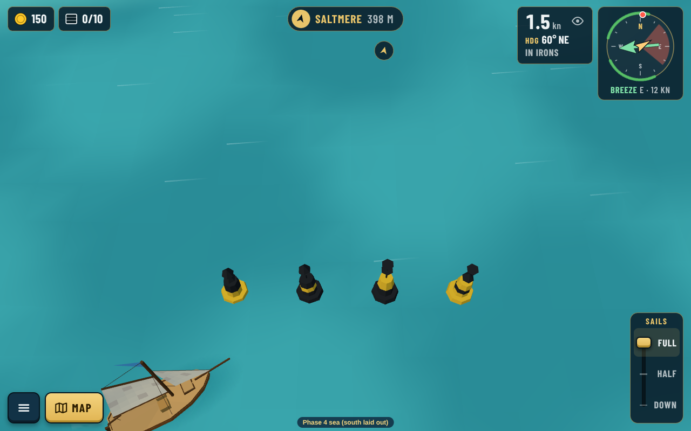
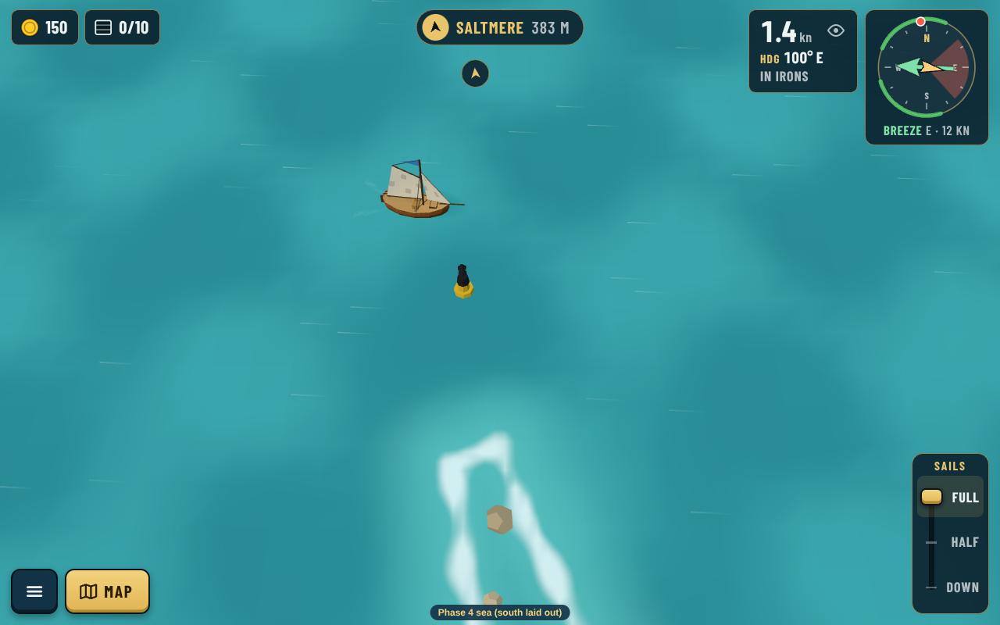
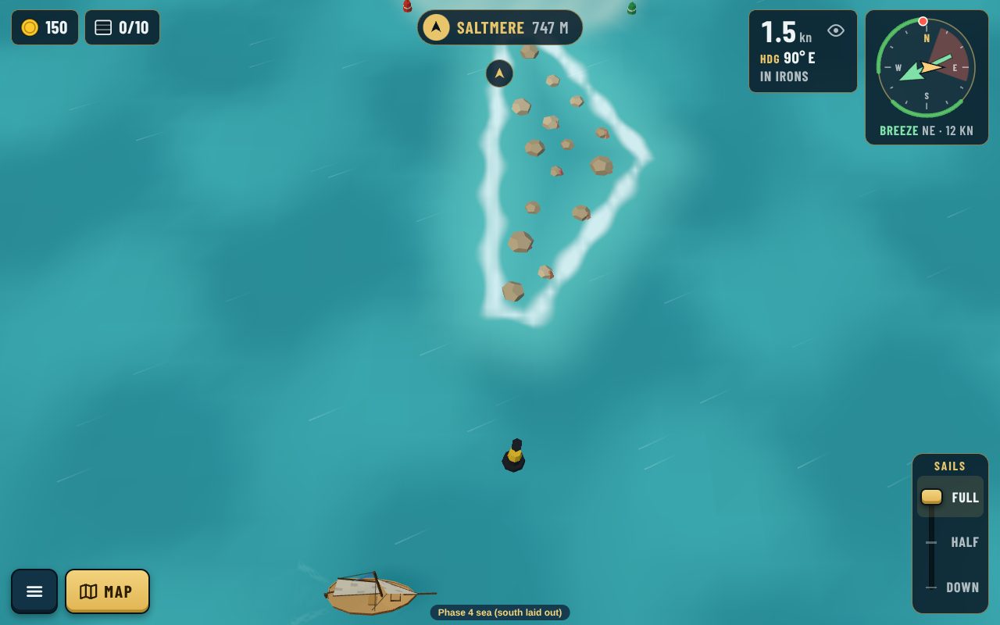
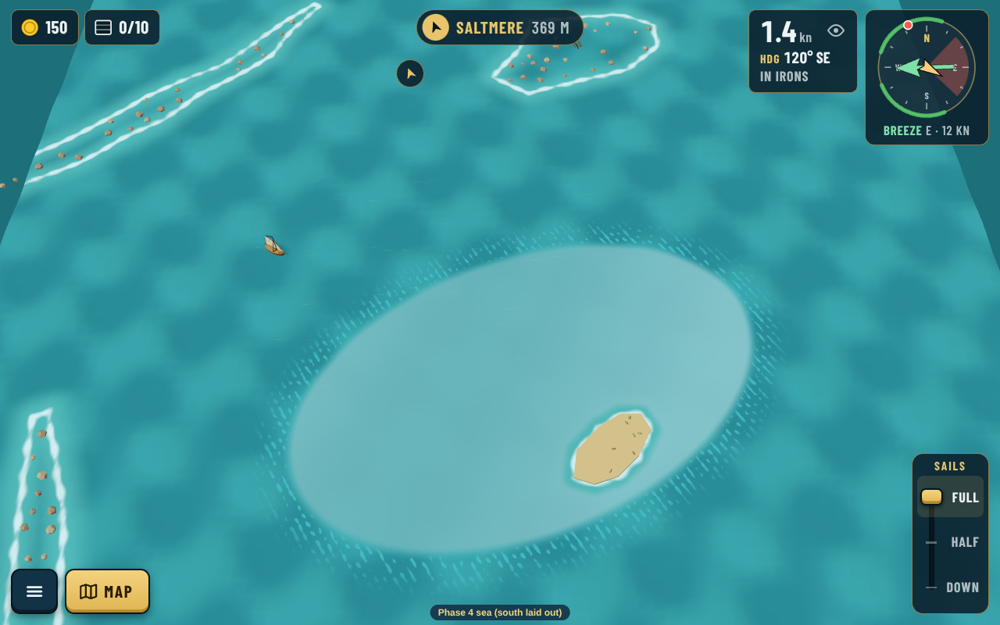
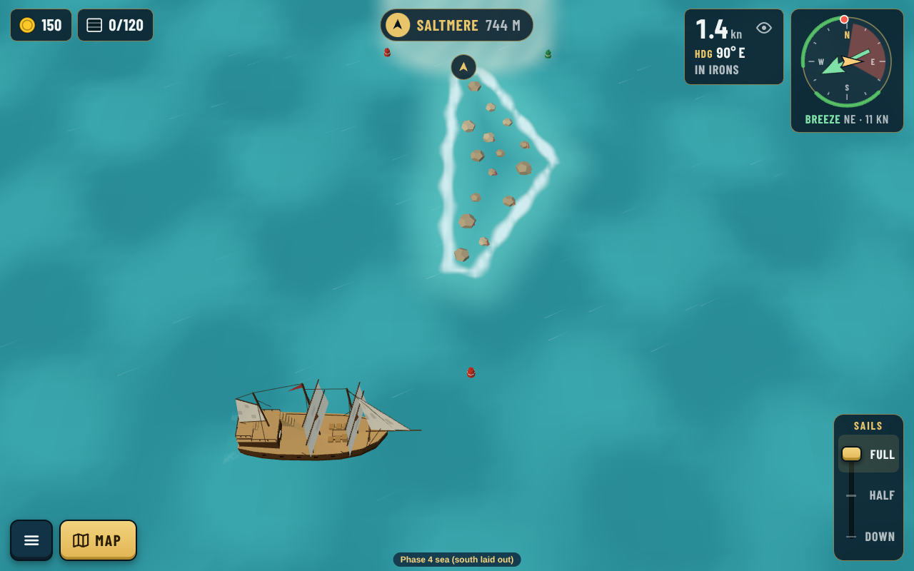

# South sea review: Sunreach (ADR 0152)

Real captures of the Phase 4 dev sea (`?map=phase4`), reviewed by Guillaume ("Ok for all", 2026-10-24). Decision: [0152](../../decisions/0152-south-sea-sunreach-layout.md).

## The plan

Drawn from the data (`src/make-schema.cjs`); routes are schematic.

## The chart

| Desktop | Portrait |
|---|---|
|  |  |

### Wind zones charted once sailed

After sailing in all three named zones: a dashed edge in the kind's colour and the name with its kind. In portrait (whole sea) the names stay off until you zoom in, like the other place names; Sunreach Sound's name shows once zoomed in.

| Desktop | Portrait |
|---|---|
|  |  |

## Sunreach

| Phone landscape | Phone portrait |
|---|---|
|  |  |

## The way in and the Narrows

## Cardinal marks

All four (north, east, south, west, left to right), then the two placed at the Narrows reef ends:

## Around the sea

The [design review](design-review.md) explains the look.

## Regenerating

- `node src/make-south.cjs` writes `src/data/seas/south.json` and the four island files (once; after that edit them in the island builder).
- `npx vite --port 5199`, then `node src/capture.cjs [name ...]` for the screenshots.
- `node src/make-schema.cjs` for the plan.
