# South sea review: Sunreach (ADR 0152)

Real captures of the Phase 4 dev sea (`?map=phase4`), for Guillaume's review before anything is merged. Decision: [0152](../../decisions/0152-south-sea-sunreach-layout.md).

## The plan

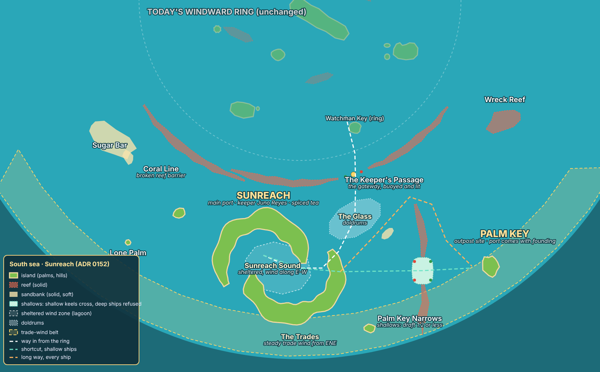

Drawn from the data (`src/make-schema.cjs`); routes are schematic.

## The chart

| Desktop | Portrait |
|---|---|
| 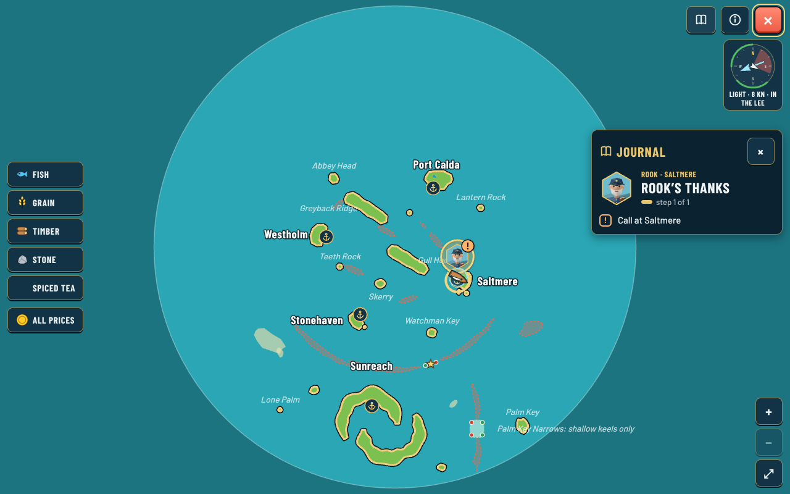 | 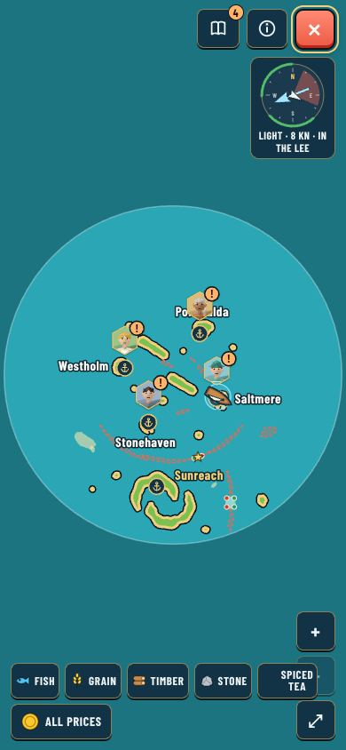 |

## Sunreach

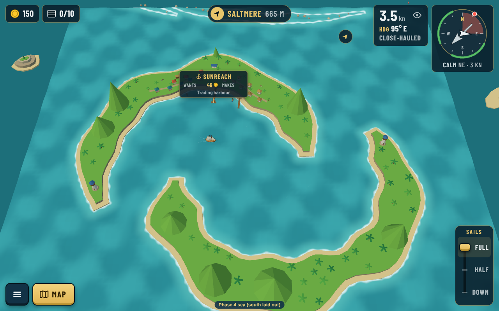
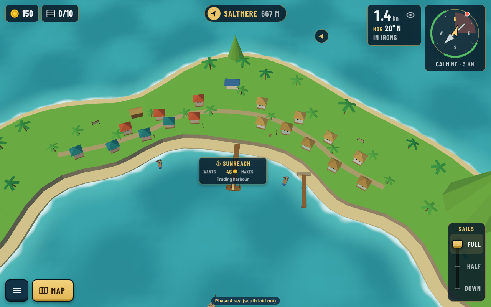
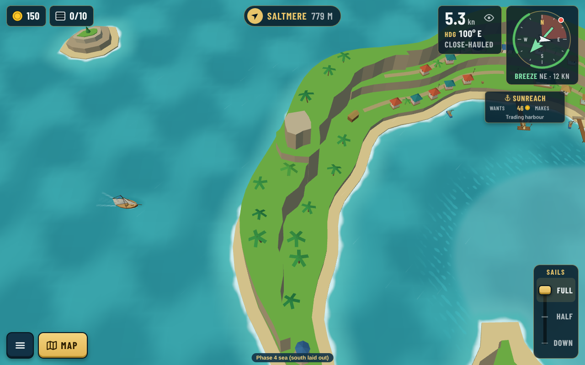

| Phone landscape | Phone portrait |
|---|---|
| 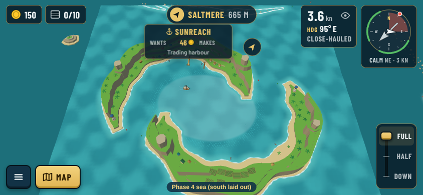 | 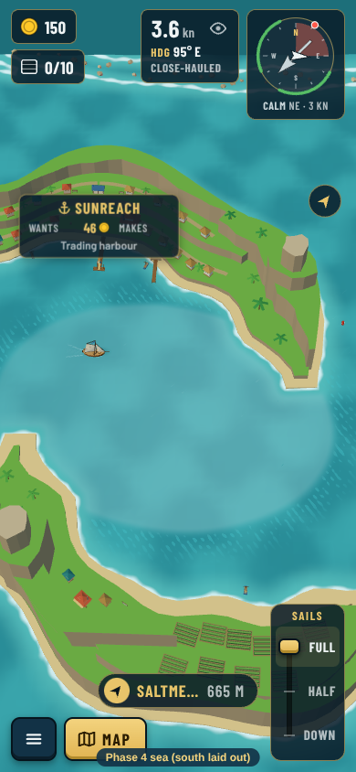 |

## The way in and the Narrows

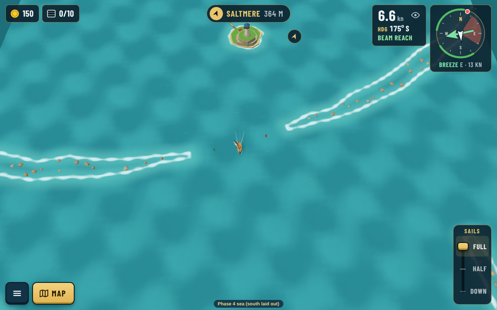
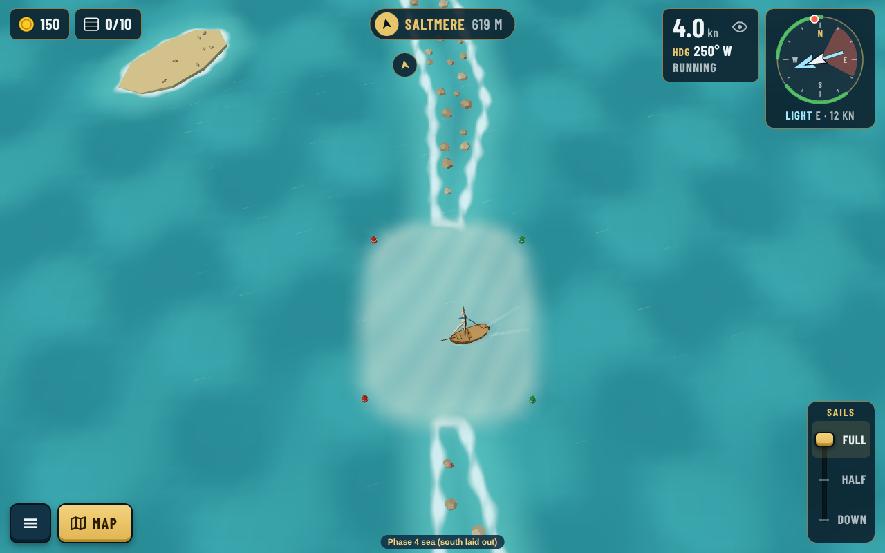
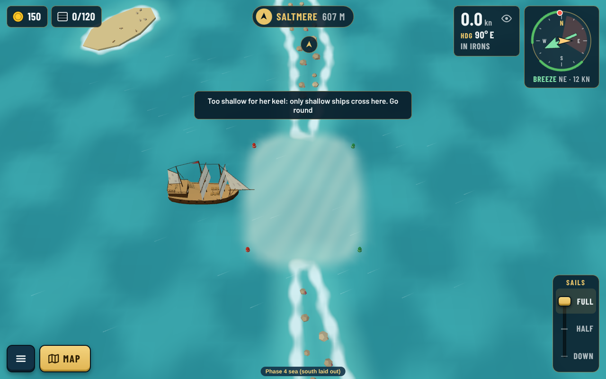

## Around the sea

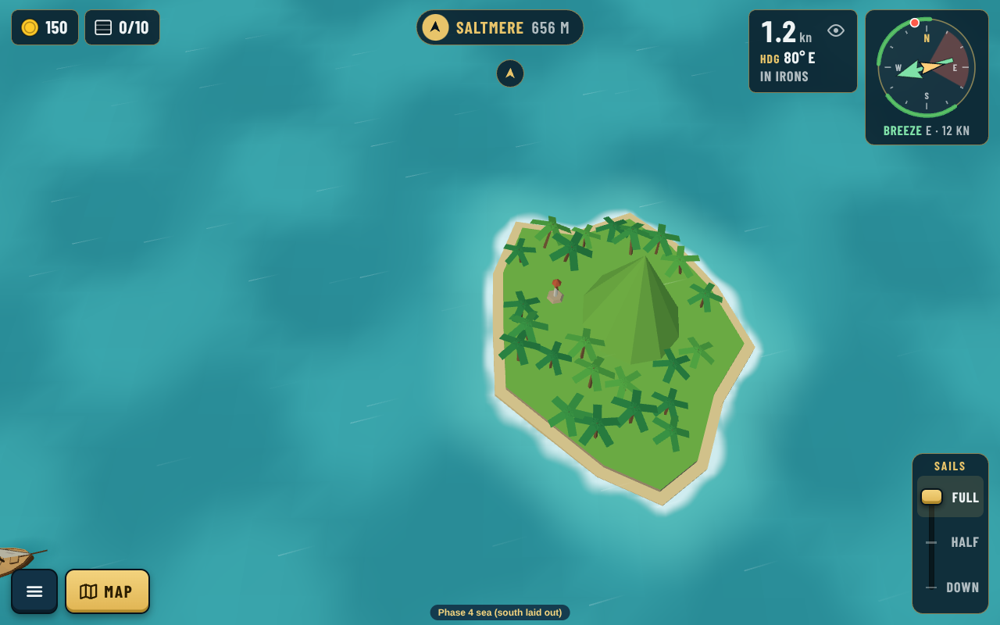
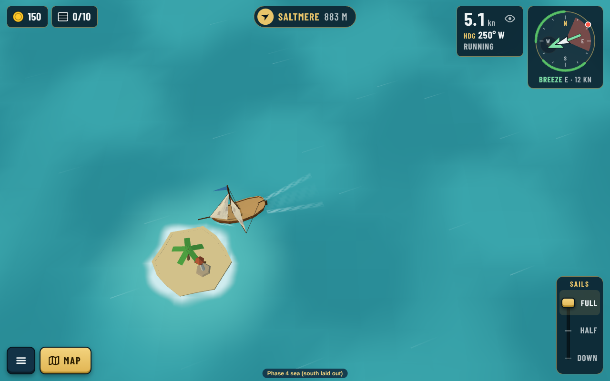
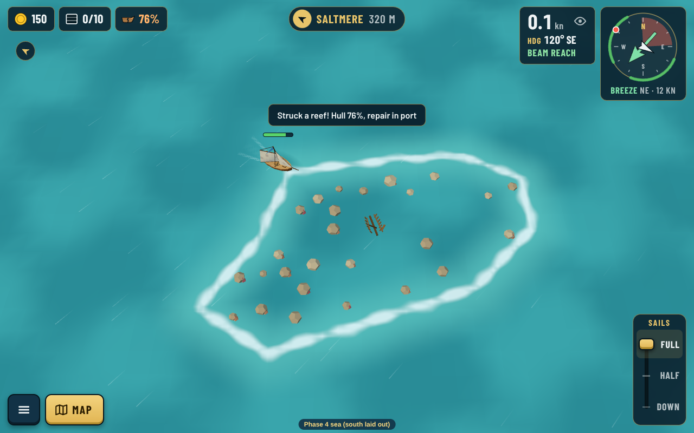
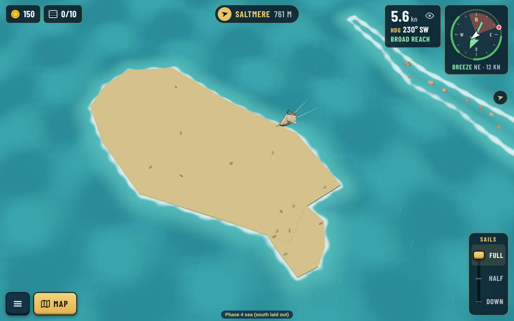

## Regenerating

- `node src/make-south.cjs` writes `src/data/seas/south.json` and the four island files (once; after that edit them in the island builder).
- `npx vite --port 5199`, then `node src/capture.cjs [name ...]` for the screenshots.
- `node src/make-schema.cjs` for the plan.
