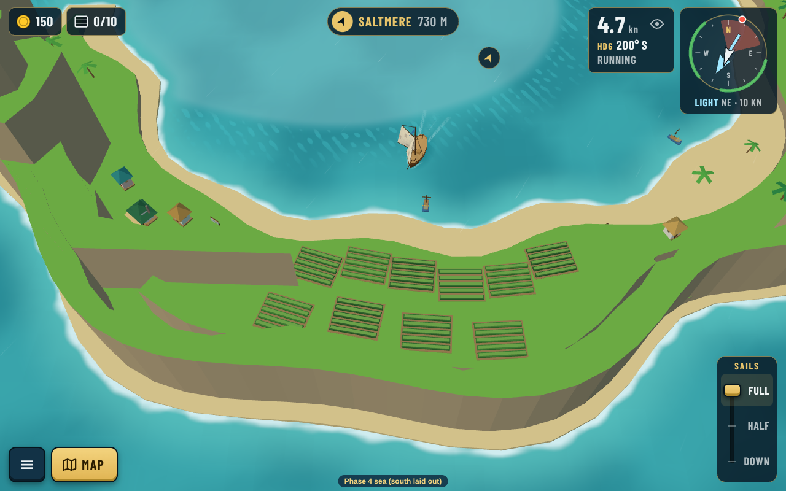

# Design review: Sunreach, The Glass and The Trades

**Guillaume chose "All three" (2026-10-24 17:58Z):** the crater Sunreach, The Glass moved south of Wreck Reef, and the deep channel through The Trades are now in the data. New captures: [The Glass](the-glass.png), [the deep channel](deep-channel.png), and the Sunreach shots below (green-roofed tea house, more palms round the gardens). Measured after the change: deep ships 115 s out and 90 s home, against 104 s and 82 s for a sloop through the Narrows.

_Guillaume, 2026-10-24: "Is the doldrums too close? Should it be under Wreck Reef where it's empty? Sunreach is not finished at all. It's empty and looks bad. Besides the shape there are no features. Should it be completely flat? Should there be buildings on the south island? Should there be bigger beaches on one of the islands? Perform a real design review: how it fits the game universe and the island's role." Also: "The Trades wind is cut by reefs. Is it on purpose?"_

Decision record: [0152](../../decisions/0152-south-sea-sunreach-layout.md). Earlier screenshots: [README](README.md).

## 1. What Sunreach has to do

Start from Sunreach's role in the game, not its shape.

- **It's the first far port.** It's the reward for the whole Phase 3 story, and the first time the player sails past the reef. When it comes into view it has to say "new world" at once, the way Port Calda says "timber" and Westholm says "mill".
- **Its keeper is Juno Reyes, a tea blender** ([brief](../../story/storyteller-brief.md#phase-4-the-four-seas)). Spice from Palm Key becomes spiced tea here. Her arc is about an **idle workshop** that comes back to life. So the port's signature should be **tea**: the tea house and the tea gardens, visible from the harbour.
- **Players come back to it again and again** (0146: honey out, spice in, tea home). The far goods rule says it must be a place worth returning to, so it needs something to look at on every visit.
- **The lagoon is the way in** (0143). Both entrances and the sheltered Sound are part of every visit, so the island should frame the lagoon and show where the ways in are.

## 2. What was wrong with the first pass

- **It was flat.** One grass level everywhere, with a few cone "hats" dropped on top. Nothing told you where the high ground or the sheltered side was.
- **It had no signature.** The town was one row of houses on a path. Nothing in the picture said tea, Juno, or a far port.
- **The south arm was a strip of palms** with no reason to exist except closing the ring.
- **Every shore looked the same.** The beach was the same narrow band inside and out, so the calm lagoon side and the open-sea side looked alike.

## 3. The idea: an old drowned crater

A ring island with a lagoon is, in real life, the rim of an old volcano that has sunk (like Santorini). That fits the world: the fire sea to the west has a live volcano, and Sunreach is a peaceful old one. It also answers each of your questions with one rule:

| Your question | Answer from the crater idea |
|---|---|
| Should it be flat? | **No.** The rim stands high on the **open-sea side**, with cliffs and a rocky summit on each arm (the south one is the highest). It slopes down in terraces to the lagoon. |
| Buildings on the south island? | **Yes, a few, with a job.** The south arm holds Juno's **tea gardens**: two terraces of tea rows facing the town across the Sound, a small drying house, a few pickers' cottages and drying racks. It stays mostly green: the town is on the north arm. |
| Bigger beaches? | **Yes, on the lagoon side only.** Sheltered water makes soft white beaches, and the open sea makes cliffs. The south arm gets a **wide white beach** along its inner bay, under the tea gardens. |
| How does it fit the universe? | **The tea is the story made visible.** Juno's tea house stands at the harbour head, and the gardens the workshop needs are across the water. After her arc, the `after:sunreach-tea` props can switch the gardens and the drying racks on, so the port visibly comes back to life. |

## 4. The rework (first pass, real captures)

| Before | After |
|---|---|
|  |  |
|  |  |

| Phone portrait | Phone landscape |
|---|---|
|  |  |

What changed (all data: the island files, plus two new props and four palette colours):

- **Ground:**
  - The rim ridge runs along the outer side with an irregular edge (no straight walls).
  - A grass shoulder with a rock top on each arm replaces the cone hats.
  - The town sits on **two terraces**: a lower one along the shore lane, and an upper one with the market hall and more homes.
- **The tea house** (new `tea-house` prop) at the harbour head:
  - Two storeys under a double terracotta roof, with a veranda and a canvas awning.
  - Drying trays and tea chests.
  - It is the biggest building in town, next to the arrival pier.
- **The tea gardens** (new `tea-garden` prop): rows of dark tea bushes with lighter tips, on two terraces of the south arm, facing the harbour.
- **The south arm:**
  - Pickers' cottages, a small drying house and racks.
  - A wide white beach along the lagoon with boats drawn up.
  - Its summit is the island's highest point.
- **The lagoon:**
  - Paler, smoother water (the calm-water look of 0144, set softer than The Glass).
  - A red and a green buoy at each entrance, so you can see the ways in from the lagoon.

Still to do after your OK:

- Fill the south arm's terraces with a few more palms.
- Make the tea house read better from far away.
- Add the `after:sunreach-tea` changes with Juno's arc.

## 5. The Glass (doldrums)

**Recommendation: move it to the empty water south of Wreck Reef, and make it bigger.**

- **Where it is now, it's the first thing the player meets** after the Keeper's Passage, the story's big gateway. The first taste of the new sea would be a dead calm. That's the wrong first impression.
- **It doesn't really block anything.** The route planner sails round it: ring ↔ Sunreach takes the same time with it there or moved (average 98 s one way, 96 s back, over five wind directions). So it costs a careless captain time and does nothing else on the main route.
- **Under Wreck Reef, it fills the empty quarter you pointed out.** It also sits on the open water between the ring's east side and Palm Key, the way round the barrier for anyone not using the gateway. When the east sea is added, it becomes the calm belt between the two seas, where real doldrums sit: between the trade winds.
- Moving it changes the deep ships' long way to Palm Key by about 1 % (121 s to 118 s outbound).

## 6. The Trades and the Narrows reef

**Not on purpose.** The Narrows reef runs north–south to force the choice between the shortcut and the long way. It happens to cut the trade belt.

**Recommendation: open a deep-water channel at the reef's south end, inside The Trades.** The long way for deep ships then becomes "ride the Trades round the south", instead of "leave the belt and slog round the north":

| Sunreach ↔ Palm Key (average over 5 wind directions) | Now | With the channel |
|---|---|---|
| Sloop through the Narrows, out / home | 104 s / 85 s | 104 s / 82 s |
| Deepest ship the long way, out / home | 121 s / 111 s | 117 s / **91 s** |
| Deep ship's extra time, out / home | +16 % / +31 % | +13 % / +11 % |

The shortcut still pays for shallow ships, and deep ships keep a real, pleasant option that uses the belt. The Trades blow from the east-north-east, so they help most on the way **home with the spice**. The reef still blocks the middle, so the Narrows keep their meaning.

## 7. Summary of recommendations

1. Sunreach as an old crater rim, with tea gardens and a tea house (built above as a first pass).
2. Move The Glass south of Wreck Reef and make it bigger.
3. Open a deep channel at the Narrows reef's south end, inside The Trades.

Nothing is merged; PR #146 stays a draft until you say OK.
