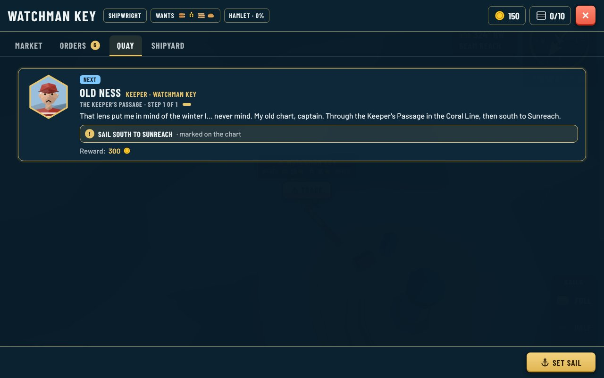
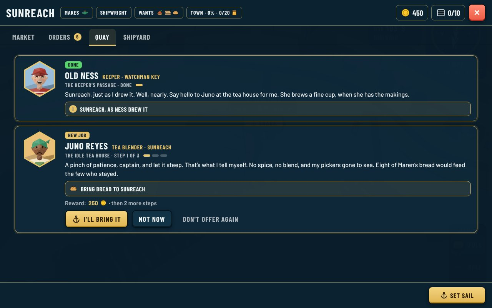
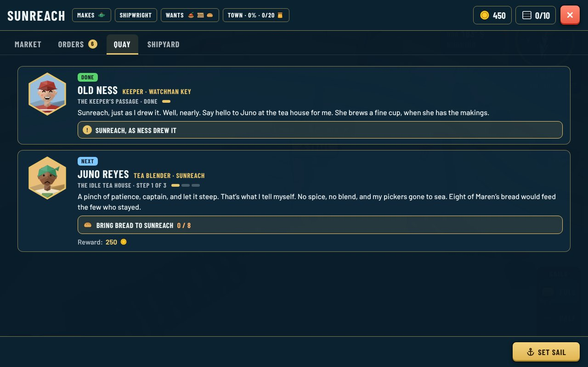
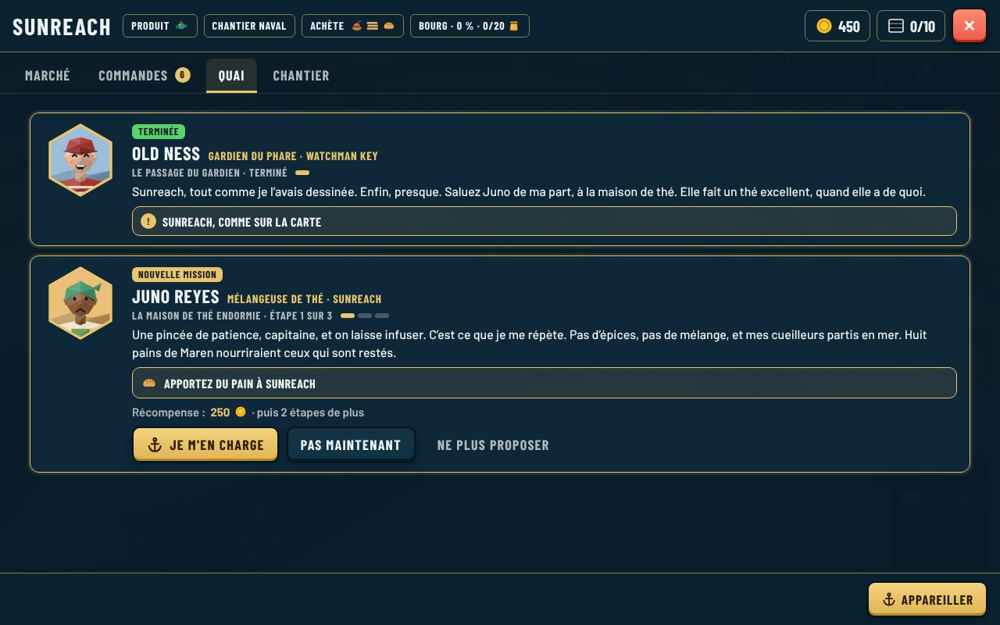
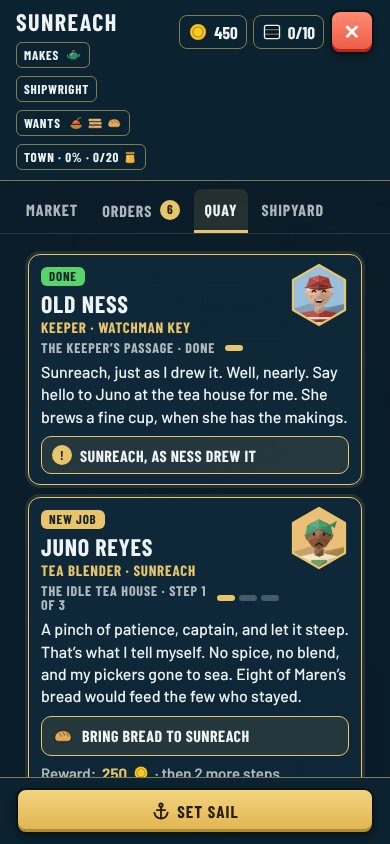
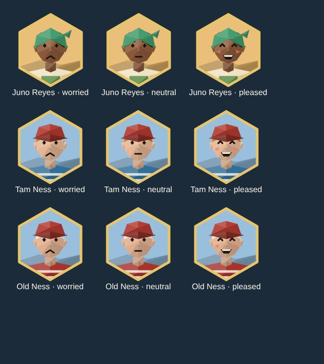
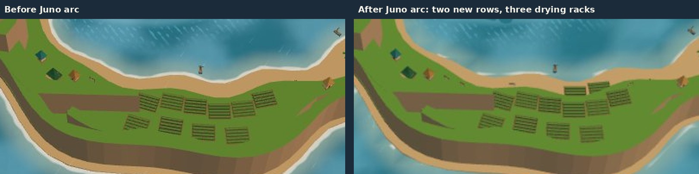

# The south sea story: review

Written by the head storyteller ([0155](../../decisions/0155-south-sea-story.md)), from the [storyteller brief's Phase 4 section](../../story/storyteller-brief.md#phase-4-the-four-seas). Play it with `?map=phase4`: the quests run only on a map that has Sunreach.

## What a player sees

1. **The keeper's passage** (`watchman-passage`, Old Ness). Once the epilogue is done, Ness hands over his old chart the next time the captain calls at Watchman Key. Sailing to Sunreach through the Keeper's Passage ends it. His thanks shows on Sunreach's Quay and sends you to Juno.
2. **The idle tea house** (`sunreach-tea`, Juno Reyes). Her workshop stands idle, with no spice and the pickers gone:
   - `bread`: bring 8 bread (Maren's: Westholm bakes it from town level, which the mill arc reaches).
   - `garden`: look at Palm Key's wild spice from its west beach, slowly (under 3 kn for 3 s). The card says a shallow keel takes the Narrows and deep ones go round.
   - `racks`: bring 10 planks (Port Calda saws them after the slipway arc).
   - Done: the tea garden gets two more rows and three drying racks (`after:sunreach-tea`). Juno names Tam for the first time.
3. **Palm Key** (`outpost-south`): the draft is below. It goes in once founding is built.

| Ness at Watchman Key | Sunreach's Quay: Ness's thanks and Juno's offer |
|---|---|
|  |  |

| Juno's first step, accepted | French |
|---|---|
|  |  |

Phone portrait: 

## New for Guillaume to check

**Two new people** (data only, the existing low-poly portraits): Juno Reyes (scarf, apron, Sunreach's warm backdrop) and Tam Ness (his great-uncle's red cap, a fisher's striped jumper), next to Old Ness. Each has a babble voice in `audio.json`: Juno slow and low, Tam quick and high.

**The tea garden after Juno's arc.** Two more rows by the beach and three drying racks, all existing props:

## Draft: `outpost-south`, "Palm Key"

Agreed with the founding thread, which builds the fields: `site` on Palm Key's port, the goal `landed`, the reward `found`. The quest file comes once that work is merged, with the landing spot it lays out.

- **Start:** `sunreach-tea` done. Giver `juno`, port `sunreach`, offered.
- **`supplies`** (Juno, worried): `all` of `landed` 10 timber and 6 planks at the Palm Key landing (under 2 kn). Gold about 300.
  - EN "Bring timber to Palm Key": "Tam’s coming, bless him, and he’ll want a roof. Ten timber and six planks to the landing on Palm Key, captain. Come in slow, it’s shallow by the beach."
  - FR « Apportez du bois à Palm Key » : « Tam arrive, le pauvre, et il lui faudra un toit. Dix bois et six planches au débarcadère de Palm Key, capitaine. Doucement, c’est peu profond près de la plage. »
- **`settler`** (speaker `tam`, card at Watchman Key): `carried` the item `tam` (space 0) from Watchman Key to the landing. Gold about 450.
  - EN "Bring Tam to Palm Key": "Uncle Ness says a good keeper packs light. Well, he says a lot. But it’s only the one bag! Palm Key, captain? I’ve had it drawn on my wall for years."
  - FR « Emmenez Tam à Palm Key » : « L’oncle Ness dit qu’un bon gardien voyage léger. Enfin, il dit beaucoup de choses. Mais je n’ai qu’un sac ! Palm Key, capitaine ? Je l’ai dessinée au mur depuis des années. »
- **Reward:** `found: ["palm-key"]`. Palm Key starts as a hamlet and gathers a little spice at once. The flagpole and name board stand on it (`after:outpost-south`).
- **Done** (`pleased`; Tam should speak it, which needs a `speaker` for the done card, added with the quest):
  - EN "Palm Key is founded": "The flag’s up and the board says Palm Key! Bring what we gather to Juno at Sunreach, captain, and the tea house will do the rest. Rook will want that in the book."
  - FR « Palm Key est fondée » : « Le drapeau est hissé et le panneau dit Palm Key ! Portez ce qu’on cueille à Juno, à Sunreach, capitaine, et la maison de thé fera le reste. Rook voudra l’inscrire au registre. »

Every step can be done in any ship: the deep channel always reaches Palm Key (0152 point 6).
