# Stonehaven arc: "A light on the Teeth" ([0133](../../decisions/0133-stonehaven-light-arc.md))

Static screenshots of every card, taken in the game (`?debug`) on 2026-10-23.

| Card | Desktop | Desktop (French) | Phone landscape | Phone portrait |
|---|---|---|---|---|
| Offer, `scaffold` (Ada, worried) | 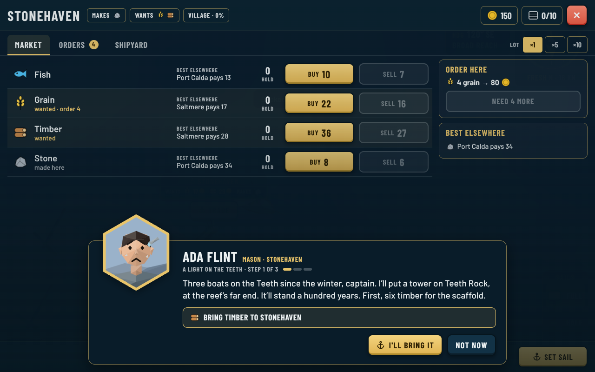 | 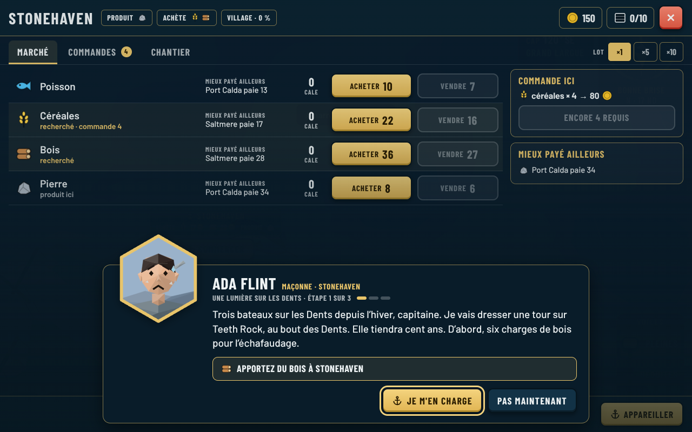 | 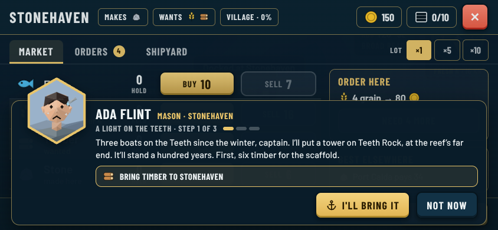 | 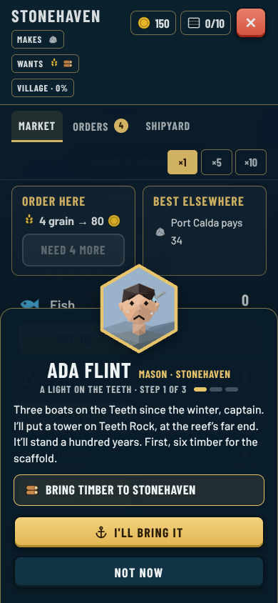 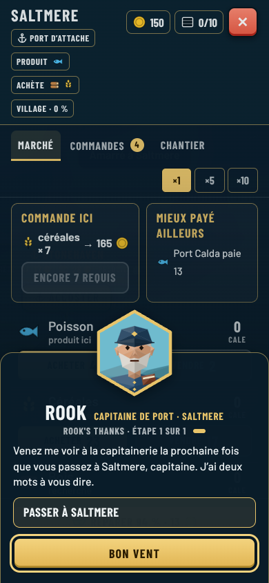 |
| `stone` (Ada) | 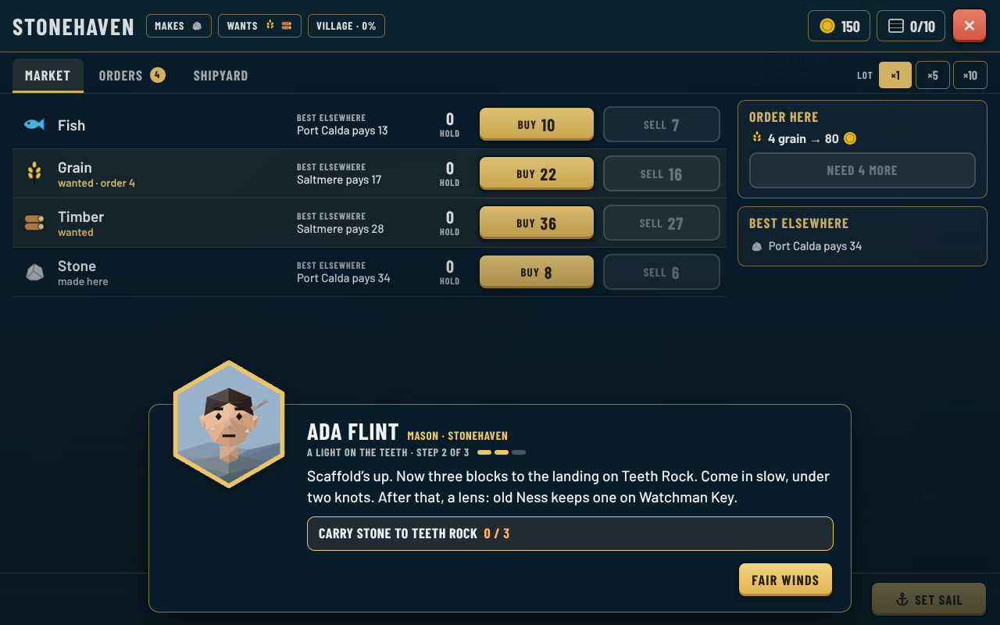 | 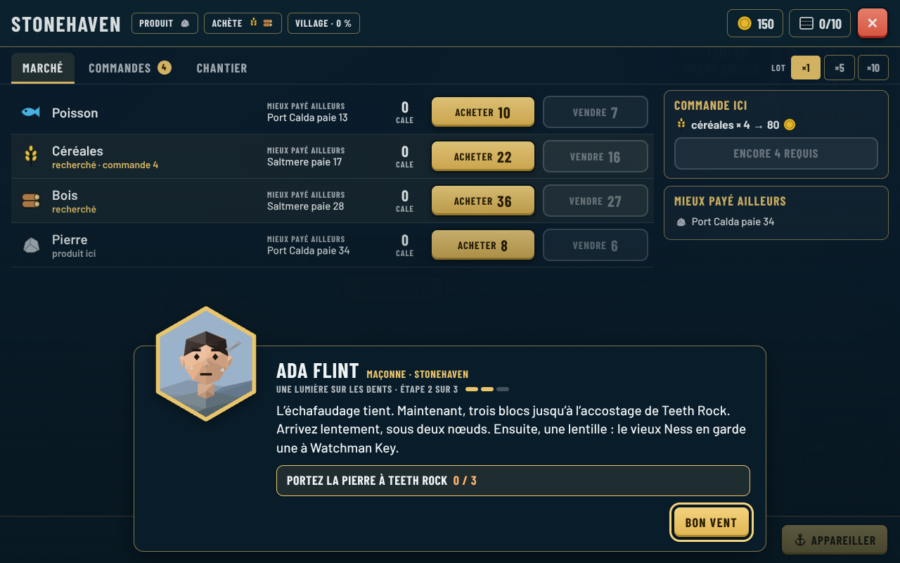 | 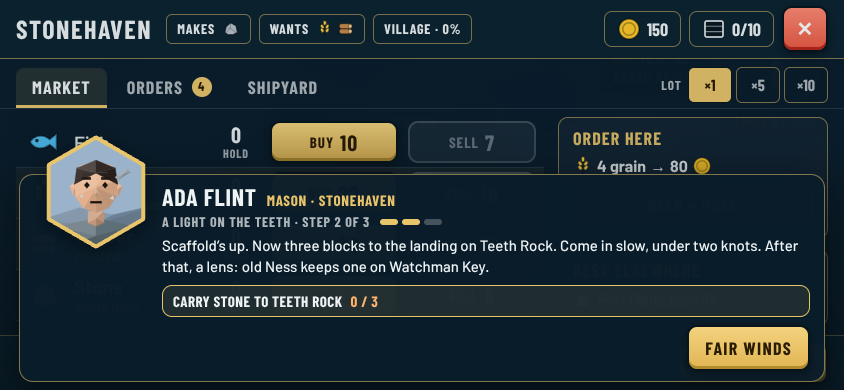 | 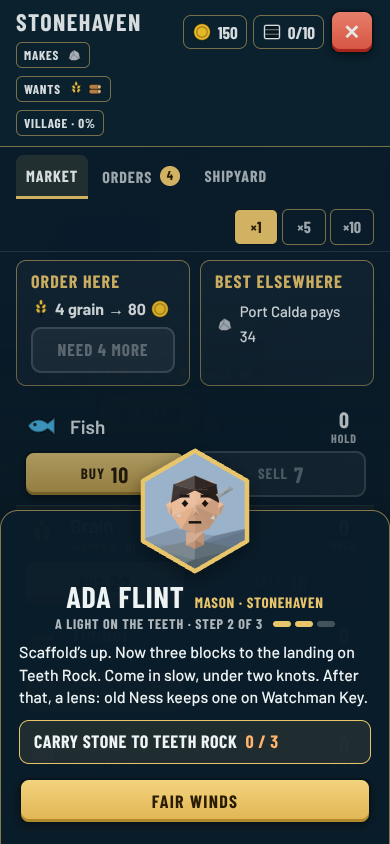 |
| `lens` (Old Ness speaks, at Watchman Key) | 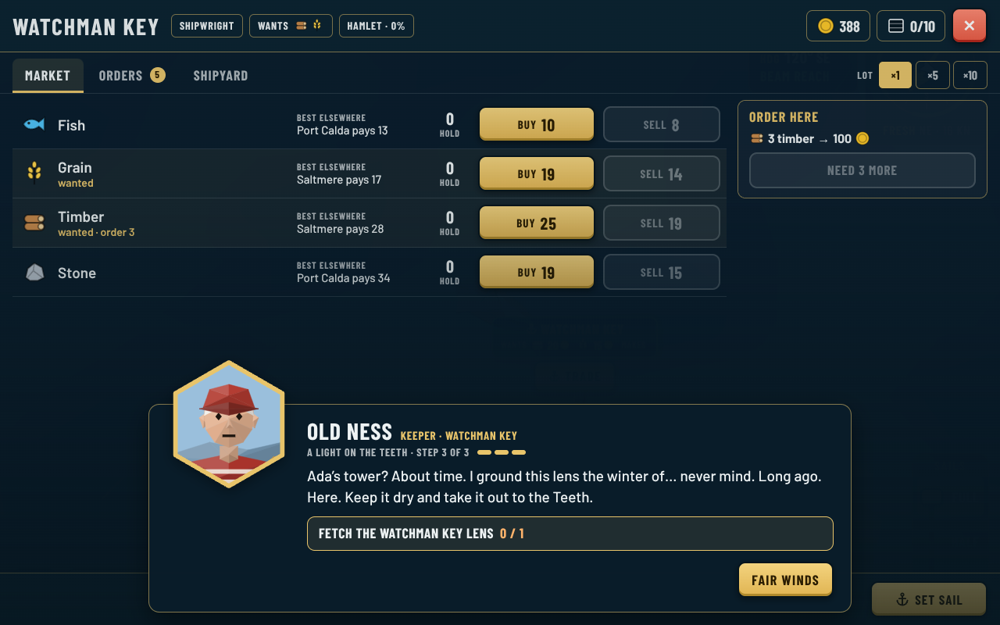 | 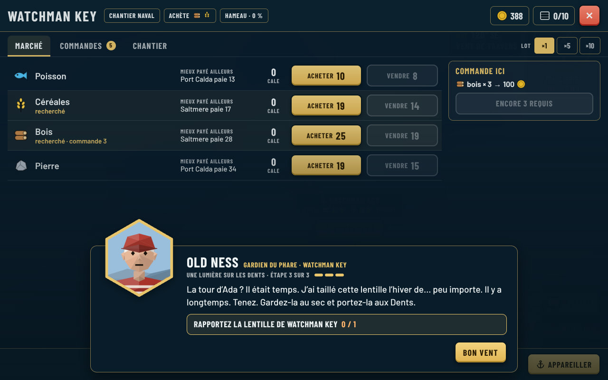 | 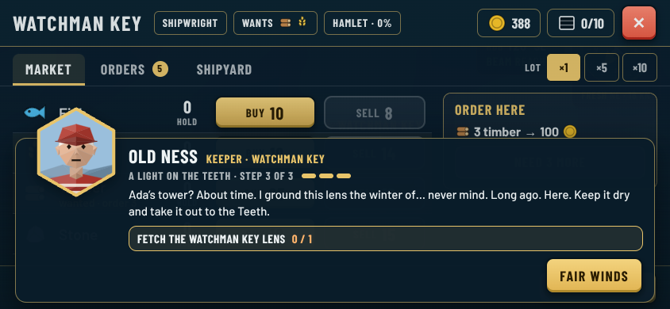 | 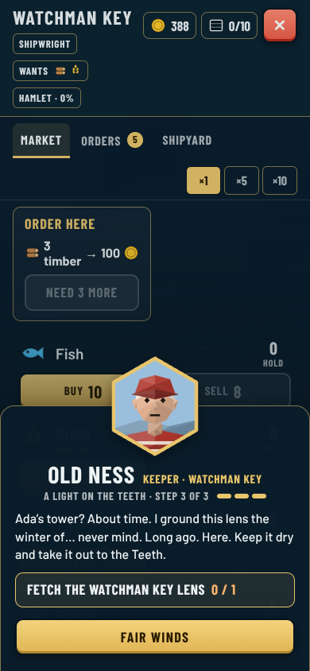 |
| Thanks (Ada, pleased) | 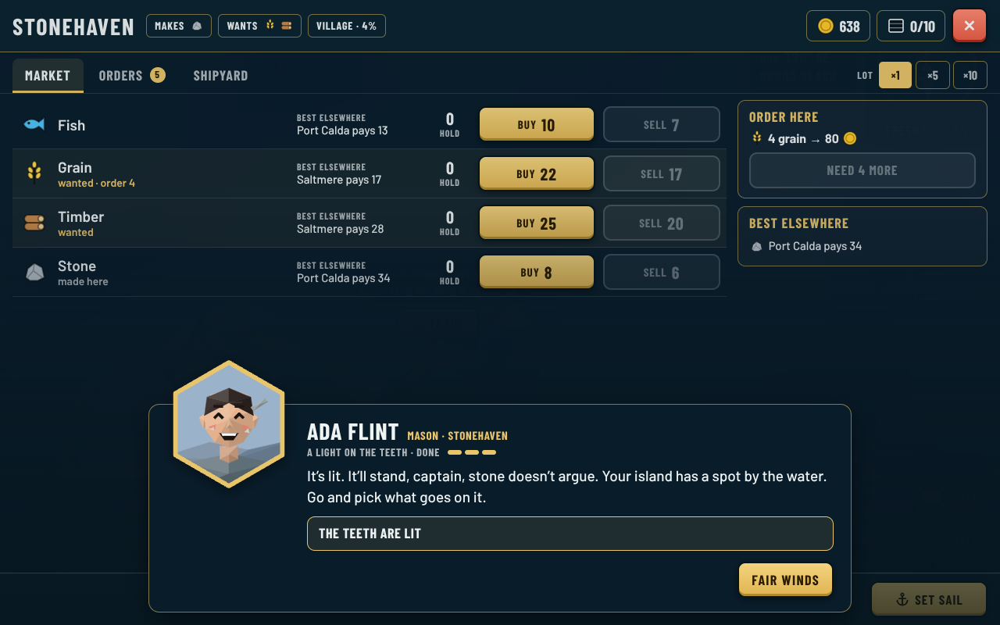 | 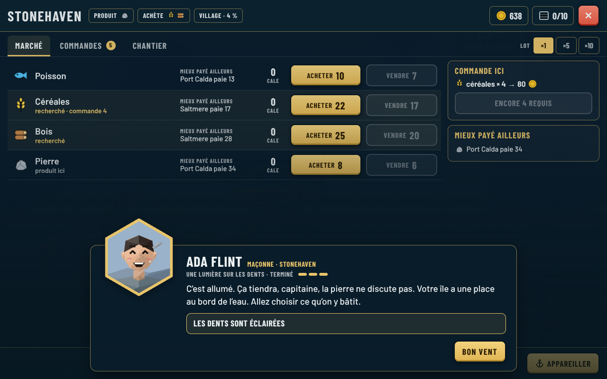 | 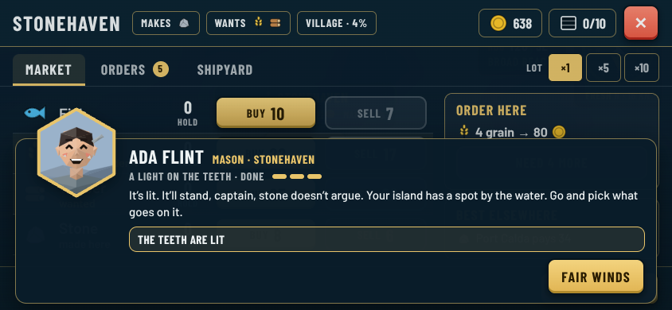 | 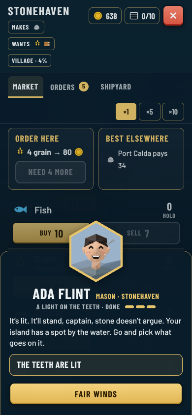 |

Teeth Rock before the arc, with its unlit day mark: 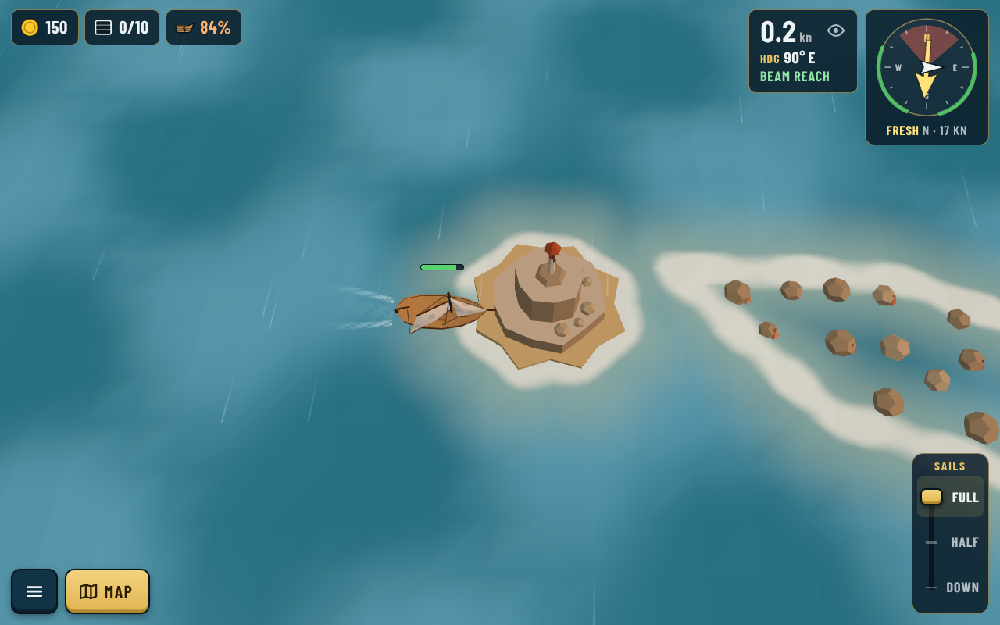

Teeth Rock after the lens is landed, with the lighthouse: 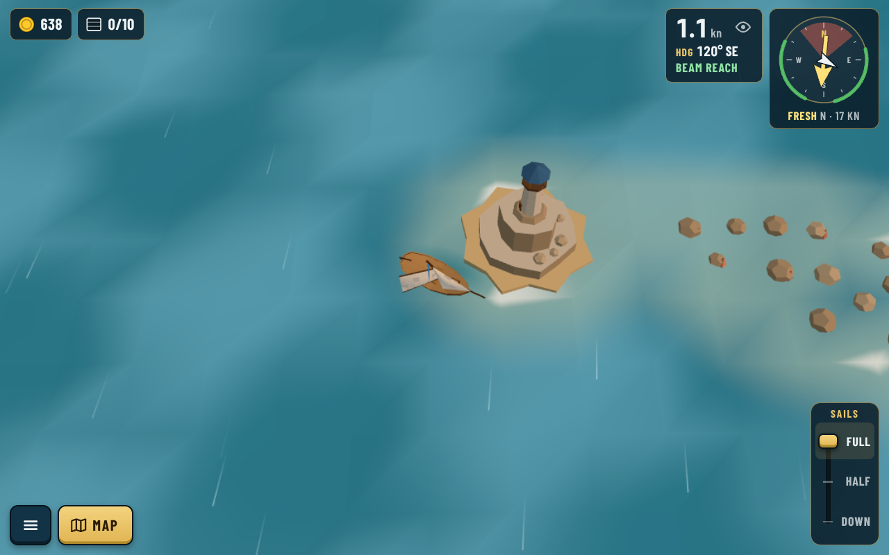
