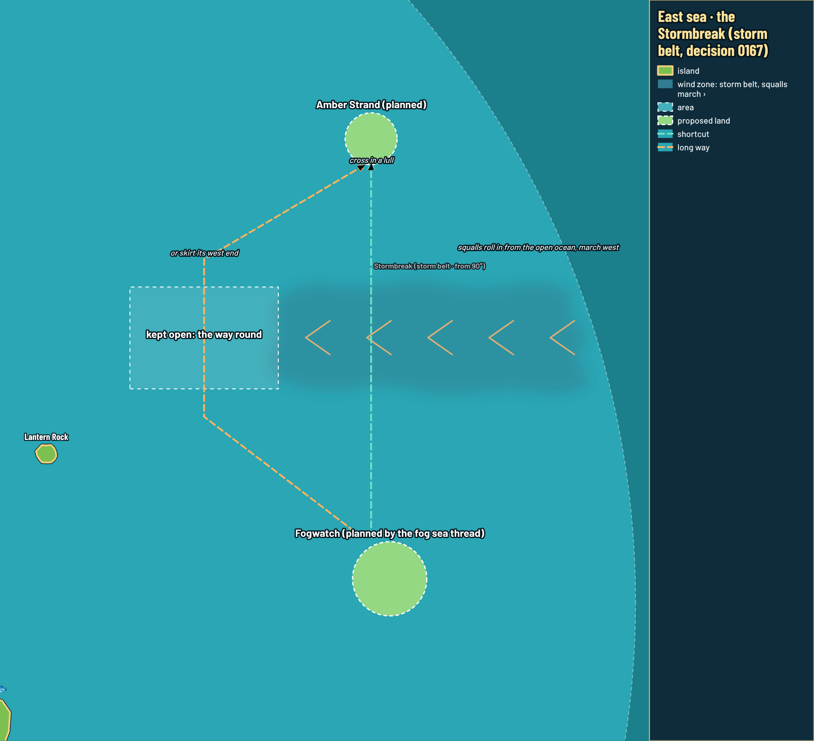
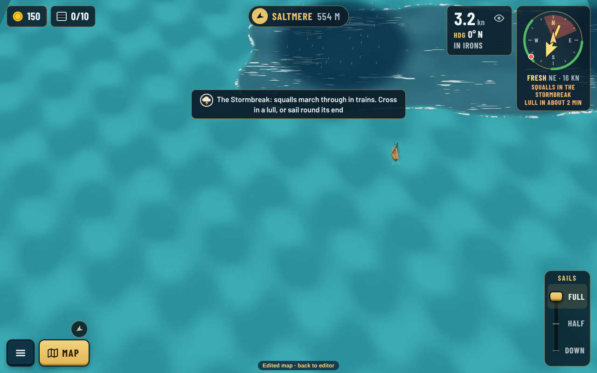
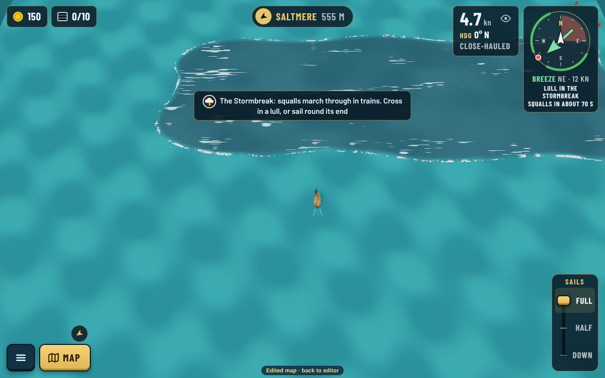
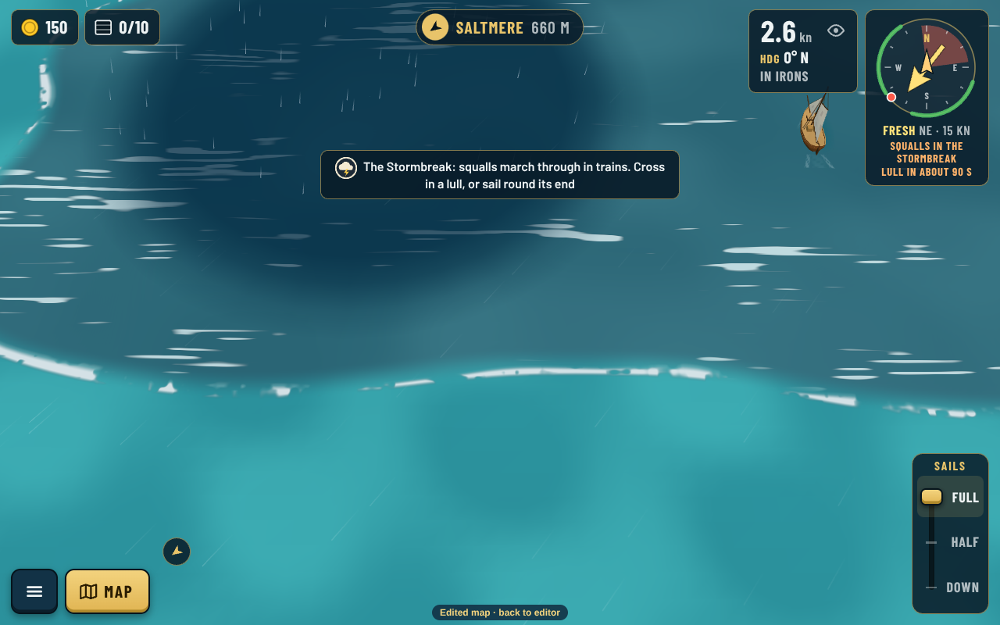
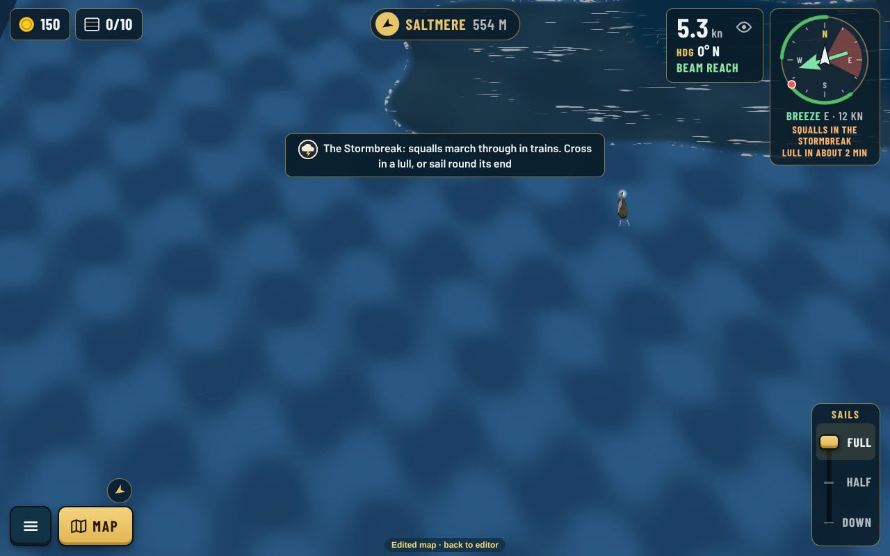
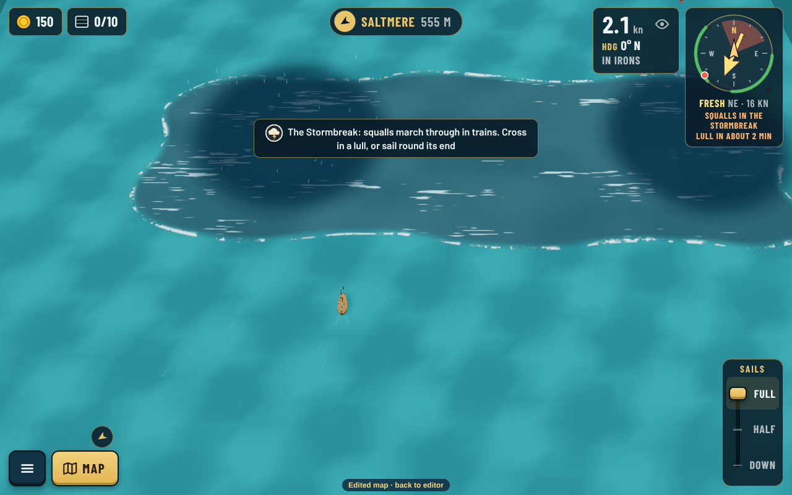
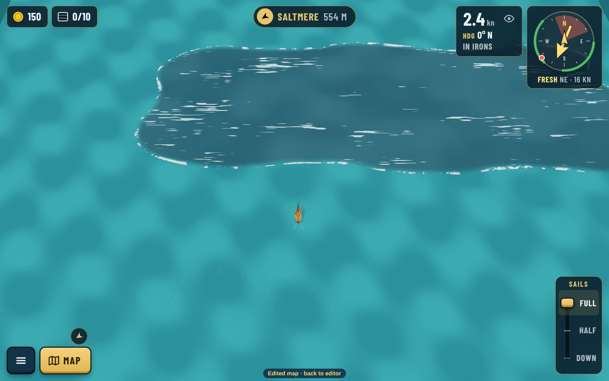
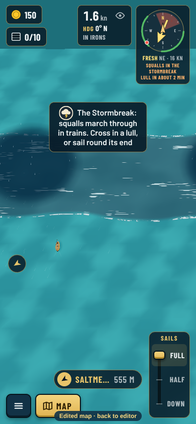
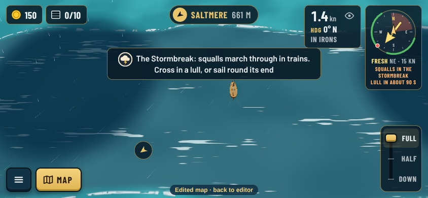

# Storm belt review (decision 0167)

The Stormbreak in a scratch east sea at its agreed place ([src/east.json](src/east.json); no islands yet, the east fog sea thread lays those out). Captures by `npm run shots -- --list src/list.json --sea src/east.json --storms`, chart by `npm run chart -- --sea src/east.json --view 300,-150,1000,650 --overlay src/overlay.json`.

| | |
|---|---|
|  | **Map.** Squalls roll in from the open ocean and march west (amber chevrons). Fogwatch and Amber Strand (planned) either side: cross in a lull, or skirt the west end. |
|  | **Squalls, day.** Dark squall discs in the slate band; HUD: "Squalls in the Stormbreak · lull in about 2 min". |
|  | **Lull.** No squalls; "Lull in the Stormbreak · squalls in about 70 s". |
|  | **Inside a squall.** Whitecaps blown downwind, rain, darker sky. |
|  | **Night.** The foam edge still reads. |
|  | **Low quality** (old tablet). |
|  | **Storms off.** The water stays, no squalls, no HUD line. |
|  | **Phone portrait.** |
|  | **Phone landscape.** |
