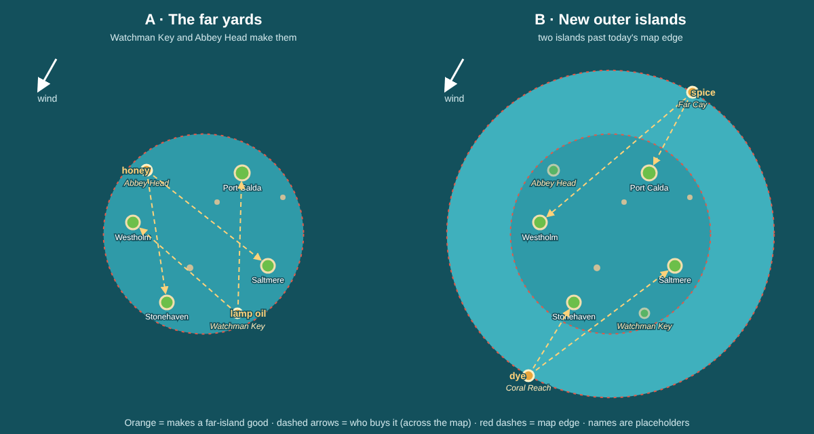

# Review: how towns grow, and goods from distant islands

2026-10-22, asked by Guillaume. A review before building anything: how settlement growth works today ([0059](../../decisions/0059-settlement-levels.md), [0060](../../decisions/0060-growing-town-visuals.md), [0063](../../decisions/0063-specialized-town-goods.md)), where it is weak, and options for the Phase 2 item "goods produced only on distant islands". Decisions taken from it go into new ADRs.

## 1. How a town grows today

Every port is a settlement: **1 hamlet, 2 village, 3 town, 4 port town**. The four charted ports start as villages, the two hidden shipyards (Watchman Key, Abbey Head) as hamlets. Code: `src/sim/settlement.ts`.

| | How it works |
|---|---|
| Growth points | 1 point per unit of a **wanted** good sold, +5 per delivery order. Unwanted goods give nothing. |
| Points to next level | 40 (to village), 150 (to town), 350 (to port town) |
| Neglect | After 3 min with no wanted goods, growth drains 2 points/min back to the start of the level. Levels never drop. |
| Bigger town = deeper market | Wanted stock 15 / 12 / 10 / 8 (dearer), produced stock 85 / 100 / 115 / 130, order size ×0.8 / 1 / 1.25 / 1.5 |
| New wants at town | Calda adds grain, Saltmere stone, Westholm timber, Stonehaven fish |
| Workshop at town (0063) | Saltmere smoked fish (20 g), Westholm bread (24), Calda planks (32), Stonehaven cut stone (40). Other ports start buying it once it is made. |
| Home port gate | Level 3 ship upgrades need the home port (Saltmere) to be a town. |
| Port town (level 4) | Only deeper demand and bigger orders. Nothing new yet. |

Visuals: each port has its own island, buildings and industry per level, see [the level sheets](../../art/towns/) (for example `levels-port-calda.png`) and [port screen captures](../../screenshots/settlements/).

### Measured pace

From the 0046 balance simulation (`tests/economy-balance.test.ts`), run for 40, 90 and 180 minutes. The bots trade the four charted ports for gold; they never aim at growth on purpose, and never visit the hidden yards.

| Captain | First town | Second town | First port town | State after 3 hours |
|---|---|---|---|---|
| Sharp, with orders | Calda 27 min | Westholm 43 min | Westholm 90 min, Calda 133 min | Calda 4, Westholm 4, **Saltmere 2, Stonehaven 2** |
| Sharp, market only | Saltmere 34 min | Westholm 44 min | none | Saltmere 3, Westholm 3 |
| Relaxed | Westholm 57 min | Stonehaven 83 min | Westholm 178 min | Westholm 4, Calda 3, Stonehaven 3, Saltmere 2 |

So a first town lands inside a first session for a good player, and a port town is a three-to-six session goal. That pace feels right.

## 2. Weak spots

1. **The home port can be left behind.** The sharp bot never grows Saltmere in 3 hours, so the cutter's top upgrades never unlock: the best paying loops (Calda, Stonehaven, Westholm) reach Saltmere without the timber or grain it wants. A real player sees "Grow Saltmere to Town first" and can choose to feed it, but nothing in the economy pulls them there.
2. **Rich towns get richer.** A bigger town keeps less stock of what it wants, so it pays more, so trade flows to it, so it grows again. After 3 hours two towns are port towns and the other two have zero growth.
3. **Orders fade late.** Orders are 36 % of income at 40 minutes but 6 % at 3 hours: market trading with a big hold outgrows them.
4. **Port town has no payoff.** Level 4 only makes the market deeper. No new good, no new building purpose, no new want.
5. **The yards never grow.** Watchman Key and Abbey Head make nothing and only buy. Once you bought your ship there, there is little reason to return.
6. *(minor)* A unit of fish (8 g) and a unit of cut stone (40 g) both give 1 growth point, so growing towns is cheapest with cheap goods.

Possible fixes, to pick from:

- **Catch-up orders** (recommended, fixes 1, 2 and partly 3; **chosen, built as [0069](../../decisions/0069-help-orders.md)** with a 1.5× reward instead of 2× and a pause between them): the smallest or most neglected town posts a "help" order with double reward and double growth, marked on the chart. The home port always counts as neglected while an upgrade waits on it.
- **Orders pay more in bigger towns** (fixes 3): reward per unit scales with the town's level, like order size already does.
- **Growth by value** (fixes 6): 1 point per 10 gold of base price instead of per unit. Simple but changes all the 0059 numbers; not recommended now.

## 3. Goods only made on distant islands

The roadmap wants them as new demand for big towns. Rules shared by every option:

- One rare good per source, worth more than the specialties (base 50 to 60 gold).
- **Wanted only on the far side of the map**, so every delivery is one of the longest legs in the game; the order reward already pays by haul distance (0028).
- Small stock where made (like a workshop, 40 %), so you cannot fill a big hold every visit.
- Each charted port wants one rare good from **town** level.

| | A · The far yards | B · New outer islands | C · A visiting trader |
|---|---|---|---|
| Where | Watchman Key and Abbey Head, already on the map corners | Two new small islands past today's map edge (map radius 440 to about 720), one upwind, one downwind | A merchant ship docks at a random port for a few minutes with rare goods |
| Goods (placeholders) | Abbey Head: honey; Watchman Key: lamp oil | Far Cay: spice; Coral Reach: dye | Anything |
| Leg length | 590 to 750 units, the longest on the map (2 to 3 min sloop) | 750 to 1,000 units (3 to 5 min), a real beat upwind for one of them | No sailing change |
| Gives the yards a purpose | Yes: a yard must grow to village before it makes its good, so you feed it first | No | No |
| Work | Small: map data, goods, icons, workshop art on two islands | Big: new islands and art, bigger map and edge buoys, chart, balance, discovery | Medium: new moving actor, UI |
| Fits | Phase 2 as written | Overlaps Phase 4 (bigger explorable map, exotic goods from far regions) | Weak: not islands, not sailing |

**Recommendation: A now, B in Phase 4.** It fixes weak spot 5, needs no new map, reuses discovery (you must find the yard first), and makes the longest crossings of the Windward Ring worth sailing. Phase 4 then adds truly far islands with the same rules.

### How rare goods tie to port town

- **(i) Gate:** a town cannot become a port town until it has received some of its rare good (for example 20 units). Readable ("Calda needs honey to become a port town") and gives level 4 a payoff. Risk: blocked if the player never finds the yard, so the header must say where it comes from.
- **(ii) Bonus only:** rare goods count 3 growth points per unit, no gate. Softer, but level 4 stays a numbers bump.

**Recommendation: (i)**, with the port screen naming the source port once discovered ("from Abbey Head").

### Port town payoff

With (i), reaching port town could also give the town a second dock trade: it **resells** the rare good it imports (a hub), so a port town on your route saves the long crossing for later Phase 3 automated routes. Optional; can wait for Phase 3.
