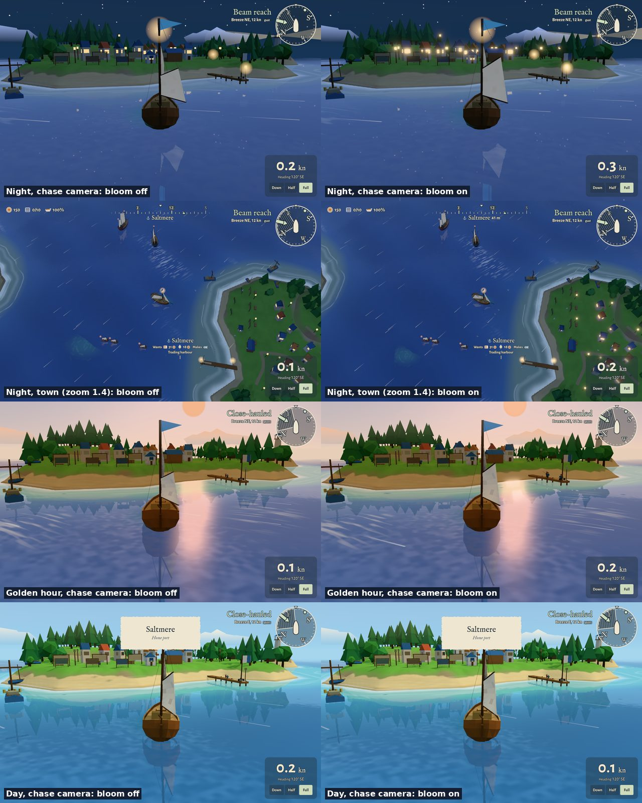

# Bloom on Ultra (#501, decision 0299)

Saltmere on Ultra, the same camera with Settings › Glow off and on: night from the chase camera and
over the town, golden hour, day. By day nothing changes.

Re-run: `npm run shots -- --quality ultra --night --chase` and the same with `--query off=bloom`
(`--zoom 1.4` for the town, `--time 400` for golden hour).
