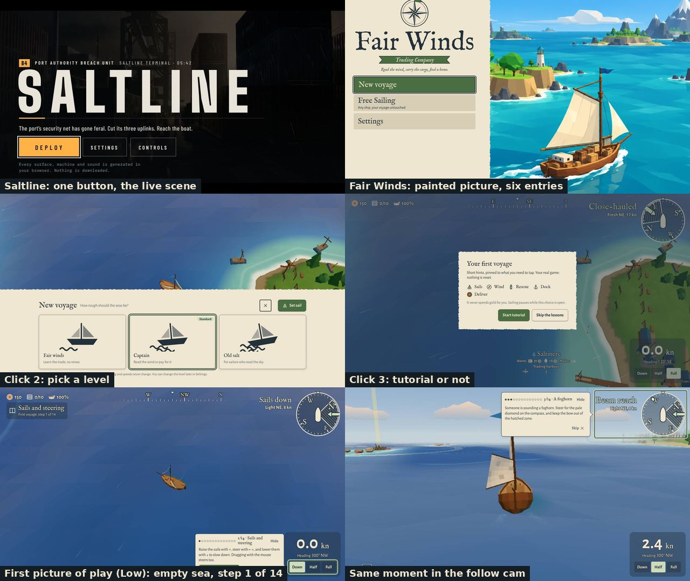
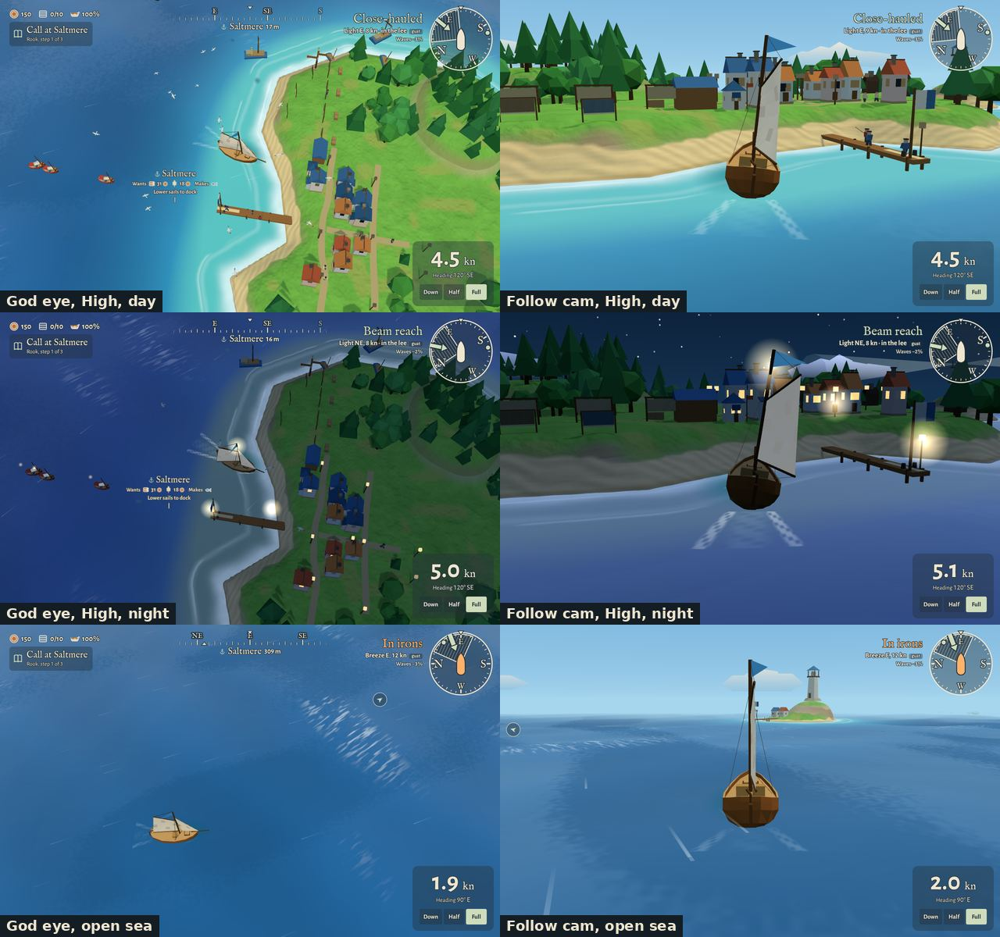
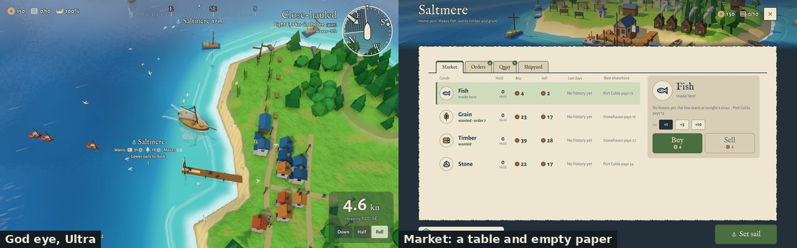
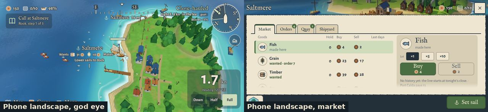

# The whole game after v1.9, against Saltline (review, 2026-11-12)

Guillaume asked for a complete review of the game: what to fix, improve, change and discard, and
where it can go, with Saltline as the reference for performance, ease of use and graphics levels,
and with a look at both cameras, the follow cam and the god eye. The game must stay original and
upbeat. Every finding is an issue; the table in section 10 lists them all.

Earlier reviews: [after Phase 4](../whole-game/README.md), [before v1.2](../whole-game-v1.2/README.md),
[the Saltline lighting mockups](../saltline-lighting/README.md).

## How it was checked, and what was not

Checked on `main` at `5256d91` (v1.9.411):

- 23 real-game screenshots with `npm run shots` in both cameras: day, night, open sea, by a town,
  Low, High and Ultra, desktop and phone landscape, the title, the market, the chart.
- A fresh first run played by script on the production build: clicks, cards and steps from the
  title to a moving boat.
- Saltline (the artifact "Saltline (Copy)") started the same way, for its loading and first screen.
- The build (sizes, chunks), the test suite, the performance budgets, the code graph (`graphify`),
  file sizes, the open issues, the roadmap, the art bible and the last two reviews.

Not checked, said plainly:

- **No real device.** Everything ran in headless Chromium on a software renderer. Frame rates from
  it mean nothing; only the game's own work per frame, draw calls, triangles and bytes carry over.
  The device rounds #377 and #291 are still open (finding 5.1).
- **Saltline in play.** Its title rendered here, its play view did not (a black frame on the
  software renderer). What is said about its rendering comes from the code reading of 2026-11-10.
- **Sound.** Not heard. One finding comes from the code only (#555).
- **The story.** Not replayed. The quest review of 2026-10-29 and the v1.6 release stand.

Guillaume's answers to the five opening questions (2026-11-12), which the review follows:

1. What he misses most from Saltline: **softness, details, textures** (#572).
2. Desktop first, phone landscape second, Xbox third: yes.
3. The follow cam may become the default **if it feels better and both views have the same
   atmosphere, light and colours** (#573).
4. Cuts may be recommended; they may or may not be followed.
5. The next goal is a stranger's first 15 minutes before a Steam demo, **and which features are
   missing** (section 8).

## 1. The verdict

1. **The game is healthy and large.** Four seas, 16 towns, 56 quests, 10 ships, two languages,
   editors and about 20 command-line tools, 218 green test files, a CI that guards draw calls, hitches
   and graphics memory. Nothing found is broken at the root.
2. **Its best view is hidden.** The follow cam is where the game has atmosphere: sky, a horizon,
   towns with lit windows at night. It is an optional key (C) with half the HUD missing, and the
   look was tuned from above, so the follow cam shows a row of small defects the god eye hides.
3. **The first minute is the weakest minute.** A painted title that does not look like the game,
   three clicks and three choices, then "step 1 of 14" over an empty blue sea seen from above.
   Saltline: one button over the live scene.
4. **Against Saltline, the gap is light and surface, not polygons.** Our High level draws about 31 calls and
   161k triangles; a desktop has room for ten times that. What Saltline has and we lack is light
   with depth: shadows you see, things that sit on the ground, a sea that sparkles and moves near
   the camera, a sky that carries the weather, and soft, textured surfaces near the camera (Guillaume's own
   words: softness, details, textures). All of it can be bright and storybook.
5. **Speed is measured well and proven nowhere.** The budgets are good; the proof on a phone, a
   tablet, a desktop and the Xbox has been waiting for weeks.
6. **The code is clean except at its centre.** `src/main.ts` is 2026 lines with 334 links; 32 more
   files pass the 400-line rule; `docs/` weighs 339 MB.

## 2. The first minute and ease of use



| | Saltline | Fair Winds today |
|---|---|---|
| Title | The live scene, one line of premise, one orange button, Settings and Controls | A painted picture in another style than the game, six entries |
| Clicks to play | 1 | 3: New voyage, Set sail, Start tutorial |
| Choices before moving | 0 | 3: voyage or Free Sailing, the level, tutorial or not |
| First picture of play | Inside the place, lit, with a goal on screen | A small boat, sails down, on an empty sea from above |
| Teaching | One line and prompts in the world | "1/14 · Sails and steering" |
| Loading here | 15 s, one 1.4 MB file | 9 to 12 s to the menu, 19 requests, about 0.7 MB |

Loading is already as good as Saltline's. The rest is not:

- **The title promises another game** (#531). The painted boat with its crates and the faceted sea
  are not what follows. The sea is already drawn behind the New voyage screen; put it behind the
  title, in the follow cam.
- **One click** (#532). Start on Captain, keep the level as a line on the title and in Settings,
  drop the tutorial question (the first voyage has a Skip), fold three small entries away.
- **Open on a view worth looking at** (#533). The same first moment in the follow cam shows clouds,
  an island and the wreck on the horizon.
- **Fourteen steps read as homework** (#534). Keep the rescue, show about five beats, teach trade
  at the first market.

## 3. The two cameras



### The god eye (the default)

**What works.** It is the sailor's chart view: wind, reefs, shallows, the pier and the other boats
read at a glance, and the HUD is complete. Depth-blue water with the turquoise ring is handsome,
most of all on Ultra. For racing and tight passages it is the right view and must stay.

**What it lacks is feeling.**

- **Distance.** The player's boat is about 100 px on a desktop and 40 px on a phone, at any speed.
  It is a counter on a map. A closer default that pulls back with speed would give both presence
  and a sense of speed (#545).
- **The open sea is empty.** Away from land the picture is one blue with thin streaks. That is the
  view a trader sees most. Cloud shadows, whitecaps that grow with the wind and swell lines would
  give it life for almost nothing (#546).
- **Night is the day under a blue filter.** Land loses all form; lamps are white discs. Moonlight
  as a real light and a moon path on the sea would make night a reason to sail (#547, #543).
- **Towns read as grids** from above. Already filed: #528.

### The follow cam (key C, off by default)

**What works.** This is where the game is charming. By a town at night, with windows lit and stars
over the firs, it has the mood Guillaume is after. On the open sea the gust patches finally read
as wind on water, and a lighthouse island on the horizon gives a goal you can see.

**Why it is not yet a view to play in.**

- **Half blind** (#535). Coins, hold, hull, the quest line, the heading strip, the port label and
  the Cargo button are gone. Nothing on screen says the view exists, and it is not remembered.
- **Fixed** (#536). You cannot look at your sails, astern or at the town going by.
- **The boat hides the way** (#537). She sits dead centre, so the mast covers the pier or the gap
  being steered for, and the arrival card lands on the town (#538).
- **The look was tuned from above.** From behind the boat these show
  ([look-bugs.jpg](look-bugs.jpg)): the wake as chequered strips (#539), wind streaks as white
  bars (#540), a lighthouse beam as a solid grey slab across the night sky (#541), the Ultra
  mirror with stair-stepped edges and windows reflecting as loose squares (#542), lamp halos
  blown out (#543), drying racks that read as blank billboards and firs three houses tall (#544).
- **Nobody is aboard, and the boat is plain** (#553). The hull is a brown tub, the sail a flat
  sheet edge-on. The quays have people; the boats have none.
- **The sea is flat near the camera** (#551) and going faster changes nothing on screen (#554).
- **It sounds the same as from above** (#555, from the code).



**One atmosphere** (#573). The two views are lit and coloured apart: the follow cam has had its own
sky, fog colour and sea reflection since v1.6, and everything else was tuned from above. The same
place at the same hour is paler and sunnier from behind the boat, deeper from above. Guillaume's
condition for a follow-cam default is that they match, so this comes before the light work.

**Advice.** Make the follow cam a first-class view (v1.11 below), then let the player choose the
default in Settings. Do not force it: the god eye is the better tool for reefs and races, and the
game's honest sailing is its identity.

## 4. Graphics levels, with Saltline as the reference

Saltline has four levels, each with a cap on drawn pixels, and looks coherent on all of them
because its lowest level drops effects, not smoothness. Ours:

| Level | Pixel cap | What it has | State |
|---|---|---|---|
| Ultra-low | 0.2 Mpx | Plain water and ground | For the 2 GB tablet; keep until a device round says otherwise |
| Low | 0.4 Mpx | No waves, no shadows | **Looks broken, not simple**: square tiles in the water, stair-stepped edges (#548) |
| Medium | 1.25 Mpx | Waves, better water | Fine from above; what most phones get |
| High | 2.5 Mpx | Shadows, mirror of the sky, gusts, rich houses | Good from above; flat light in the follow cam |
| Ultra | 3.7 Mpx | Tone mapping, AO, bloom, sea mirror | The best picture; mirror defects in the follow cam (#542), moon missing (#526) |

- **Auto only ever goes down, a whole level at a time** (#549). One slow moment costs the waves and
  shadows for the session. Saltline's lever, the pixel count, should move first, and Auto should
  climb back.
- **Light with depth is the real gap** (#550). In the day follow-cam shots on High and Ultra nothing
  casts a shadow you can see, nothing sits on the ground, the sea has no sun path. The mockup of
  2026-11-11 found soft shadows "hard to see from our cameras"; that was from above. Order of
  value: shadows tuned for the follow cam, contact shade, sun glitter, sun-coloured haze. All of it
  bright and blue-shadowed, as the art bible asks. None of Saltline's grit or dark grade.
- **Softness, detail and texture** (#572), Guillaume's first answer. Everything but the ground is
  flat faces of one colour with hard, stepped edges. From above that is clean; near the follow cam
  a wall, the hull, the quay and the sail are blank. The answer that keeps the storybook look and
  adds no downloads: good anti-aliasing and soft shadow edges on High too, rounded edges near the
  camera, and small procedural patterns in the material (planks, sail weave, plaster, roof tiles)
  that fade with distance. It changes art bible rule 1, so it starts with a sheet for Guillaume and
  the art director.
- **Waves** (#551), **sky** (#552), **the boat up close** (#553) and **spray** (#554) are the other
  four parts of the follow cam's picture.
- **What not to take from Saltline:** wet PBR materials, rust, the teal and orange grade, film
  grain, lens flare. They belong to its world, not to a sunny storybook sea.

## 5. Performance

What is good: draw calls and triangles budgeted per scenario, a hitch budget on the game's own
work per frame (v1.9, decision 0302), a graphics memory limit for the Xbox, shaders warmed before
the splash lifts, long builds spread over frames. That is more discipline than Saltline has.

1. **No device has confirmed any of it since v1.7** (#556, with #377 and #291). Make the bench one
   tap that files its own result, then run it on four devices each release.
2. **The follow cam is unguarded** (#558). The budgets measure High, from above. The follow cam
   looks along the sea and can draw everything to the horizon. Low, Medium and Ultra have no
   budget either.
3. **The first download has no budget** (#557). The Ultra code is meant to load only on Ultra, but
   a second, static import defeats that (the build prints a warning), so every phone fetches it;
   one chunk is 920 kB.
4. **Auto quality** (#549) and **Low** (#548), above.
5. The test suite takes 2 min 40 s (#570).

## 6. Ease of use after the first minute

- **The market** is still a table with half the paper empty; "best elsewhere", the whole decision,
  is small grey text (#559). Third review to say so.
- **Phone landscape**: the HUD frames the sea on four sides and the speed panel is a fifth of the
  screen ([phone.jpg](phone.jpg)) (#560).
- **The chart** is the best screen in the game. No finding.
- **Settings** are in good order (five tabs, hazards switchable). No finding.



## 7. Code and repository health

- `src/main.ts`: 2026 lines, 49 top-level functions, 334 links in the code graph. Every part
  touches it (#561).
- 32 other files over 400 lines, led by `tuning-meta.ts` (2056), the island builder (1431) and
  `balance.ts` (1409) (#562).
- `docs/` is 339 MB of pictures, against under 10 MB for the game (#564).
- Merged PRs left their issues open: eight closed by hand during this review (#569).
- Dead paths still carried: the classic look `?look=v1` with its own CI budget, Kids mode
  leftovers (#563).
- No `LICENSE` file in a public repository that serves the full game free (#566).

## 8. Fix, improve, change, discard, and where to go

**Fix (bugs).** #525, #526 (filed before), #538 to #543, #548, #569.

**Improve.** The follow cam as a full view (#535 to #537, #544), the god eye's feeling (#545 to
#547), light, waves, sky, boat and spray (#550 to #554), sound per view (#555), the market and the
phone HUD (#559, #560), the guards (#556 to #558, #570), Auto quality (#549).

**Change.** The first minute (#531 to #534). The towns (#528). `main.ts` and the long files (#561,
#562).

**Discard.** The classic look and its budget, Kids mode leftovers, the painted title picture once
the live title ships (#563); old review pictures to an archive (#564). Also worth closing by
Guillaume: #345 (the full UI redesign: v1.5 did it) and the five "after v1.4" boat ideas #302 to
#306 unless one is wanted soon; an open list should be a plan, not a memory.

**Where the game can go.** Its promise is rare and still right: a cozy game where the wind is
real. Three directions fit it and none needs pirates, fleets or a store port:

1. **Aboard.** The follow cam, a crewed boat, spray, sound: the feeling of being on the boat. This
   is what would make a stranger stop scrolling.
2. **A sea worth photographing** (#565). Photo mode turns eight releases of look work into
   pictures players share, and gives the store page its material.
3. **A living calendar** (#567). Market days, festivals and regatta days in the towns, so there is
   a cheerful reason to sail after the story ends.

**Missing features** (what a stranger from a store game will look for and not find; each checked
in the code):

| Missing | Why it matters | Issue |
|---|---|---|
| Several voyages | One save; New game wipes it. Families, a second try on another level | #574 |
| A captain's log with feats | Nothing is counted; stores expect achievements; small prides suit a cozy game | #575 |
| Text size, colour-blind check | 11 px text on a TV or phone; amber and red as the only signal | #576 |
| Changing keys and buttons | Expected on PC; AZERTY keyboards; left-handed players | #577 |
| A pace for long passages | A sea five times larger, sailed at one real-time pace, no fast travel (rightly) | #578 |
| Photo mode | Above | #565 |

Present and good, so not missing: pause, controller support with three button styles, two
languages, save transfer by code and QR, hazard and motion switches, fullscreen, Free Sailing.

Before any of them reaches a store: the stranger playtest (#364) and a licence (#566).

## 9. Proposed order (#568, for Guillaume to accept or change)

| Release | Name | Parts |
|---|---|---|
| v1.10 | Villages | #528 with #544; bugs #525, #526, #538 to #543 |
| v1.11 | Welcome aboard | #531 to #537, #560 |
| v1.12 | Light and water | #557, #558, #573 first; then #550, #551, #552, #547, #546, #548, #549 |
| v1.13 | Soft and rich | #572 (sheet first), #553, #554, #555 |
| then | Stranger playtest | #364, after #556, #566, and the store basics #574, #576, #577 |
| later | Log and feats; Market; Photo mode; Passages; Calendar | #575; #559; #565; #578; #567 |

Code health beside them, one at a time: #561, #562, #564, #563, #569, #570.

## 10. Every finding

| # | Finding | Kind | Effort | Visual |
|---|---|---|---|---|
| #531 | Title screen: show the live sea, not a painted picture | idea | medium | yes |
| #532 | One click from the title to sailing | idea | medium | small |
| #533 | First voyage: open on a view worth looking at | idea | small to medium | yes |
| #534 | Shorten the first-voyage lessons from 14 steps | idea | medium | no |
| #535 | Follow cam: a full HUD and a remembered default view | idea | medium | yes |
| #536 | Follow cam: look around with the mouse, stick or finger | idea | medium | no |
| #537 | Follow cam: frame the boat so the way ahead shows | idea | small to medium | yes |
| #538 | Arrival card covers the port you are arriving at | bug | small | yes |
| #539 | The wake draws as chequered strips in the follow cam | bug | small | yes |
| #540 | Wind streaks show as white bars close to the follow cam | bug | small | yes |
| #541 | Lighthouse beam draws as a solid pale slab at night | bug | small | yes |
| #542 | Ultra sea mirror is blocky in the follow cam | bug | medium | yes |
| #543 | Night lamp halos blow out to white discs | bug | small | yes |
| #544 | Check every town and prop from the follow cam | idea | medium | yes |
| #545 | God eye: a closer default view that pulls back with speed | idea | small to medium | yes |
| #546 | God eye: life on the open sea | idea | medium | yes |
| #547 | Night: moonlit shape on the land and a moon path on the sea | idea | medium | yes |
| #548 | Low quality: smooth upscale and no square tiles in the water | bug | small to medium | yes |
| #549 | Auto quality: scale the resolution first, and step back up | idea | medium | no |
| #550 | Light with depth on High and Ultra | idea | high | yes |
| #551 | Waves you can see from the follow cam | idea | medium to high | yes |
| #552 | A richer sky | idea | medium | yes |
| #553 | The player's boat up close | idea | high | yes |
| #554 | Spray and motion you can feel | idea | medium | yes |
| #555 | Follow cam sound | idea | small to medium | no |
| #556 | One-tap device bench that files its own result | idea | small | no |
| #557 | First load: split and budget | idea | small to medium | no |
| #558 | Frame budget for the follow cam and every level | idea | small to medium | no |
| #559 | Market screen: use the empty half | idea | medium | yes |
| #560 | Phone landscape: a compact sea HUD | idea | medium | yes |
| #561 | Split `src/main.ts` | idea | high | no |
| #562 | Split the other 32 long files, hold the line in CI | idea | high | no |
| #563 | Discard the old look, Kids mode leftovers, classic budgets | idea | medium | no |
| #564 | The docs folder is 339 MB: slim it and cap it | idea | small to medium | no |
| #565 | Photo mode | idea | medium | yes |
| #566 | Choose a licence before any store build | idea | small | no |
| #567 | After the story: a harbour calendar | idea | high | yes |
| #568 | Roadmap after v1.9 | idea | small | no |
| #569 | Merged PRs leave their issues open | bug | small | no |
| #570 | Tests: make the common run quicker | idea | small | no |
| #572 | Softness, detail and texture on what is near the camera | idea | high | yes |
| #573 | One atmosphere in both views | idea | medium | yes |
| #574 | Missing: several voyages (save slots) | idea | medium | small |
| #575 | Missing: a captain's log with feats | idea | medium to high | small |
| #576 | Missing: text size, colour-blind check, access settings | idea | medium | yes |
| #577 | Missing: change the keys and controller buttons | idea | medium | small |
| #578 | Missing: a pace for long passages | idea | medium | small |

Filed before and linked, not repeated: #528 organic towns, #526 moon on Ultra, #525 dark windows,
#377 and #291 device rounds, #364 stranger playtest. Closed as done during the review: #513, #516,
#492, #497, #477, #422, #392, #405.

## Re-run

```
npm run shots -- --at 243,-116 --heading 120 --quality high            # god eye by Saltmere
npm run shots -- --at 243,-116 --heading 120 --quality high --chase    # follow cam (add --night)
npm run shots -- --at 0,-330 --heading 90 --quality high --chase       # open sea
```

The first run: open the built game with `?quality=low` in a fresh browser profile.
