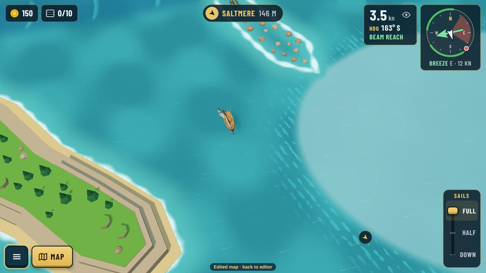
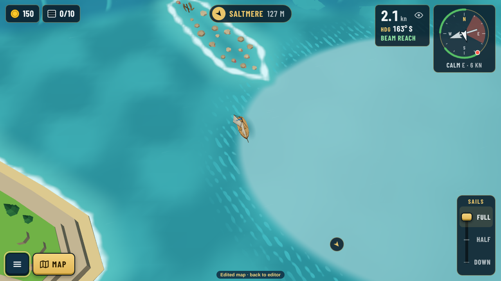
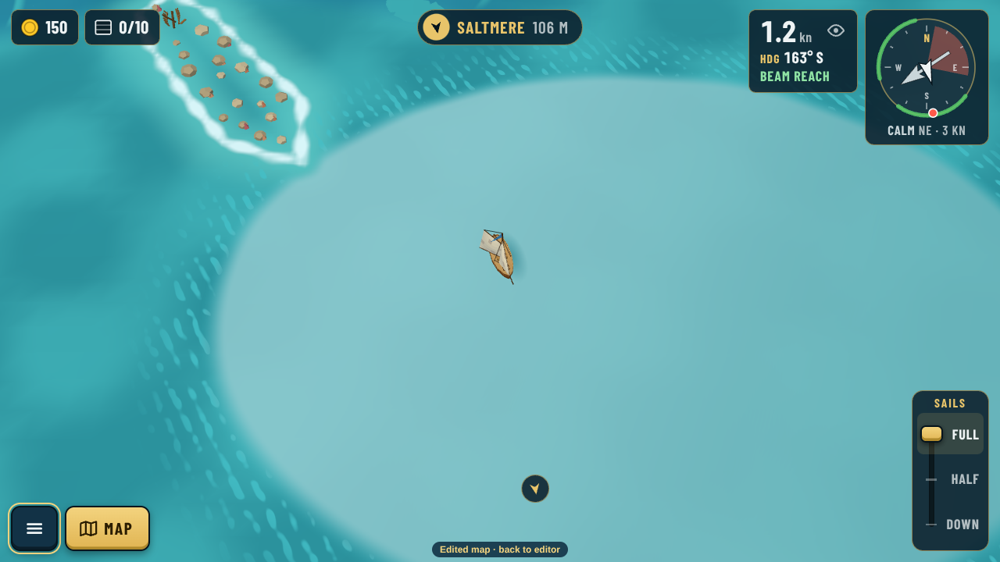
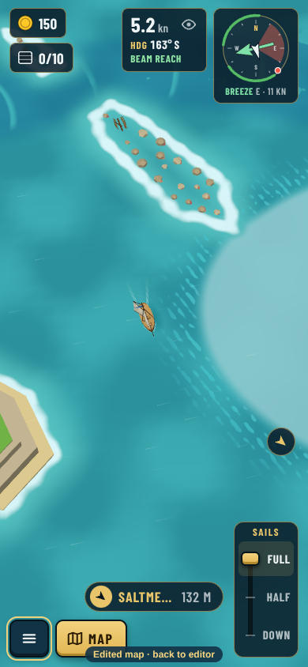
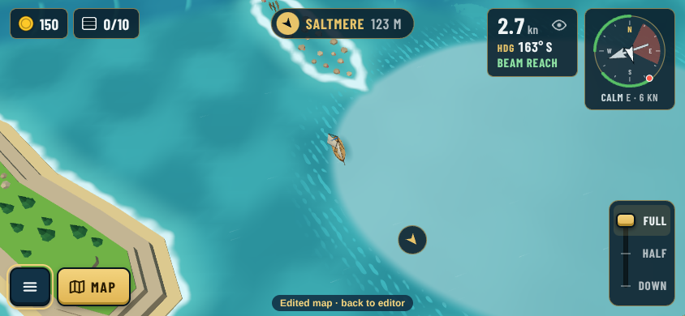
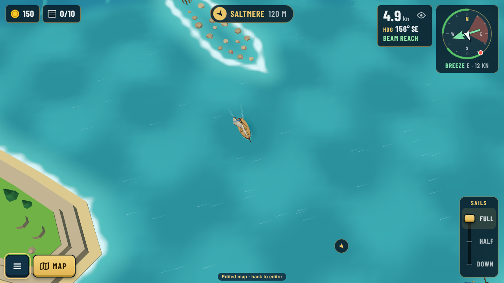

# Wind zones: the doldrums look (decision 0144)

Real game captures, taken with [src/capture.cjs](src/capture.cjs) against `npx vite --port 5199`. A doldrums zone ("The Glass", an oval east of the middle) is painted into a copy of today's map and sailed through the editor's "Play this map" path (`?map=edited`). The shipped ring itself has no wind zones (0140). The boat sits just inside the zone's west edge, so the open sea is on the left of each picture.

Guillaume's comments: the first try was "not really visible", and the next three looks were "still not identifiable enough" and he asked whether we see the edge clearly. The look is now a bright, glassy mirror with a sharp edge. Just outside the edge, a band of small ruffled ripples shows where the breeze dies. The wind itself still eases over the whole 40-unit fade.

| Approaching from the open sea | At the edge | Inside |
|---|---|---|
|  |  |  |

| Phone portrait | Phone landscape | Zones off (same spot as "At the edge") |
|---|---|---|
|  |  |  |

- The sheet is a fine grid that rides the waves, so no chop pokes through it. The first try's coarse fill let the waves show through in patches.
- How strong the look is per kind is `glassy` in `weather.json` › `zones.kinds`: doldrums 0.7, a sheltered lagoon 0.3, others none. Any zone can set its own value with `tune`.
