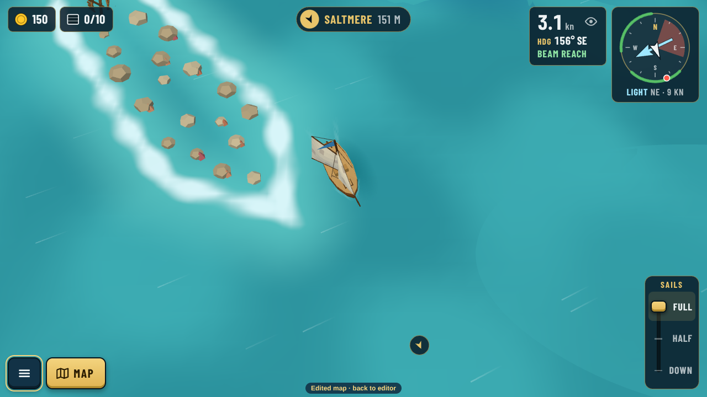
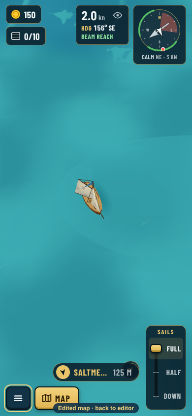

# Wind zones as built (decision 0144)

Real game captures, taken with [src/capture.cjs](src/capture.cjs) against `npx vite --port 5199`. A doldrums zone ("The Glass", an oval east of the middle) is painted into a copy of today's map and sailed through the editor's "Play this map" path (`?map=edited`). The shipped ring itself has no wind zones (0140).

| Zones on | Zones off (Settings › Wind zones) |
|---|---|
|  |  |

- **In the doldrums** the wind drops to a light or calm 3 to 4 kn (a breeze of 11 kn outside), so the wind streaks almost vanish. The water is a paler, glassy sheet with slow faint swells. Its edge fades in over the same 40 units as the wind.
- **With Wind zones off** the same spot has the open sea's breeze and chop.
- How glassy each kind looks is `glassy` in `weather.json` › `zones.kinds`: doldrums 0.7, a sheltered lagoon 0.3, others none. Any zone can set its own value with `tune`.
