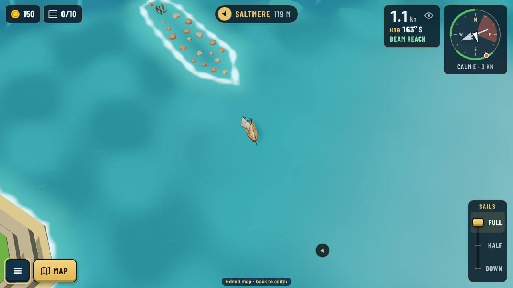
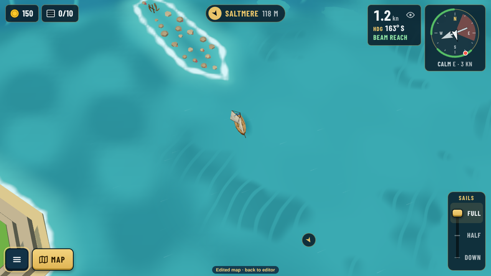
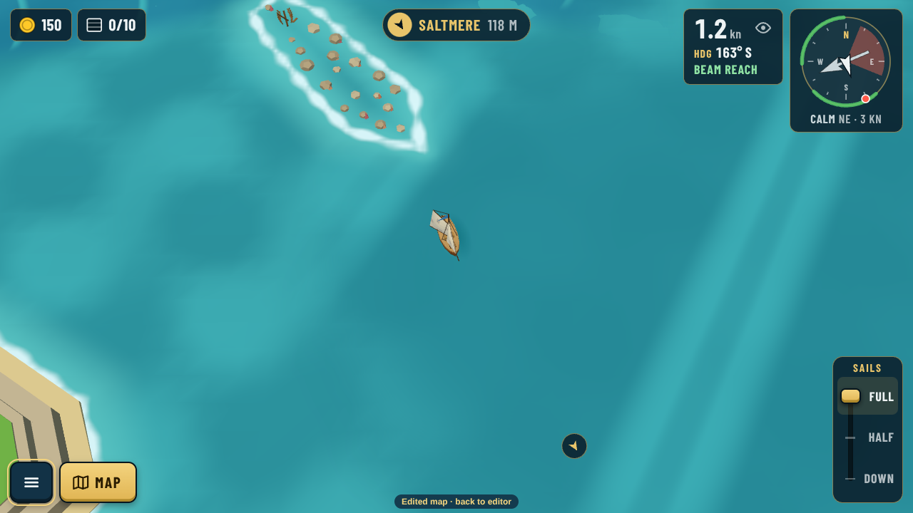
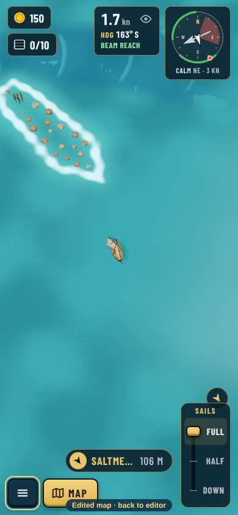
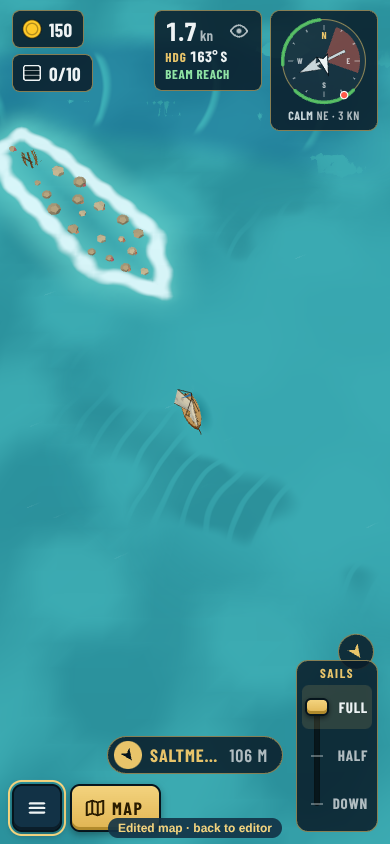
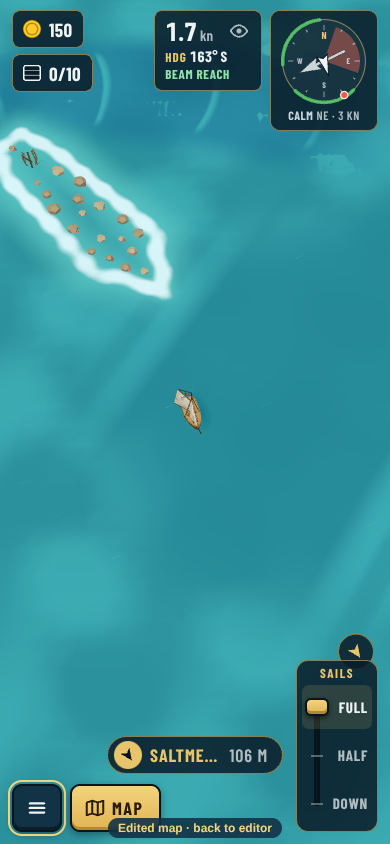

# Wind zones: the doldrums look (decision 0144)

Real game captures, taken with [src/capture.cjs](src/capture.cjs) against `npx vite --port 5199`. A doldrums zone ("The Glass", an oval east of the middle) is painted into a copy of today's map and sailed through the editor's "Play this map" path (`?map=edited`). The shipped ring itself has no wind zones (0140). The boat sits just inside the zone's west edge, so the open sea is on the left of each picture.

Guillaume found the first try "not really visible". It was too faint, and its fill was too coarse, so the waves poked through in patches. The sheet is now a fine grid that rides the waves. Three looks to choose from:

| A, mirror | B, cat's paws | C, slick swell |
|---|---|---|
|  |  |  |
|  |  |  |

- **A, mirror:** a smooth, pale, glassy sheet with long soft bands of reflected light (recommended: the clearest "no wind here").
- **B, cat's paws:** still water with darker ruffled patches drifting where a puff touches it.
- **C, slick swell:** deeper, darker still water with long pale swell lines rolling through.

With Wind zones off, the same spot has the open sea's breeze and chop:

How strong the look is per kind is `glassy` in `weather.json` › `zones.kinds` (doldrums 0.7, a sheltered lagoon 0.3, others none). Any zone can set its own value with `tune`.
