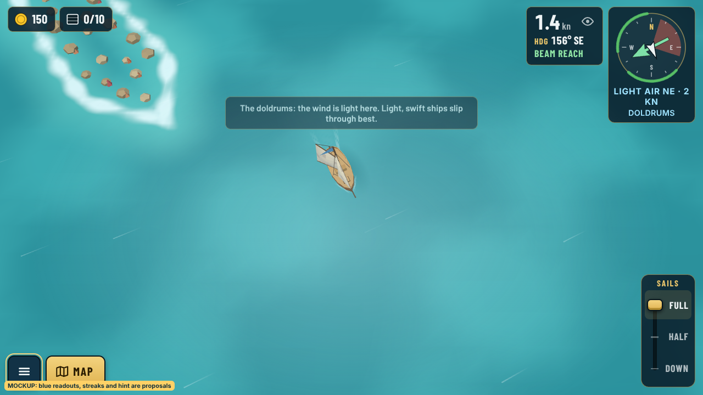
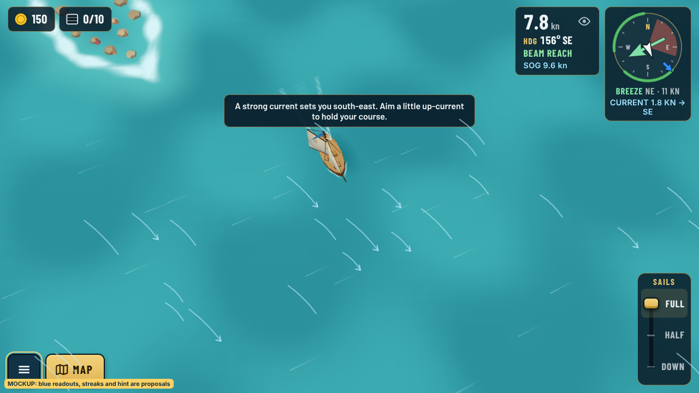
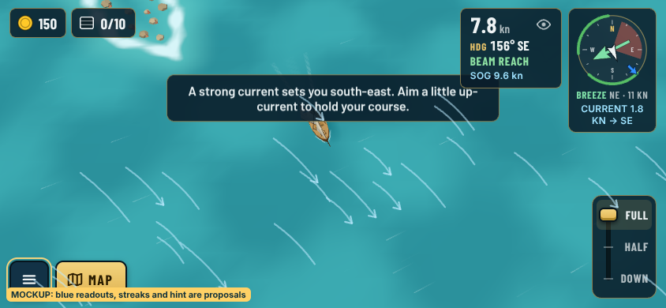
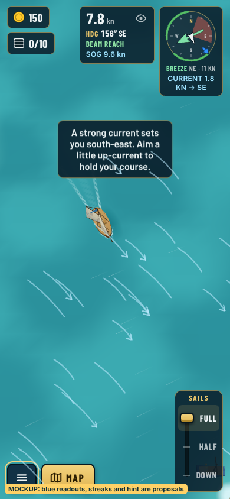
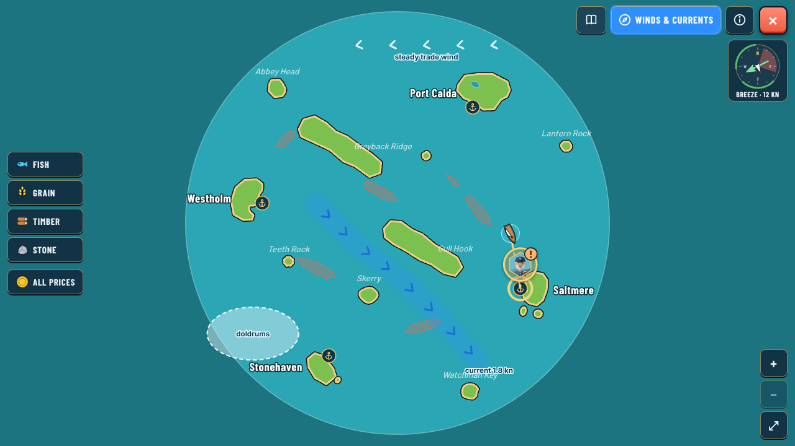
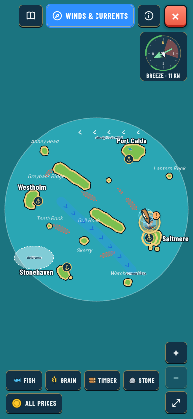

# Winds and currents for Phase 4 (proposal, 2026-10-24)

**Status:** Proposal for Guillaume. Nothing is decided or built. It follows [0137](../../decisions/0137-phase-4-biomes-and-founded-outposts.md) point 6 ("wind zones and currents become authored, per biome") and the [Phase 4 map](../phase-4-map/README.md) (layout B). The code was read with graphify: `windAt` in `src/sim/wind.ts`, `stepBoat` in `src/sim/boat.ts`, `stepWorld` in `src/sim/world.ts`, and the HUD in `src/ui/hud.ts`.

The mockups are real game captures with the proposed readouts drawn on top. The yellow tag marks what is new. `src/capture.cjs` makes them.

## What today's wind already does

- On Captain and Old salt the wind wanders round the whole compass every 3 minutes, and it bends by up to ±40° from one part of the sea to another ([0064](../../decisions/0064-wind-from-every-quarter.md)). Fair winds keeps it steady by default ([0083](../../decisions/0083-difficulty-levels.md)).
- Weather spells (calm, breeze, rain, gale) and moving storms sit on top of that ([0067](../../decisions/0067-weather-states-and-storms.md)), and islands shelter or funnel it ([0027](../../decisions/0027-islands-shape-the-wind.md)).
- The wind is a pure function of seed, time and place, so the save holds no weather.
- The boat already drifts sideways with the wind (`leeway`, about 0.5 kn in a 12 kn breeze).

So Phase 4 does not need a new wind. It needs **local character** on top of the wandering wind, plus a new force, **currents**.

## 1. Wind zones

A zone is an area of the map (an outline, painted in `editor.html`) with a kind. Its numbers live in `weather.json`, and it fades in over its edge (about 40 units), so you sail into it gradually.

| Kind | Where | What it does to the wandering wind | Feels like |
|---|---|---|---|
| **Trade belt** | Tropical south | Pulls the direction towards the belt's own heading (about 70 %) and halves the gusts. It still turns a little. | A fast, reliable highway: haulers love it |
| **Doldrums** | Tropical south, near the port | Strength ×0.25 to 0.4, with light shifting puffs | Patience. Light, swift ships slip through; a loaded fluyt crawls |
| **Stormy coast** | East, fog coast | Gusts ×1.5; storms are born here about twice as often | Ease the sails (the press warning matters) |
| **Cold gale** | North, ice | Strength ×1.2, steadier but colder | Fast but tiring beats around the icebergs |
| (none) | Ring, fire biome, open sea | Today's wind unchanged | |

- Like everything wind-related it stays a pure function of seed, time and place. Nothing is added to the save, and a resumed voyage is in the same wind.
- **Fair winds:** zones still apply (they are the sea's character), but the doldrums never drop below a floor (for example ×0.6), so the easy level never stalls.
- **Cost:** one zone lookup per frame through the existing `SpatialGrid` ([0117](../../decisions/0117-nearby-wind-shelter-and-camera-far.md)), the same order as island shelter today.

*In the doldrums, the wind readout says "light air" and a small blue DOLDRUMS tag names the zone. The water looks glassier. A first-time hint explains it once, like the press warning hint ([0078](../../decisions/0078-press-warning.md)).*

## 2. Currents

A current moves the water, and everything floating on it, over the ground.

- **Shape:** a **lane** is a polyline with a width and a speed, flowing along it (the fog coast's strong current, a channel between two islands). An **area** has a direction and a speed (the fire biome's warm current). Both are painted in `editor.html`, and they fade at their edges and near coasts so harbours stay calm.
- **Speeds:** 0.5 to 2.5 kn, against boats doing 5 to 16 kn. A 2 kn current across a 10 kn crossing sets you about 11° off your course: enough to matter, never enough to trap you.
- **Sim:** one line in `stepBoat`. The current's vector is added to the boat's movement, as leeway is today. The polar, the heel and the press stay "through the water", so the boat sails exactly the same. Only where it ends up changes. A moored boat ignores it, so docking stays reliable ([0041](../../decisions/0041-harbour-mooring-and-edge-buoys.md)).
- **Icebergs** in the north drift with the current where there is one, and with the wind otherwise.
- No save change, and it's cheap: a lookup on the same grid.

### How you read it at sea

- **Compass:** a small **blue arrow** on the ring points where the water flows, next to the green wind arrow. Under the wind line there's "Current 1.8 kn → SE".
- **Speed log:** under today's speed, "**SOG 9.6 kn**" (speed over ground) appears only while you are in a current. This follows the sailing-first rule: numbers visible but small, and the log's eye toggle hides them with the rest.
- **On the water:** light streaks flow with the current, like the wind streaks do with the wind ([0040](../../decisions/0040-visible-wind-strength.md)).
- **First time only:** "A strong current sets you south-east. Aim a little up-current to hold your course."

Phone landscape and portrait:

 

### On the chart

A **Winds & currents** button in the chart header toggles a layer. It shows current lanes as blue bands with chevrons and their speed, wind zones as shaded areas (doldrums, trade belt with its arrows, stormy coast), and only charted areas, so the fog of war still hides the rest. The placements above are **examples on today's sea**. In Phase 4 they sit in the biomes, and the ring keeps none.

## 3. Settings and difficulty

Guillaume's rule is that every hazard or annoyance can be switched off. Proposal:

- **Settings › Weather** gets two new switches. **Currents** (off: no current anywhere, and the readouts disappear) and **Wind zones** (off: no doldrums, trade belt or stormy coast, so the sea has today's wind everywhere). Both are on by default.
- Every story step works with both off (head storyteller's rule in 0137).
- **Difficulty** changes only the strength of currents, like gales: Fair winds ×0.6, Captain ×1, Old salt ×1.2. The boat itself still sails the same at every level.

## 4. What it costs to build (a guess)

1. Zones and currents in the map format, checks and the editor (paint, preview): about 2 PRs.
2. Sim (`windAt` zone term, current vector in `stepBoat`, iceberg drift) with tests: 1 PR.
3. HUD readouts, sea streaks, chart layer, first-time hints, Settings switches, en/fr: 1 to 2 PRs.
4. The balance check's bots learn to aim up-current, and the targets get checked: 1 PR.

Everything waits for the v0.3.x release. The data format can be drafted earlier, since nothing in the game reads it until then.

## Questions for Guillaume

1. **Readouts:** blue current arrow on the compass, "SOG" under the speed, and streaks on the water. Is that enough, or too much?
2. **Two switches** (Currents, Wind zones), or one switch for both?
3. **Difficulty:** should currents scale with the level (Fair winds weaker), or stay the same everywhere?
4. **Tides** (currents that turn slowly over time) left for later? I recommend later.
