# Screenshots

Captures of the game at each phase, taken headless with Playwright (software WebGL, so colors and antialiasing differ slightly from a real GPU).

| Phase 0, desktop (1280×720) | Phase 0, phone (390×844) |
|---|---|
| 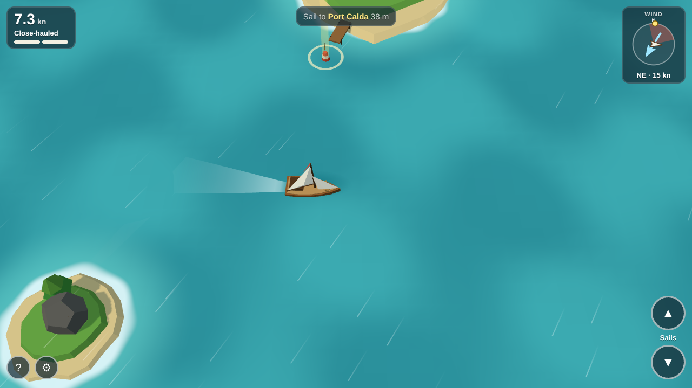 | 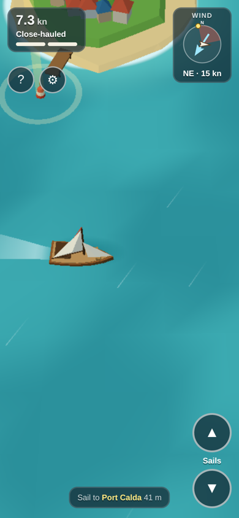 |

| Main menu, desktop | Main menu, phone | Main menu, phone landscape |
|---|---|---|
| 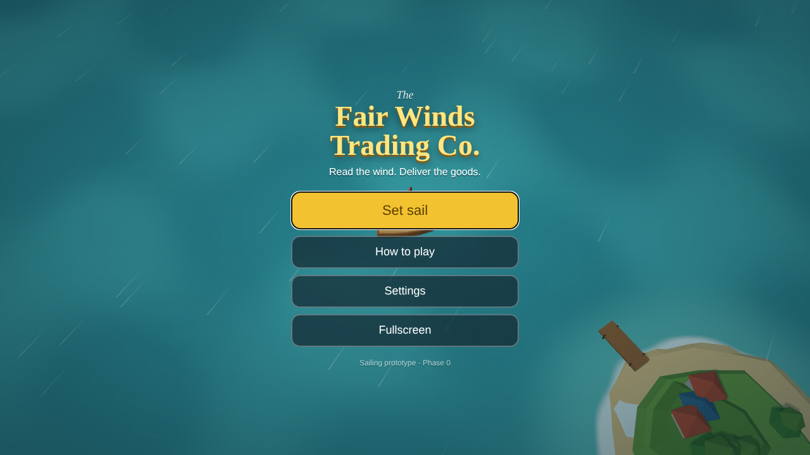 | 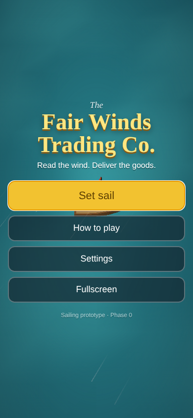 | 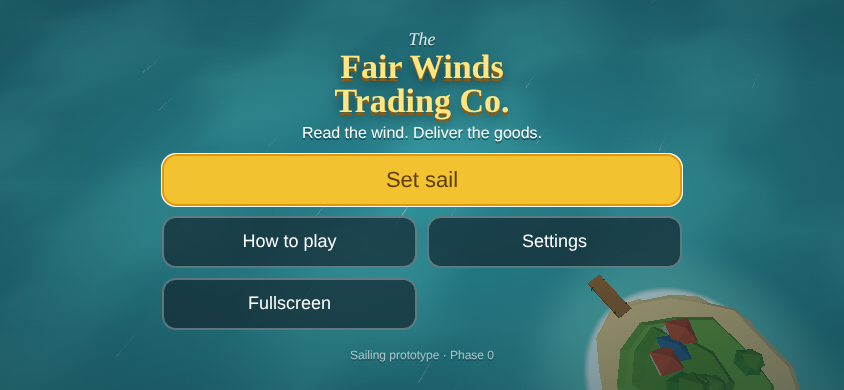 |

| Delivery orders, Captain mode | Delivery orders, Kids mode |
|---|---|
| 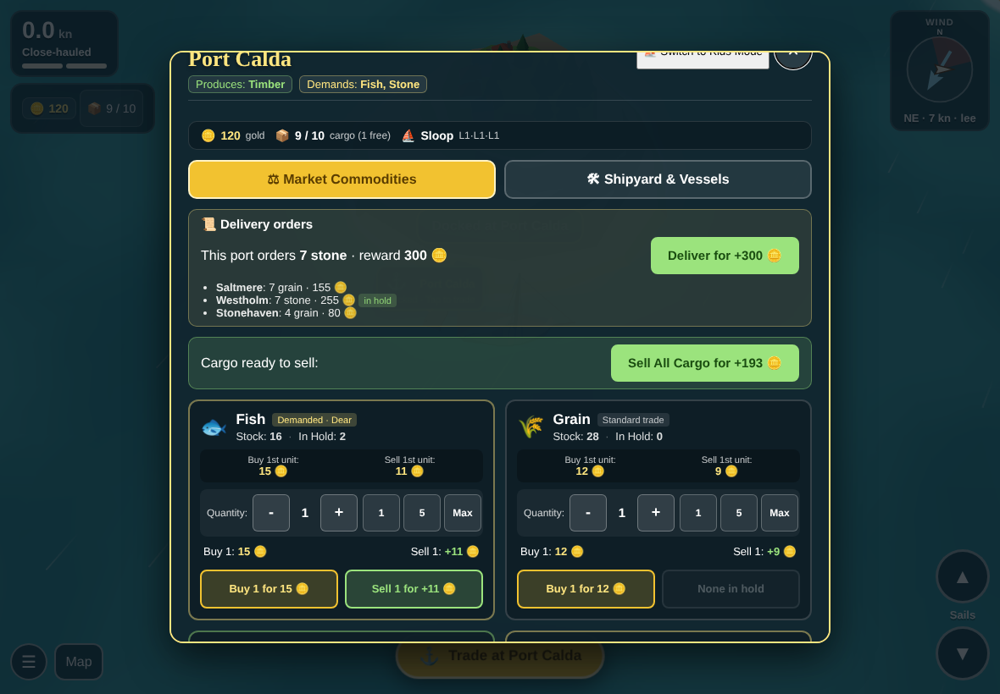 | 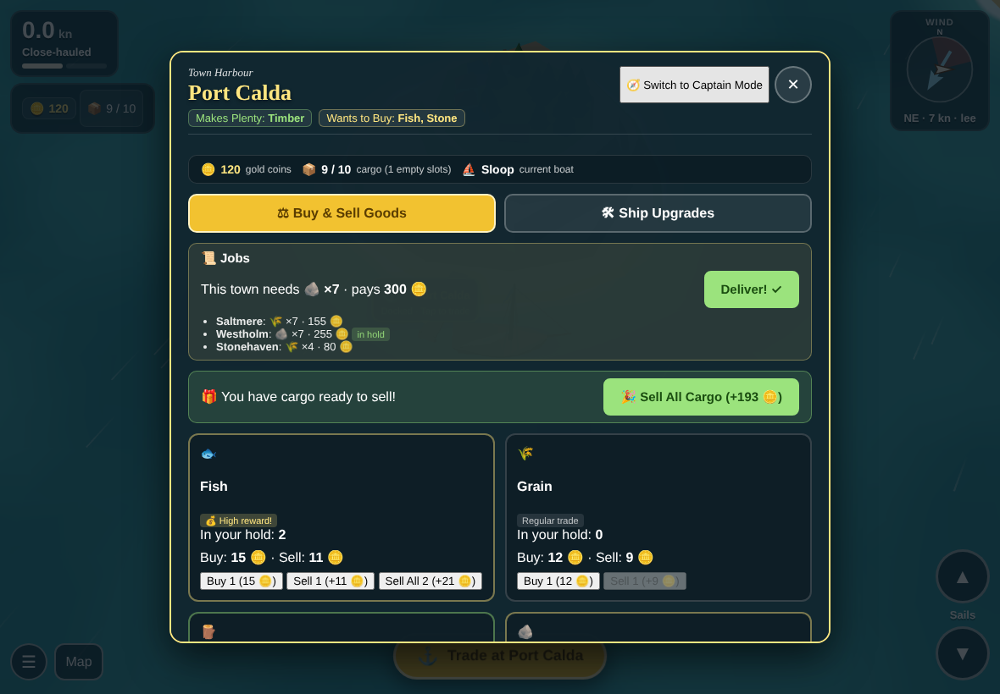 |

| Reef strike: hull at 52% in the HUD | Repairing the hull in port |
|---|---|
| 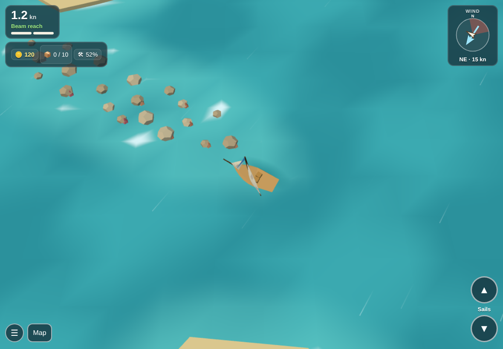 | 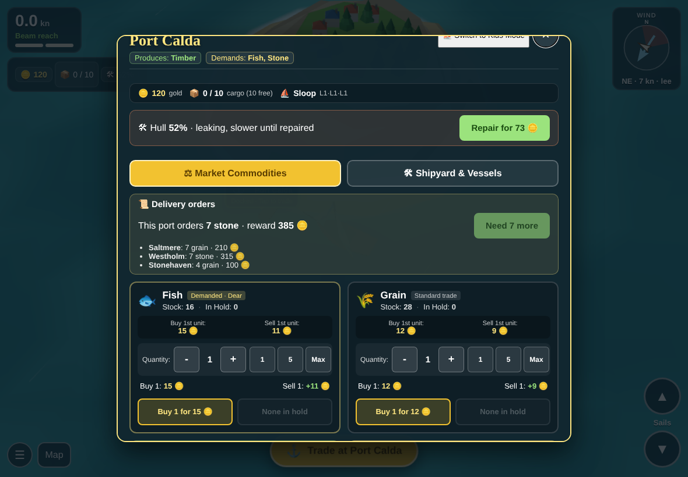 |

| Chart: each port's top need and the price board (decision 0036) | Same chart on a phone |
|---|---|
| 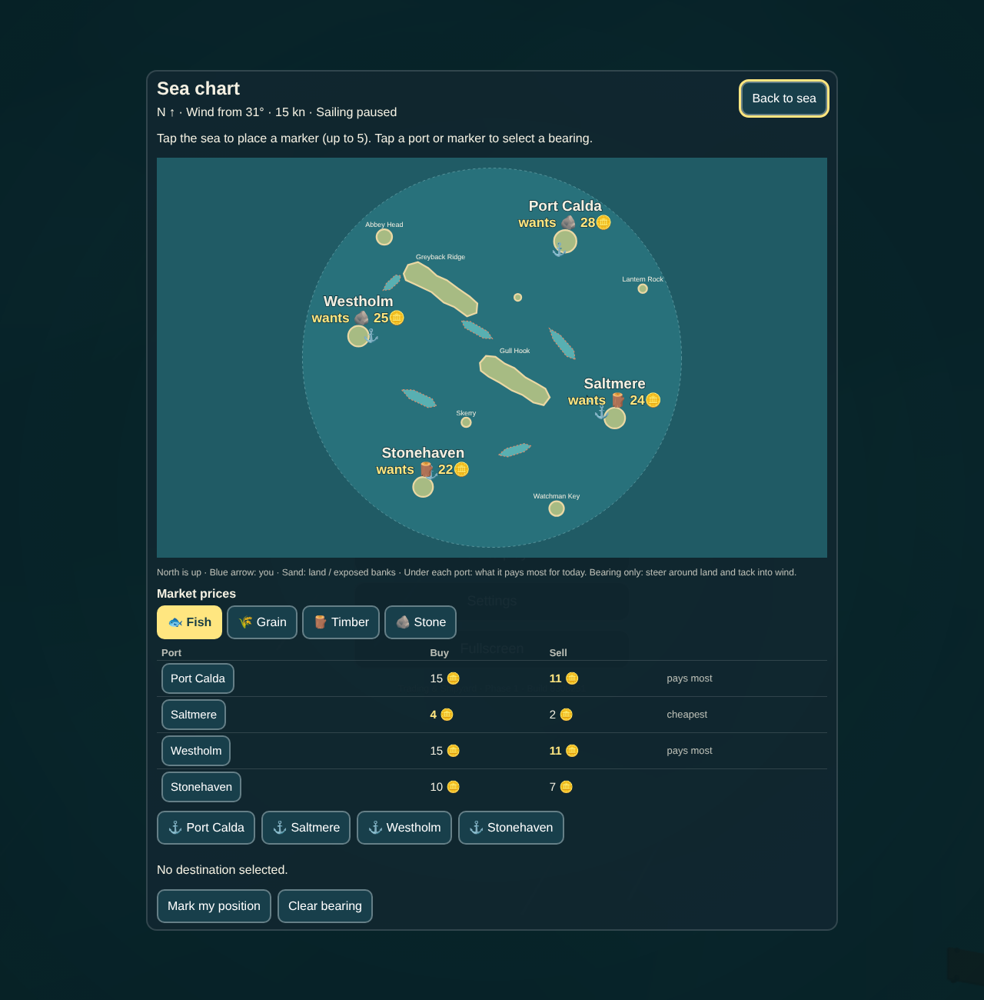 | 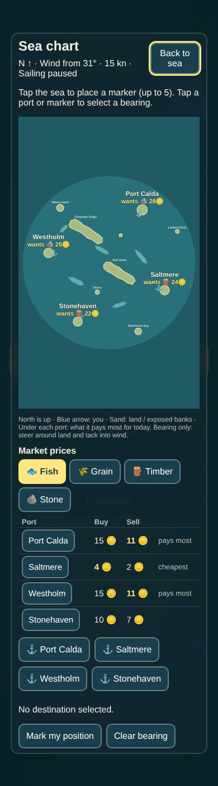 |

Harbour: "Best sale elsewhere" under each good (decision 0036)

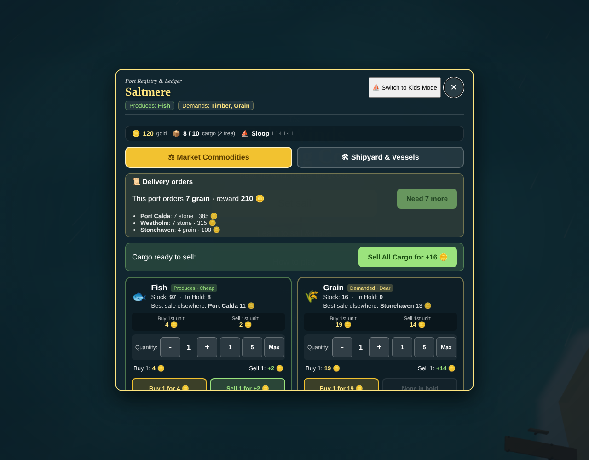

| French main menu with the language switcher (decision 0037) | Same menu on a phone |
|---|---|
| 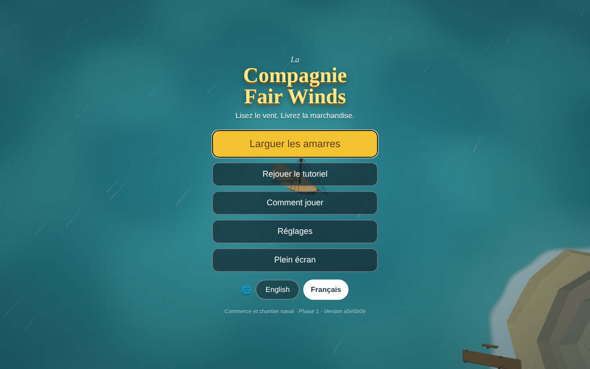 | 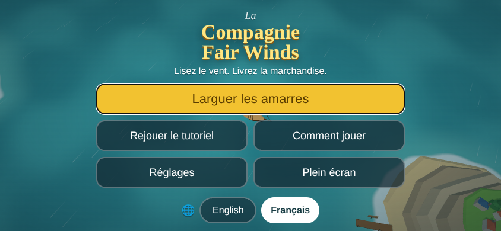 |

| Harbour in French, Captain mode | Kids mode | Sea chart |
|---|---|---|
| 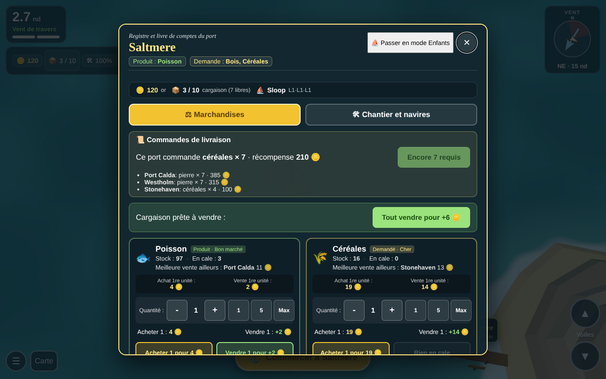 | 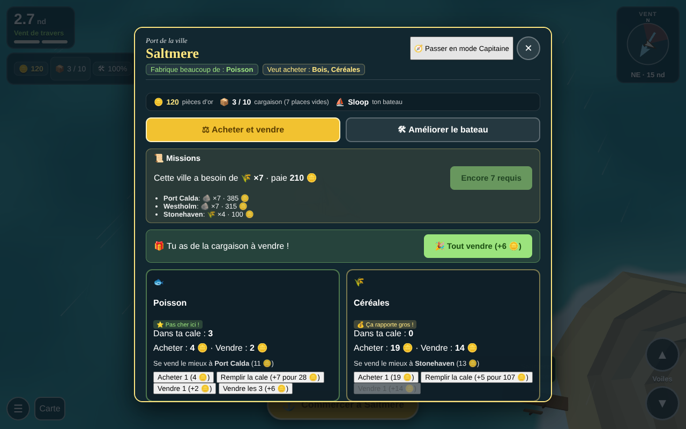 | 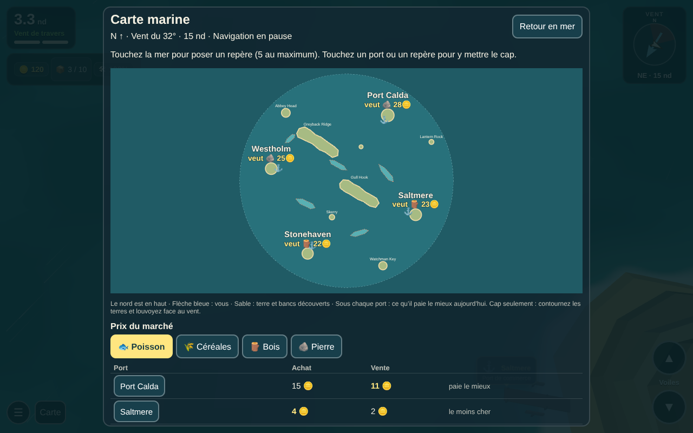 |
