# Screenshots

Captures of the game at each phase, taken headless with Playwright (software WebGL, so colors and antialiasing differ slightly from a real GPU).

| Phase 0, desktop (1280×720) | Phase 0, phone (390×844) |
|---|---|
|  |  |

| Main menu, desktop | Main menu, phone | Main menu, phone landscape |
|---|---|---|
|  |  |  |

| Delivery orders, Captain mode | Delivery orders, Kids mode |
|---|---|
|  |  |

| Reef strike: hull at 52% in the HUD | Repairing the hull in port |
|---|---|
|  |  |

| Ran aground on a rocky shore (decision 0038, French) | Rammed Port Calda's pier at 8 kn: the harbour opens with the repair bar |
|---|---|
| 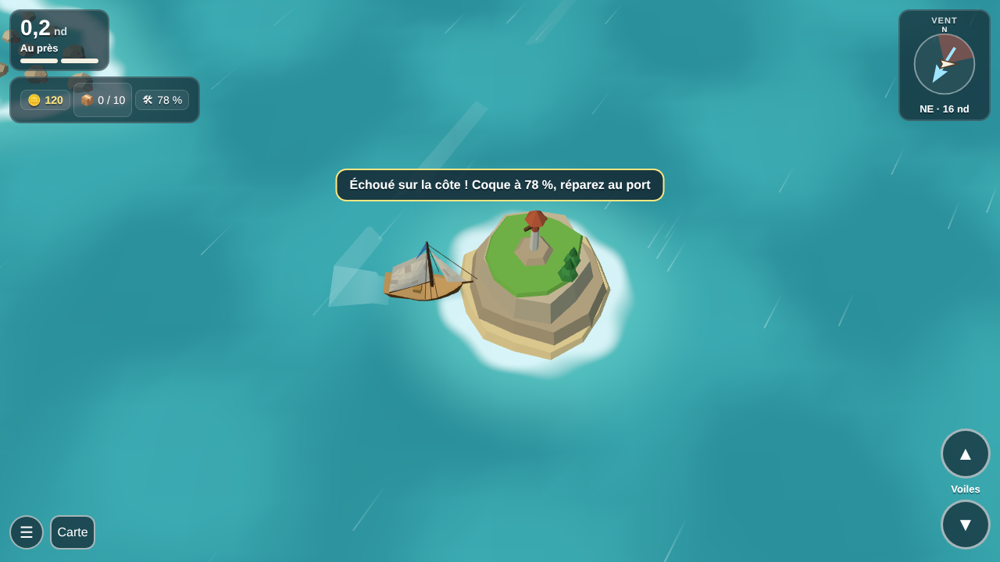 | 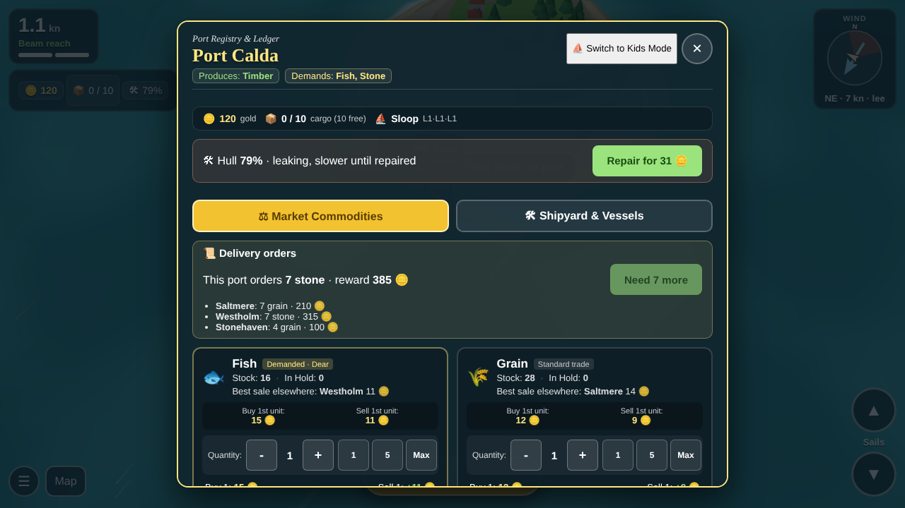 |

Red buoys marking the edge of the sea (decision 0041)

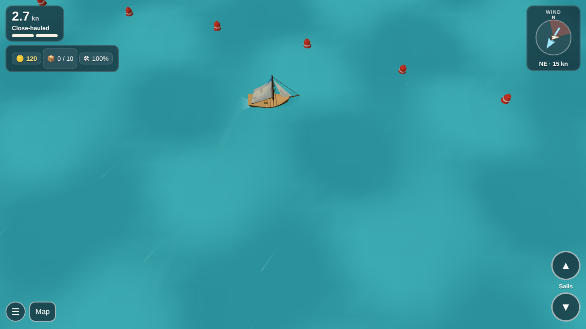

| Chart: each port's top need and the price board (decision 0036) | Same chart on a phone |
|---|---|
|  |  |

Harbour: "Best sale elsewhere" under each good (decision 0036)

| French main menu with the language switcher (decision 0037) | Same menu on a phone |
|---|---|
|  |  |

| Harbour in French, Captain mode | Kids mode | Sea chart |
|---|---|---|
|  |  |  |

## Wind strength (decision 0040)

| Breeze, desktop | Calm, phone | Strong with a gust, phone |
|---|---|---|
| 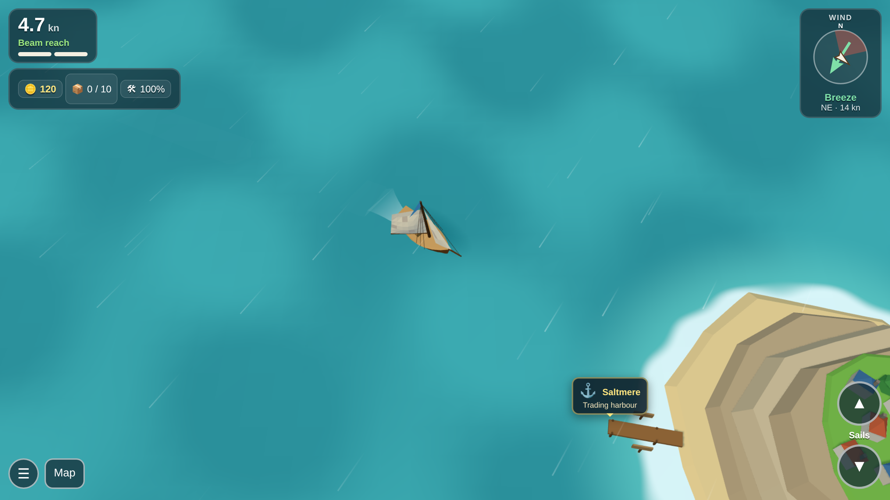 | 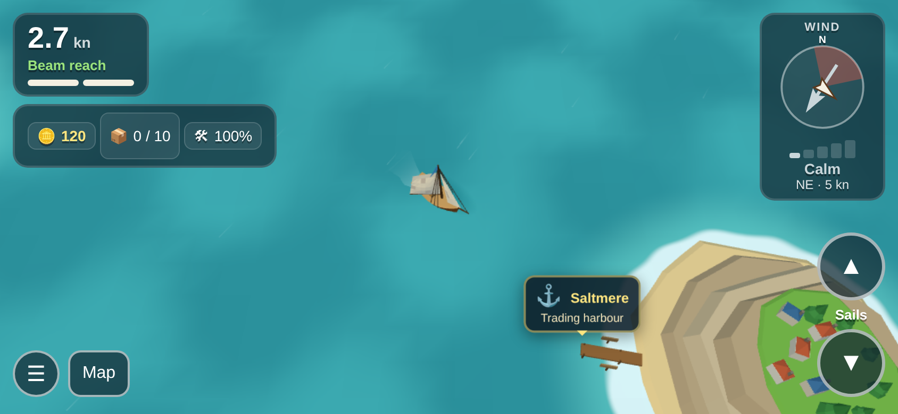 | 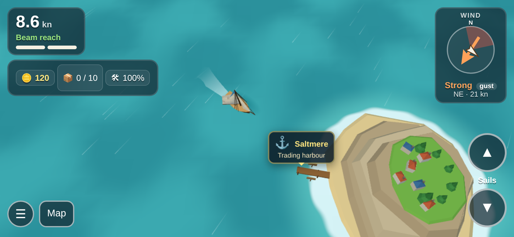 |

| Kids mode, strong | Kids mode in French, light | French, fresh with a gust, portrait |
|---|---|---|
| 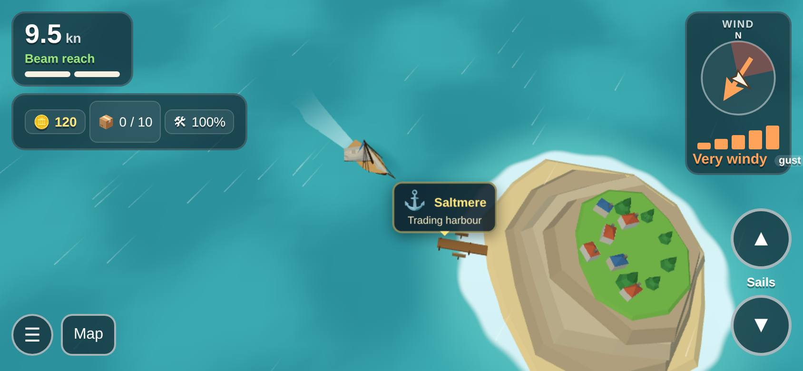 | 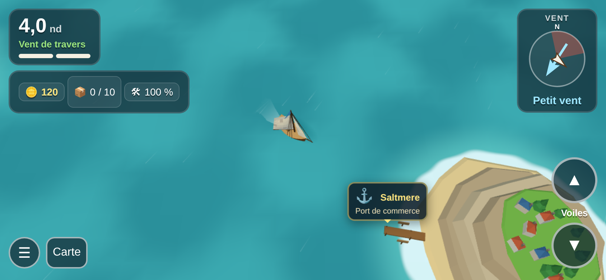 | 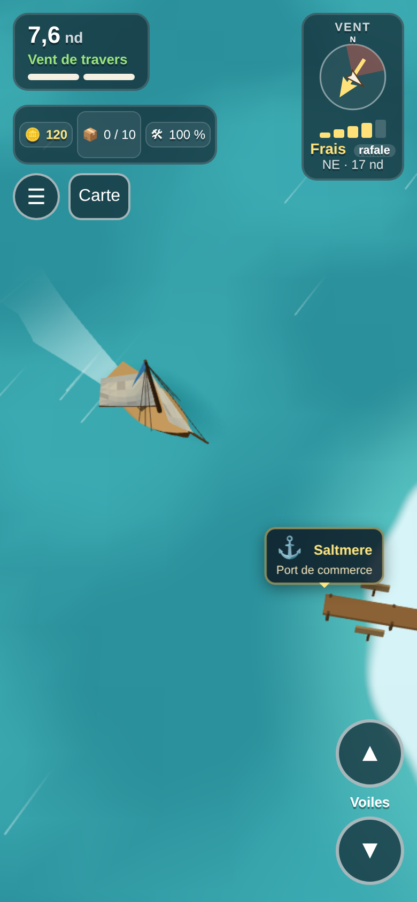 |

## Ship unlocks ([0048](../decisions/0048-ship-unlocks-home-port-and-yards.md))

| Abbey Head yard, hoy unlocked | Away from home: no upgrades, where each ship is built | A fluyt at sea |
|---|---|---|
| 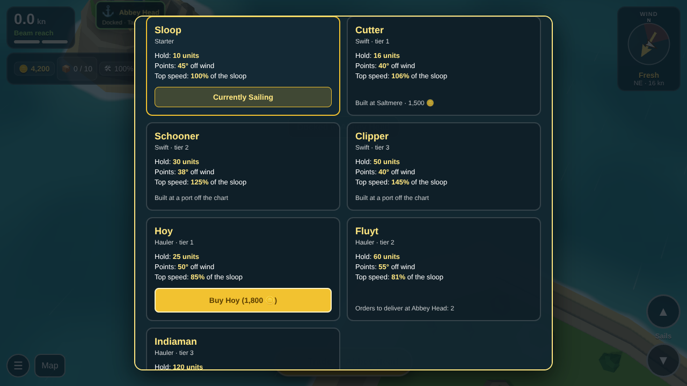 | 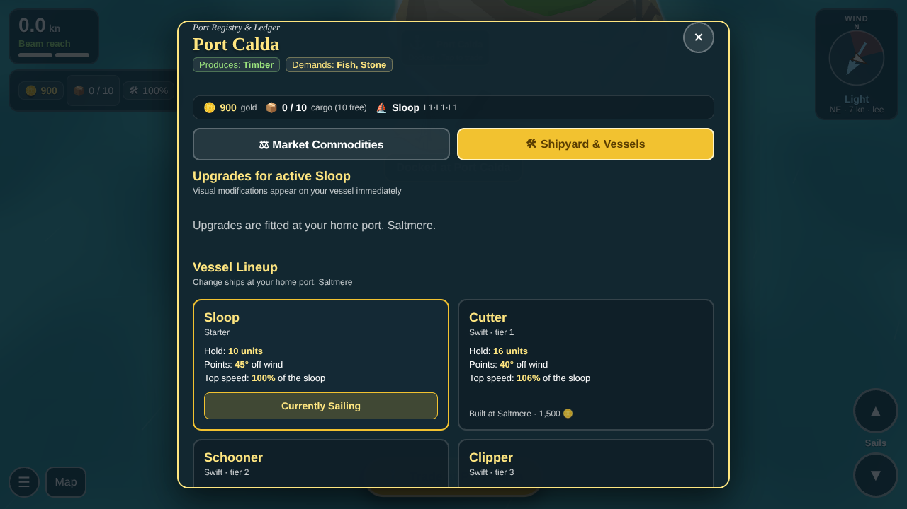 | 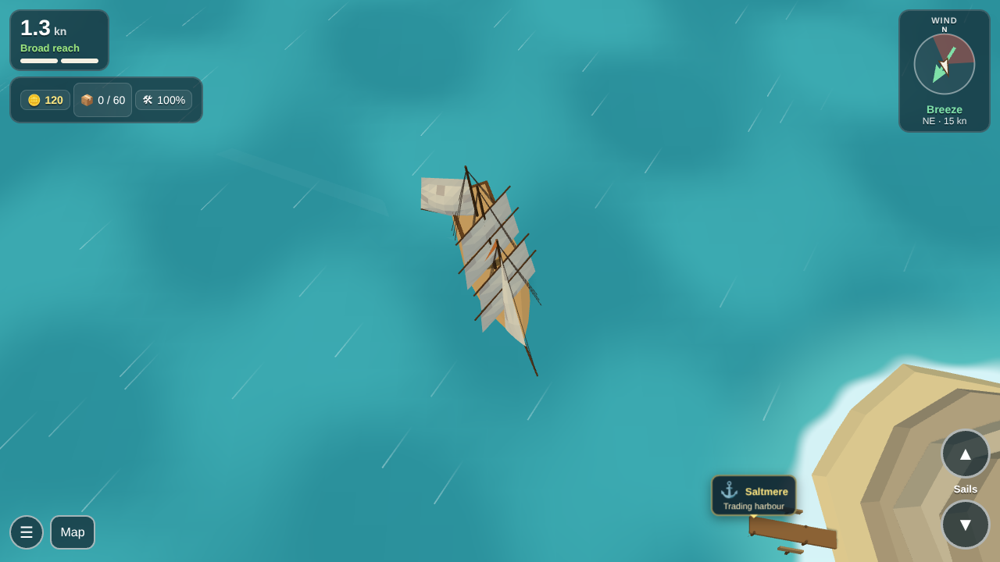 |
