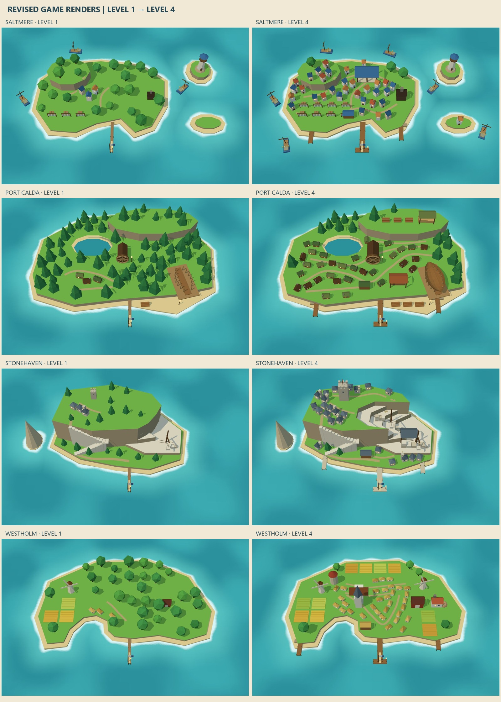

# Producer island identities

Actual renders from the game's model sheet, not generated concept art. Level 1 is on the left;
level 4 is on the right. The camera and coastline stay fixed within each pair; Stonehaven's quarry expands as the town grows.

| Island | Level 1 | Level 4 |
| --- | --- | --- |
| Saltmere | [Full render](fish-level1.jpg) | [Full render](fish-level4.jpg) |
| Port Calda | [Full render](timber-level1.jpg) | [Full render](timber-level4.jpg) |
| Stonehaven | [Full render](stone-level1.jpg) | [Full render](stone-level4.jpg) |
| Westholm | [Full render](grain-level1.jpg) | [Full render](grain-level4.jpg) |

[Stonehaven: all four quarry stages](quarry-growth.jpg) shows the extraction face retreating into the mountain while the village and coastline remain fixed.

The blue-and-white flag marks the player berth. Shorter working piers and fishing boats leave its arrival lane clear.

[Night review of all four port towns](night-comparison.jpg) uses the game moonlight, water colours, lit windows and lanterns. Add `&night` to the same model-sheet URL.

## Reproduce

Start the dev server, then open `models.html?view=towns&kind=fish&focus=1` at 1600×1000.
Use `kind=fish`, `timber`, `stone` or `grain`; `focus=1` is the hamlet, `focus=4` the port town.
The focused view isolates one island and uses the same seed for each growth level. Omit `focus`
to inspect all four levels together. `before=1` retains the earlier fixed-house model sheet.

The comparison is a labelled contact sheet of the eight captures, with surrounding empty sea
cropped consistently. The geometry and buildings in the images have not been painted or edited.

Revised after visual review: wooded starting villages, progressive clearing, larger working waterfronts and a quarry cut into the mountain.

See [decision 0072](../../decisions/0072-wooded-villages-and-working-landscapes.md) and [decision 0071](../../decisions/0071-distinct-producer-islands.md).
