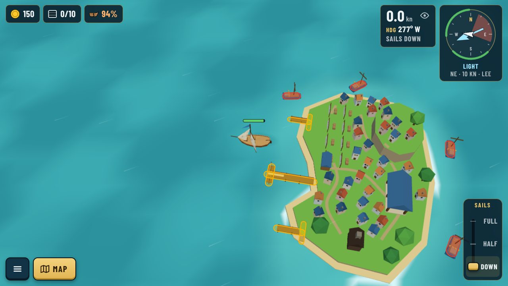
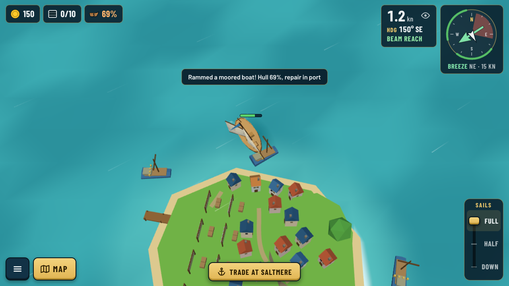
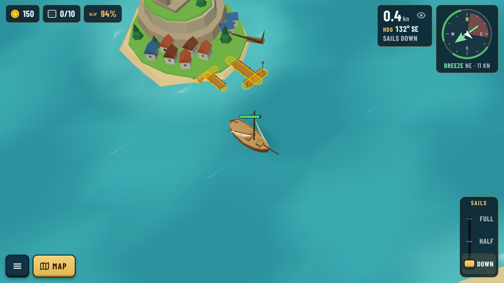
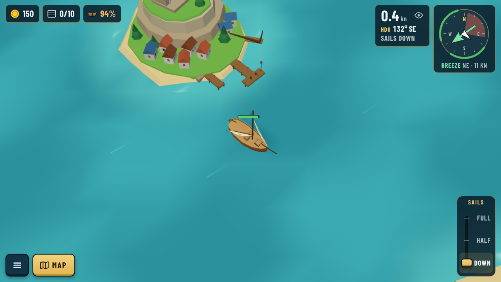
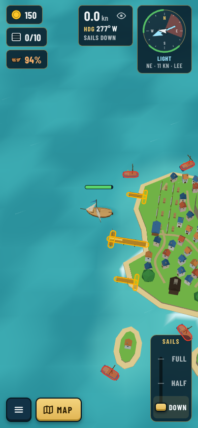
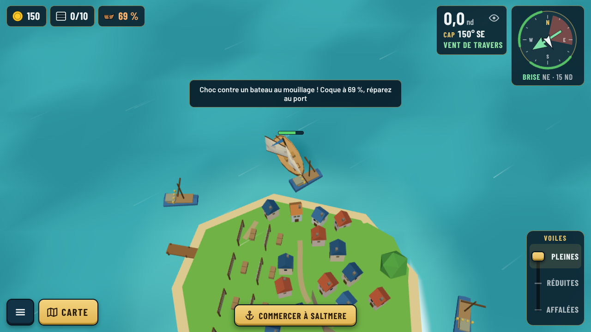

# Solid moored boats and yard docks (decision 0082)

Captured in the built game with headless Chromium (`capture.cjs`, against `npx vite --port 5199`).
The overlays are drawn from the live `world.piers`: yellow = solid piers, T-heads and quays,
red = moored boats.

| Saltmere, port town: every moored fishing boat is solid | Rammed at 8 kn: the hull takes the hit |
|---|---|
|  |  |

| Abbey Head yard at level 4: T-head, second pier and quay | The same harbour without the overlay |
|---|---|
|  |  |

| Phone portrait | French toast |
|---|---|
|  |  |
