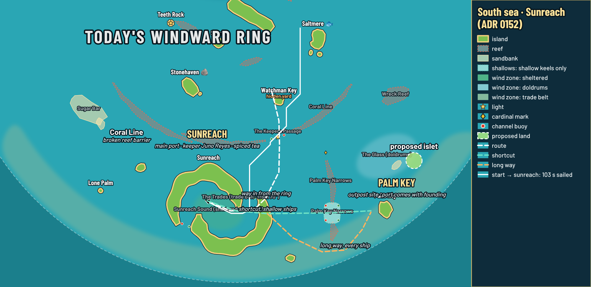
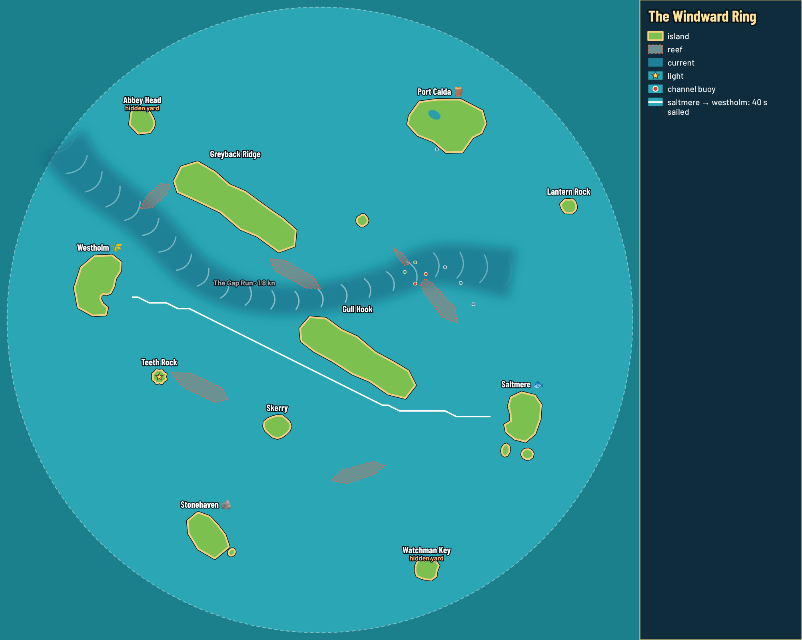

# `npm run chart`: the labelled map (decision 0153)

A labelled map of a sea as PNG and SVG, drawn by the map editor's own chart code from the real map and island files, plus an optional overlay of proposed places. This is the "map and schema" Guillaume sees with every map or layout change.

```sh
npm run chart                                     # the whole ring → output/chart/ring.{svg,png}
npm run chart -- --sea phase4 --around sunreach --radius 330 --route start,sunreach
npm run chart -- --sea src/data/seas/south.json --view -820,-1000,820,0 \
  --overlay docs/tools/chart-example.json --out docs/reviews/my-review/map
```

- **Seas:** `ring`, `stress`, `phase4`, an editor export (a whole map, it has `boundsRadius`) or a sea file shaped like `src/data/seas/*.json`, merged round the ring in place of the shipped sea with the same id.
- **View:** the whole sea by default; `--around <island|port|x,y> --radius r`, or `--view west,south,east,north` (map units, y north).
- **Layers:** `--layers names,flow,marks` (the default); add `harbours` (piers and dock ranges), `course` (waypoints), `grid` (50 units).
- **Routes:** `--route start,sunreach;saltmere,westholm` sails each leg with `sailRoute` (the route checks' planner, a sloop in the map's base wind), draws it and prints its time. Exit code 1 when a leg has no way through.
- **Size:** `--width 1600` PNG pixels for the map; `--scale 1.5` (default) is the text and line size. The legend panel adds 270 × scale pixels on the right; `--legend none` drops it.
- **Sectors:** on the grown sea (`phase4` or a sea file) a dashed spoke marks each sea's border and the sea's name and span sit near the rim (decision 0179); `--sectors none` hides them.
- **Density:** `--density` (grown sea only) shades empty water, farther than `--sight` (default 160) from any island, reef, bank, ice or mark, rings the biggest empty discs and puts each sea's counts in the legend (decision 0180). `npm run sea -- density` prints the same numbers.
- `--ghosts` draws dashed outlines where shapes sat on the shipped ring; `--svg` skips the PNG (no Chromium); `--json` prints what was written.

## Overlay file

Everything in map units (x east, y north). All parts are optional. Example: [chart-example.json](chart-example.json).

```json
{
  "title": "South sea · Sunreach",
  "areas": [{ "outline": [[0, 0], [50, 0], [25, 40]], "style": "proposed", "label": "new reef" }],
  "islands": [{ "x": 620, "y": -560, "radius": 28, "name": "proposed islet" }],
  "lines": [{ "points": [[0, 0], [0, -300]], "style": "route", "label": "way in", "arrow": true }],
  "labels": [{ "at": [-100, -480], "text": "SUNREACH", "note": "main port", "style": "port" }],
  "legend": [{ "style": "fog", "text": "fog bank to come" }]
}
```

- Area and island styles: `proposed` (default), `land`, `reef`, `bank`, `shallows`, `zone`, `fog`, `ice`, `warm`, `tint`.
- Line styles: `route` (default, white dashes), `short` (green), `long` (orange), `block` (red), `current` (dark blue band).
- Label styles: `name` (default), `port`, `zone`, `note` (italic), `big` (biome titles). `note` adds a smaller second line.
- The legend lists by itself what is in view (terrain kinds, wind zone kinds, currents, marks, overlay styles, sailed routes); `legend` adds lines.

Labels are not moved apart: place overlay labels where the map's own names are not.




