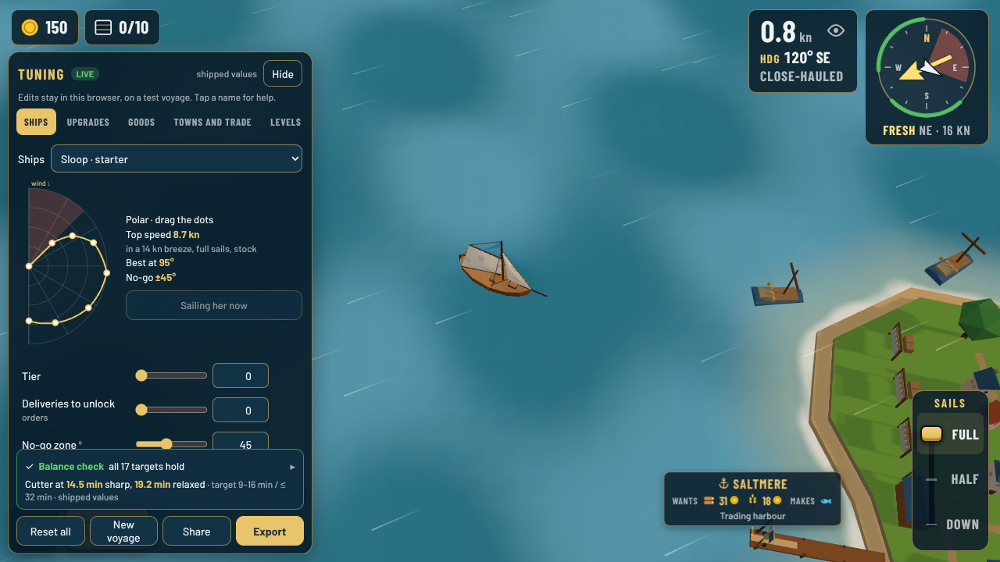
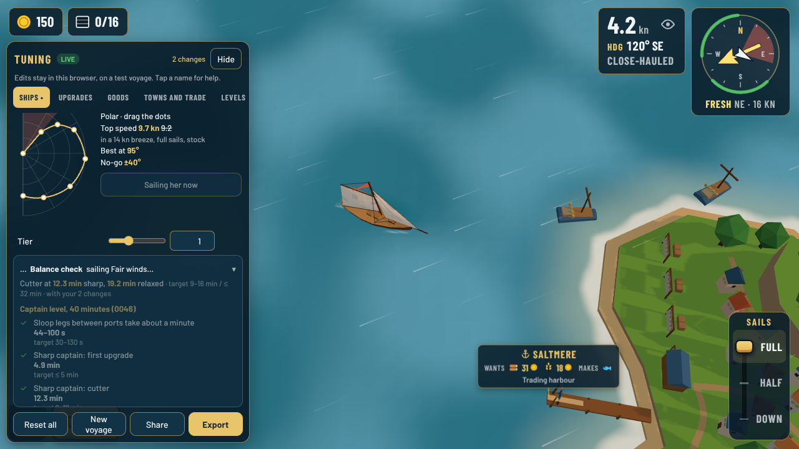
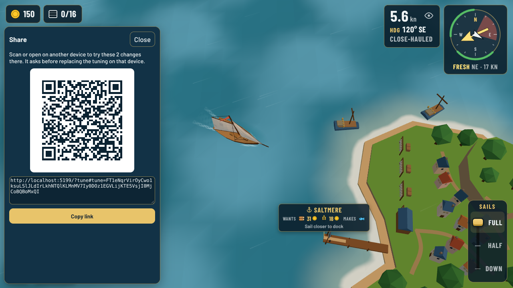
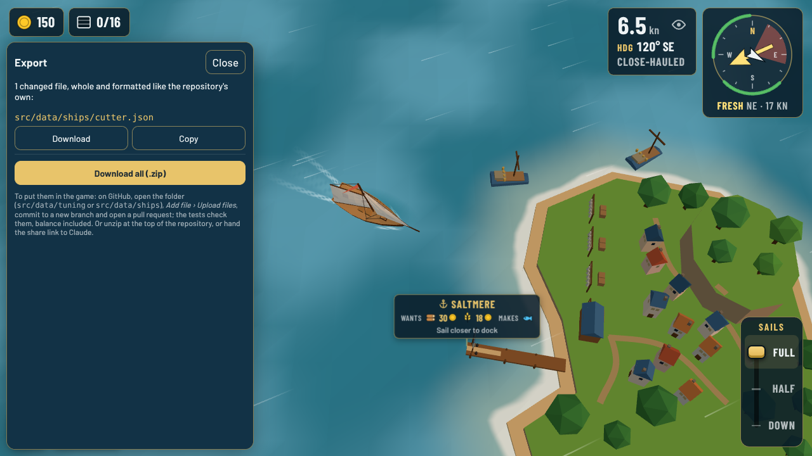
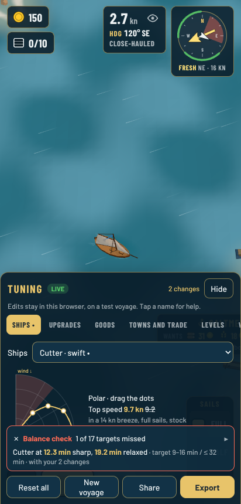

# Tuning panel (`?tune`)

Decision: [0114](../decisions/0114-tuning-panel-and-balance-check.md).

Open the game with `?tune` at the end of the address: <https://djguiaume.github.io/fair-winds-trading/?tune>. It sails a **test voyage** of its own, so your real voyage is never touched. Your tuning stays in that browser until you reset it.

## Tuning

- Pick a tab (Ships, Upgrades, Goods, Towns and trade, Levels, Weather, Seamanship), then a ship, good, level or weather kind in the picker.
- Drag a slider or type a number: it applies at once, while you sail. A changed value is outlined; ↺ puts it back. Tap a name for what it means and its shipped value.
- **Ships:** drag the dots of the polar curve (a dot moves along its own angle). Top speed, best angle and no-go update beside it. **Sail this ship** switches you to it right away.
- Start gold and similar values show on a fresh voyage: **New voyage** starts one and keeps your tuning.
- **Hide** folds the panel into a small "Tuning" button.

## Balance check

Under the values: the same simulation the tests run, on your numbers, a moment after each change (about two seconds). A green tick means every target holds; red says how many are missed. Tap it for every check with its result and target. The targets are in `src/data/balance-targets.json`. Every level is sailed in its own wind and currents, five weather seeds each ([0149](../decisions/0149-balance-in-each-levels-real-wind-and-currents.md)), so a run now takes about five seconds; weather, wind zone and current edits move the result too.

## Sharing and export

| Share | Export |
| --- | --- |
|  |  |

- **Share** shows a QR code and link with your changes: open it on the phone or tablet (it asks before replacing the tuning there), or paste it to Claude.
- **Export** lists every changed file, whole and formatted like the repository's own. To put them in the game: on GitHub open `src/data/tuning` or `src/data/ships`, *Add file › Upload files*, choose the downloaded file, commit to a new branch and open a pull request. The tests run on it, balance included; merging deploys it. **Download all (.zip)** keeps the repository paths: unzip at the top of the repository.
- The first deliberate tuning change also deletes the "moved values equal the old constants" block in `tests/tuning.test.ts` (Claude does it if you hand over the link).

## Portrait

In portrait the panel is a bottom sheet; the boat stays visible above it.
