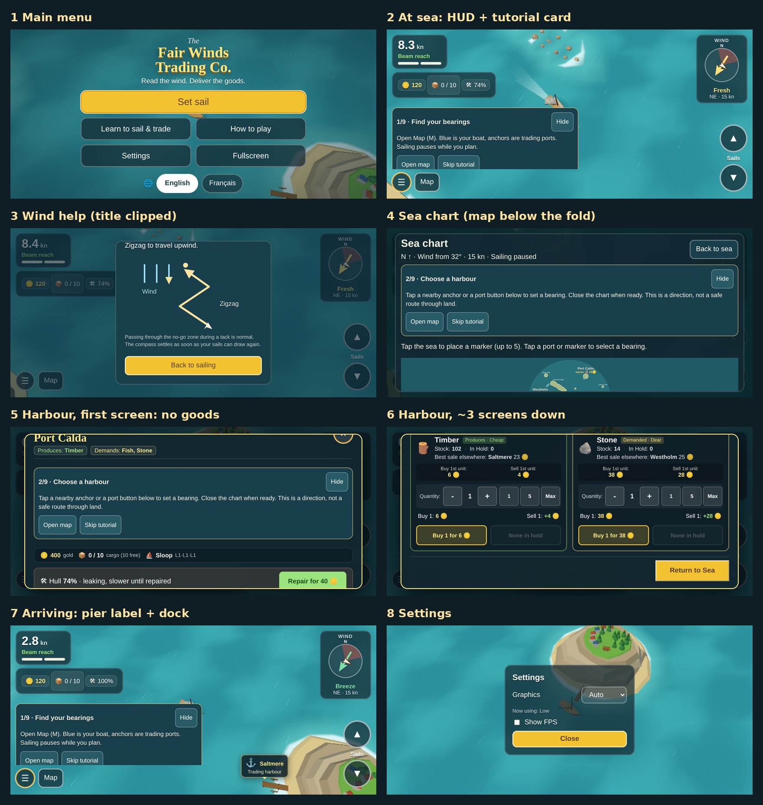

# UI refactor: analysis and recommendation

*2026-10-20. Analysis only: nothing here is decided yet. The decisions we take from it will get their own ADRs.*

Roadmap item: **Complete UI redesign** (Phase 1, [roadmap](../roadmap.md)). Constraints that still hold: desktop **and** touch, smooth on an old tablet and a phone ([0006](../decisions/0006-desktop-and-mobile.md)), English and French ([0037](../decisions/0037-english-and-french-translations.md)), style of the *Privateers: Pirate Wars* ad ([reference](../reference/)).



*Current UI on a phone in landscape (844×390), `main` at 258865e. All captures are in [current/](current/); taken headless with software WebGL. The 74% hull comes from staging the shots, not from normal play.*

## In short

The game's systems are fine; the UI presents them as **a web page laid over a game**. Every feature got its own dark panel with prose, labels and buttons, so the screen has no hierarchy and the important actions sit below the fold. Mobile games in this genre do the opposite: a full-bleed sea with information **pinned to things in the world**, a thin resource strip, one big thumb control per hand, and port screens that are **one screen per task with big icons and one tap per action**.

**Recommendation:** rebuild the UI around three screens (Sea, Port, Chart) with one shared visual language (game font, wood/parchment/gold frames, a code-built icon set), moving information out of panels and onto the world. Start with static mockups of those three screens in three visual styles ([mockups](mockups/README.md)), you pick one, then build Sea HUD → Port → Chart → menus.

---

## 1. What we have, grouped by the need it serves

The current UI has **about 40 separate elements** across 9 surfaces (`index.html`, `src/ui/*.ts`, 2,210 lines of `hud.css`). Grouped by what the player needs at that moment:

### A. Steer and read the sea (every second)

| Element | Where | What it gives the player |
|---|---|---|
| Speed in knots + point of sail word ("Beam reach") | top-left panel | Am I going fast? Am I at a good angle to the wind? |
| Sail pips (2 bars) | same panel | How much sail is up |
| Sails ▲ / ▼ buttons + "Sails" label | bottom-right | Raise / lower sail (3 steps) |
| Floating tiller (drag anywhere) | anywhere on touch | Steering |
| Wind compass: ring, red no-go wedge, wind arrow, boat arrow, waypoint dot, N | top-right panel | Where the wind comes from, where I can't sail, where my target is |
| Wind strength word + direction + knots + "gust" + "lee" | under the compass | How strong the wind is here (ADR 0040) |
| "Into the wind ⓘ" chip, first-time hint bubble | under the compass | You're stuck in irons, here's help |
| Wind help dialog (zigzag diagram) | modal | How to tack |
| Bearing to target + distance; off-screen waypoint arrow | top centre / screen edge | Where to go |
| Toasts (docked, departed, crash, reef) | centre | Something happened |

### B. Know my state (glance, a few times a minute)

| Element | Where | Need |
|---|---|---|
| Gold, cargo `0 / 10` (tap for cargo list), hull % (only when damaged), ship name | top-left second panel | Can I afford it, is my hold full, am I damaged |

### C. Decide where to go (every voyage)

| Element | Where | Need |
|---|---|---|
| Port labels on the sea (anchor, name, "wants X", dock cue; tap = set destination or dock) | world-anchored | Which ports are near and what they want |
| "Trade at …" dock button | bottom centre | Enter the harbour |
| Sea chart: instructions, SVG map, legend prose, market price board (good selector + table), port buttons, marker buttons, status line, "Mark my position", "Clear bearing" | full-screen dialog, 2.2 screens tall on phone landscape | Plan a route, compare prices across ports, set a bearing |

### D. Do business in port (every stop, the core loop)

| Element | Where | Need |
|---|---|---|
| Header: port name, "Produces", "Demands", close | trade panel | What this port is about |
| Captain bar: gold, cargo (free), ship + upgrade levels | trade panel | My state while trading |
| Hull repair bar | trade panel, when damaged | Fix the boat |
| Tabs: Market / Shipyard | trade panel | Switch task |
| Delivery orders: this port's order + reward + action, list of orders elsewhere | Market tab | Contracts (ADR 0028) |
| Per good card: icon, tag (Produces/Demanded, Cheap/Dear), stock, in hold, best sale elsewhere, buy 1st unit, sell 1st unit, quantity stepper (− n + 1 5 Max), "Buy 1: x", "Sell 1: y", Buy button, Sell button | Market tab, 4 cards | Buy low, sell high |
| Sell all bar | Market tab, when cargo | Quick unload |
| Upgrade cards (sails, hold, hull: level, description, next effect, price button), fleet/ships list | Shipyard tab | Progress |
| "Return to Sea" | bottom | Leave |

### E. Learn (first sessions)

| Element | Where | Need |
|---|---|---|
| Tutorial offer dialog | on first start | Opt in |
| Tutorial card (step n/9, text, Hide, action, Skip) | injected into sea, chart **and** harbour | Next step |
| How to play card (5 bullet points + touch/keyboard controls) | from menu | Rules |
| Wind help dialog | from compass | Tacking |

### F. System (rarely)

| Element | Where | Need |
|---|---|---|
| Main menu: title, tagline, Set sail, Learn, How to play, Settings, Fullscreen, iPhone fullscreen hint, language, version | start and ☰ | Start, configure |
| Settings: graphics, "now using", show FPS, shift wind 45°, back to start, new game, close | modal | Configure, debug, reset |
| FPS counter | corner | Debug |

### How often each is needed vs how much room it takes

| Need | Frequency | Room today (phone landscape) |
|---|---|---|
| A. Steer and read wind | constant | three of the four corners (speed panel, compass, sail buttons) |
| B. My state | glance | a second boxed panel, ~30% of the width |
| C. Where to go | per voyage | chart is a scrolling document, map partly below the fold |
| D. Business | per stop | **2.9 screens tall, 33 buttons, first good below the fold** |
| E. Learning | first sessions | tutorial card covers ~half the screen at sea and pushes the harbour and chart down |
| F. System | rare | fine |

The UI spends the most room on the least important things in the moment and buries the core loop (D).

## 2. What is wrong, concretely

1. **No visual hierarchy.** Every element is the same dark-teal rounded box with a light border and system font (see the overview). Gold, wind, tutorial and settings all look equally important. Nothing reads as a *game*.
2. **The harbour is a form.** On a phone in landscape the first screen shows the header, the tutorial card, the captain bar and the repair bar: **not a single good** (capture 5). The price of one unit appears **three times** per card ("Buy 1st unit: 6", "Buy 1: 6", "Buy 1 for 6"). Each of the 4 goods carries 8 buttons. Measured: panel 2.9× the screen height on phone landscape, 2.2× in portrait, 1.5× on a 1024×768 tablet.
3. **The chart is a document, not a map.** Title, wind line, tutorial card and an instruction sentence come before the map; the legend is a paragraph; the market prices table sits under the map. 2.2 screens tall on phone landscape.
4. **Numbers instead of pictures.** "8.3 kn", "Beam reach", "NE · 15 kn", "Wind from 32°": correct but sim-speak. The ad shows **zero** numbers about sailing.
5. **The tutorial competes with the game.** One big card with three buttons is injected into whichever surface is open and pushes its content down.
6. **Phone landscape breaks dialogs.** The wind help title is clipped (capture 3); dialogs are sized for desktop.
7. **Inconsistent iconography.** Emoji (🪙 📦 🛠 ⚓ ⚖) render differently on every device and clash with the low-poly art.
8. **Debug mixed with player settings** ("Shift the wind 45°" sits next to "New Game").
9. **Tech debt that slows any redesign.** ADR 0005 planned Preact for the HUD, but the UI is plain DOM: `tradePanel.ts` builds 1,014 lines of HTML strings, `index.html` holds the HUD markup, `hud.css` is 2,210 lines with Kids/Captain variants.

What works and should be kept: the information itself (top needs on port labels, best sale elsewhere, delivery orders, the no-go wedge), world-anchored port labels, the floating tiller, the auto-pause while planning, the bilingual text system, the wind help diagram idea.

## 3. What other games do

I looked for mobile games close to ours (sailing + trading + upgrades, short sessions, touch). Confidence is marked: **seen** = I looked at captures; **source** = store page or press; **known** = from general knowledge of the game, not re-checked in this pass.

| Game | Platform | Why it's comparable | UI lessons |
|---|---|---|---|
| **Privateers: Pirate Wars** (MADFATCAT) | iOS, Android; 4.7★ (~2K ratings) | Our style reference: low-poly ships on a teal sea, upgrades, gold | **seen** (our [ad captures](../reference/)): almost no screen HUD. Level badge, gold and gem counts and a health bar **float above each ship**. The sea fills the screen. [App Store](https://apps.apple.com/us/app/id6759914444) |
| **Assassin's Creed Pirates** (Ubisoft, 2013) | iOS, Android | Real-time sailing on touch with sail speeds and ship upgrades | **source**: one **ship's wheel at the bottom** both steers and sets speed; sails and hull are upgrade perks ([Pocket Gamer](https://www.pocketgamer.com/articles/053690/r/), [MobyGames](https://mobygames.com/game/64649)) |
| **DREDGE** mobile (Black Salt, 2025) | iOS, Android | Small boat, short trips between docks, sell catch, upgrade the boat | **source**: virtual stick left, camera right, quiet HUD; mobile settings trade battery against graphics ([wiki](https://dredge.wiki.gg/wiki/DREDGE_(mobile)), [developer FAQ](https://www.blacksaltgames.com/dredge-mobile-announcement-faq/)). **known**: docks are a few big icons (shipwright, fishmonger, …), each opening one single-purpose screen; cargo is a visual grid |
| **Uncharted Waters Origin** (LINE / Koei Tecmo, 2023) | iOS, Android, PC | Real trade-sailing: 200 ports, regional goods, fluctuating prices | **source**: markets per city, regional specialties ([launch PR](https://www.invenglobal.com/articles/18259/set-sail-on-an-adventure-of-a-lifetime-uncharted-waters-origin-now-available-for-mobile-and-pc-worldwide), [guide](https://guide.floor.line.games/UWO/en_US/detail/1167031103747200277)). **known**: port = town menu of buildings (market, shipyard, guild); trade list rows with a price-trend arrow. Also a warning: dense MMO menus, cargo ratios buried three menus deep |
| **Sailing Era** (2023) | PC, consoles (no mobile found) | The closest trade-sailing sim | **source**: players call the UI "not very uniform and accessible", say the tutorial hides whole features, and want routes in one tab instead of many steps ([Steam discussion](https://steamcommunity.com/app/2828490/discussions/0/560246339316855639), [review summary](https://vaporlens.app/app/2161440/sailing_era)). Anti-pattern to avoid |
| **The Pirate: Caribbean Hunt** (Home Net Games) | iOS, Android, PC | Wind-driven sailing, ports, trade, fleet | **source**: wind matters, two sail types ([App Store](https://apps.apple.com/app/id1108488687), [Steam](https://store.steampowered.com/app/512470/)). **known**: sail settings as a few discrete buttons, minimap in a corner |
| **Sea Port** (Pixel Federation) | iOS, Android; 4.4★ (10K) | Cargo trade management | **source**: [App Store](https://apps.apple.com/app/1216710959). **known**: top resource strip (icon + number, no words), goods as big illustrated icons, one tap to load/send, every screen fits without scrolling |
| **Sail Forth** (2022) | Switch, Xbox, PS, PC (not mobile) | Cosy arcade sailing on a stylised sea | **source**: one central **captain's wheel shows heading and wind together**; accessibility option **auto-sail** trims for you ([wiki](https://sailforth.wiki.gg/wiki/Playing)) |
| **Sea of Conquest: Pirate War** | iOS, Android | Big mobile pirate game, ships on a sea map | **known**: top resource strip, bottom tab bar in the home port, chunky gold-framed buttons; heavy monetisation UI we don't want |

### Patterns that come back in almost all of them

| Pattern | Seen in | Us today |
|---|---|---|
| Sea fills the screen; HUD in thin strips at the edges | Privateers, DREDGE, AC Pirates, Sail Forth | Boxed panels in every corner |
| Resources as **icon + number**, no words, in one top strip | Privateers, Sea Port, Sea of Conquest | Boxed, with labels in the harbour |
| Information **pinned to the world** (above ships, over ports) | Privateers, DREDGE | Port labels yes; ship state no |
| **One big thumb control** per hand (wheel/stick + sail/speed) | AC Pirates, DREDGE, Sail Forth | Tiller is good; sail is two small buttons |
| Wind shown **graphically** next to heading, not as numbers | Sail Forth, AC Pirates | Compass is good but buried in text |
| **Port = hub of a few big choices**, each a one-screen task | DREDGE, Uncharted Waters, Sea of Conquest | One long scrolling panel with tabs |
| Trade as **rows**: icon, price, cheap/dear colour or trend arrow, one tap to buy/sell, hold or slider for quantity | Uncharted Waters, Sea Port | Big cards, triple prices, 8 buttons each |
| Full-screen map, info as icons on pins | all with maps | Map is one block in a document |
| Tutorial as **coach marks** (a hand or arrow on the element, one line) | Sea Port, Sea of Conquest, most F2P | Big card in every surface |
| Game-styled frames, chunky font, illustrated icons | all | Web cards, system font, emoji |

## 4. Side by side: us vs the genre, and what I recommend

| Need | Today | Genre standard | Recommendation |
|---|---|---|---|
| Steer | Floating tiller | Stick or wheel | **Keep** the tiller, add a faint wheel under the thumb while dragging |
| Sail | ▲ ▼ buttons + pips + "Sails" label | One lever / speed setting | **Merge** into one vertical sail lever on the right thumb (3 notches, the sail drawn on it) |
| Speed, point of sail | "8.3 kn" + "Beam reach" panel | Not shown, or wake/speed lines | **Keep visible by default, smaller**, next to the compass, with a toggle to hide them (the audience is people who like sailing). The compass rim also glows green on a good angle |
| Wind | Compass + word + direction + knots + chips | Wind and heading in one widget | **Keep** the compass, make it the hero (bigger, ring coloured by strength, no-go wedge), drop the text lines; "into the wind" becomes a pulse on the wedge + one coach mark |
| Gold / cargo / hull / ship | Boxed panel | Top strip, icons + numbers | **Strip** at top: gold, cargo bar, hull only when damaged; hull **also as a bar above the boat** like the ad |
| Ports nearby | World labels with "wants X" | Pins over ports | **Keep**, restyle as signboards (port icon + wanted good icon + price), dock prompt as a big button on the pier label itself |
| Target | Bearing line + edge arrow | Edge arrow, distance on it | **Keep** the edge arrow with the distance, drop the top text |
| Port | One panel, 2.9 screens, 33 buttons | Hub with big icons, one-screen tasks | **Port screen** with 3 big tabs: **Market**, **Orders**, **Shipyard**; repair as a banner only when damaged; each tab fits one phone landscape screen without scrolling |
| Trade a good | Card with prices ×3 and 8 buttons | Row: icon, price, colour, one tap | **Row** per good: icon · stock · buy price · sell price (green when it beats elsewhere) · in hold · **Buy / Sell** (tap = 1, hold = repeat, plus a "fill"/"all" chip). Price shown once. "Best elsewhere" as a small port icon + price |
| Chart | Scrolling document | Full-screen map | **Full-screen map**, close button in a corner; prices as a toggle that colours/labels the port pins by the selected good; markers and ports by tapping the map; legend as icons |
| Tutorial | Card in every surface | Coach marks | **Coach marks**: arrow/hand on the target element + one line; optional "?" for the full card |
| Menu | Plain button grid | Title art + big Play | **Keep the structure**, restyle; move "shift wind" and "back to start" to a debug section |
| Look | Web panels, system font, emoji | Game frames, chunky font, icons | **New visual language**: one display font (self-hosted for the offline web app), a wood/rope/parchment + gold palette, a code-built SVG icon set (same spirit as ADR 0014) |
| Code | HTML strings + 2.2K-line CSS | n/a | **Rebuild as Preact components** as ADR 0005 intended, with design tokens; one layout per breakpoint (phone landscape first) |

### The three target screens (phone landscape first)

```
SEA                                                   PORT (Market tab)
┌────────────────────────────────────────────────┐   ┌────────────────────────────────────────────────┐
│ 🪙 120   ▮▮▮▯▯ 3/10   ⚒ 74%          ( WIND ) │   │ ⚓ SALTMERE  makes 🐟  wants 🪵 🌾      🪙120 ✕ │
│                                      ( ⊙/↘  ) │   │ [ Market ] [ Orders • ] [ Shipyard ]  ▮▮▯ 3/10 │
│        ┌ Saltmere ┐                            │   │ 🐟 Fish   16  buy 15  sell 11  ·2  [Buy][Sell] │
│        │🌾 wants 28│      ▬▬▬ (hull bar)        │   │ 🌾 Grain  28  buy 12  sell  9  ·0  [Buy][Sell] │
│        └──[ Dock ]─┘        ⛵                   │   │ 🪵 Timber 102 buy  6  sell  4  ·0  [Buy][Sell] │
│                                         ║▲     │   │ 🪨 Stone  14  buy 38  sell 28  ·0  [Buy][Sell] │
│ ☰  🗺                       ➤ 1.2 nm   ║■ sail│   │ Best elsewhere: 🪨 Westholm 25    [Sell all 56]│
│                                         ║▼     │   │                                    [Set sail ⛵]│
└────────────────────────────────────────────────┘   └────────────────────────────────────────────────┘
CHART: full-screen map, ✕ top-right, good selector chips along the bottom colour the port pins.
```

### Principles for the redesign

1. **The sea is the screen.** HUD only in edge strips; nothing permanent in the middle.
2. **Pin it to the world** whenever it belongs to a thing (ship hull, port wants, dock).
3. **Pictures before words, words before numbers.** Numbers stay available, not in front.
4. **One screen per task, no scrolling on a phone in landscape.**
5. **One price, one button, one tap** per trade action.
6. **Thumbs:** steer on the left half, sail on the right, everything else in the top strip or behind ☰ / 🗺.
7. **Same budget:** CSS and SVG only, no heavy images, so the old tablet still runs it.

## 5. Proposed next steps (to plan together)

1. **Mockups first** (static images, as you prefer): Sea, Port and Chart in **three visual styles**, see [mockups](mockups/README.md). You pick one (or mix).
2. Write the ADR for the chosen direction and these principles.
3. Build in this order, each as its own PR with before/after screenshots: **Sea HUD → Port screen → Chart → menus, settings and tutorial coach marks**. Port portrait and tablet layouts follow each screen.
4. Kids mode stays shelved; its rework (Phase 7) builds on the new components.

### Answers so far (Guillaume, 2026-10-20)

1. **Numbers at sea:** keep speed in knots and point of sail **visible by default**, smaller than today, with a toggle to hide them. The players we target like sailing first.
2. **Port:** full-screen.
3. **Layouts:** phone landscape and desktop first; portrait must also work and look good.
4. **Visual direction:** after seeing three styles, Guillaume chose C with B's icons and buttons, B's chart, and speed and point of sail moved away from the compass. The combined proposal is [style D](mockups/README.md#style-d-combined-proposal).
