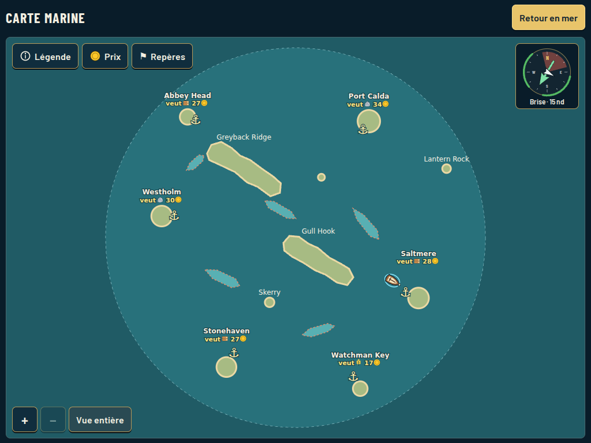

# Full-screen sea chart review

2026-10-20. Real game UI captures from the Vite app in Chromium, using software WebGL.
The only staged gameplay state is discovery of all six ports, so every harbour can be reviewed.
This is the working SVG chart and instrument, not a generated preview. See
[decision 0056](../../decisions/0056-fullscreen-readable-sea-chart.md).

| Profile | Chart | Legend | Prices |
| --- | --- | --- | --- |
| Desktop 1280×720 · Medium · English | [chart](desktop.png) | [legend](desktop-legend.png) | [prices](desktop-prices.png) |
| Tablet 1024×768 · Low · French | [chart](tablet-fr.png) | [legend](tablet-fr-legend.png) | [prices](tablet-fr-prices.png) |
| Phone landscape 844×390 · Low · French | [chart](phone-landscape-fr.png) | [legend](phone-landscape-fr-legend.png) | [prices](phone-landscape-fr-prices.png) |
| Phone portrait 390×844 · High · English | [chart](phone-portrait.png) | [legend](phone-portrait-legend.png) | [prices](phone-portrait-prices.png) |



The full-screen map replaces the old 52dvh SVG inside a scrolling document. Wind/pause prose
and permanent instructions are gone. The static compass uses the same geometry, local wind,
force colours and no-go angle as the Sea HUD. Legend, Prices and Markers are separate sheets.
The player boat stays about 32px long at every zoom; its brown/cream silhouette and blue halo
remain visible against the sea. + / − and drag allow closer inspection without stretching
geography; Whole map returns to the overview. Arrow keys pan the focused map. No pinch gesture
is required. Instructions and the pause explanation remain in the legend.

The [capture script](capture.cjs) checks actual touch placement, mouse drag without accidental
pins, port-name and market-row selection, bounded zoom with constant player screen size,
marker selection, clearing, reopening with retained pins, Escape and focus restoration.
All four profiles fit without page overflow, including after an orientation change; the Prices
sheet has no horizontal overflow. The player keeps the same screen size through zoom and resize.

[Machine-readable checks](browser-checks.json) also show zero chart DOM mutations, zero
underlying 3D render calls and zero world-time advance over an idle observation in every profile.
This verifies that the map adds no continuous drawing workload; physical tablet responsiveness
and touch comfort still need a device playtest. Low/Medium/High are exercised, not benchmarked.

Reproduce after `npm ci`, with Playwright available in Node's resolution path:

```sh
CHROMIUM_PATH=/path/to/chromium node docs/ui-refactor/chart/capture.cjs
```
