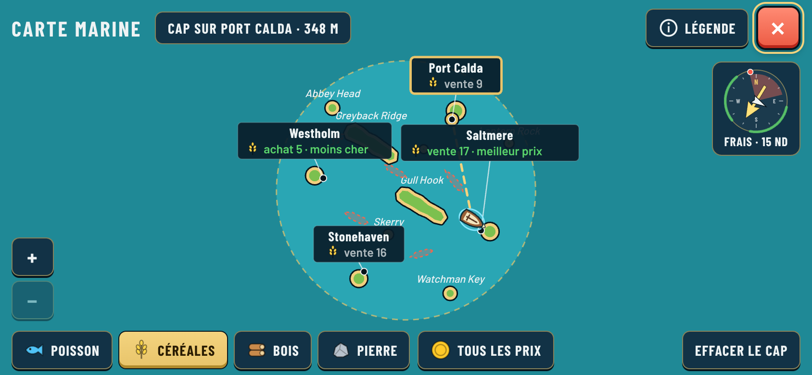
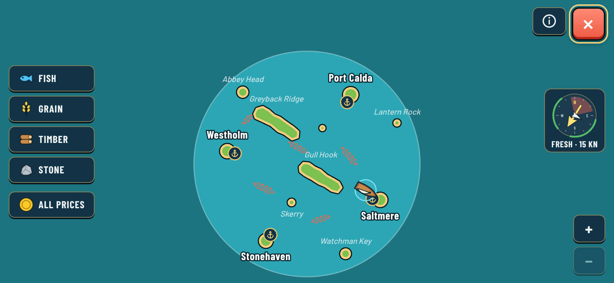
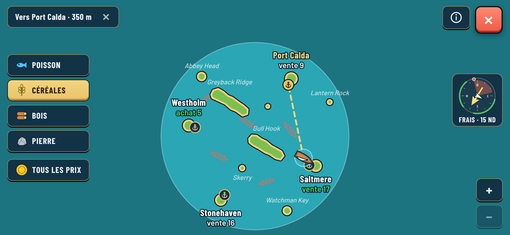
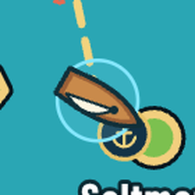
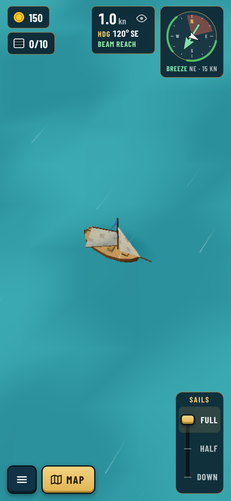
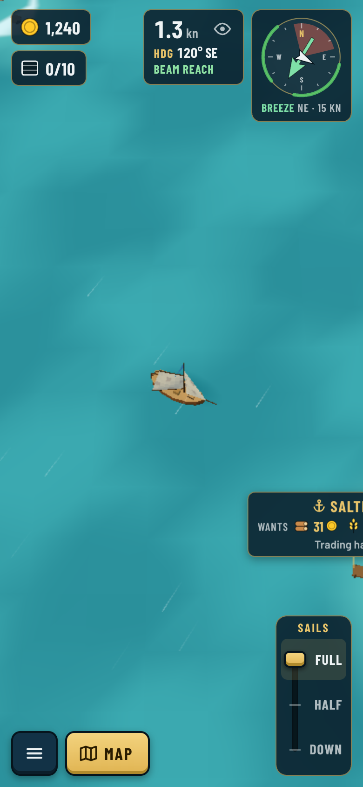

# A clear, easy-to-read chart

2026-10-20. Guillaume asked for "a clear, no clutter, player friendly, easy to read map" after the
first style D chart: island names read better without boxes, all-sand land looked wrong, the
player icon looked like a shield and portrait sailing was zoomed in too close. See
[decision 0058](../../../decisions/0058-chart-style-d-port-cards.md). Real game captures from the
Vite app in headless Chromium, all six ports discovered.

## What made the chart hard to read

1. **Boxes over the map.** Each port was a navy card wider than its island. The cards covered
   Greyback Ridge and Lantern Rock, and four of them filled the middle of a small map.
2. **Everything shouted at once.** Port cards, price words ("· cheapest", "· pays most"), stems,
   pier dots, italic names, reefs and a dashed border all had similar weight.
3. **Controls ate the map.** A title bar and a footer bar took a quarter of a landscape phone's
   height, so the round sea shrank while its left and right sides were empty.
4. **Prices were always on**, even with an empty hold, so the map was never just a map.
5. **Land was all sand**, unlike the green islands at sea, and the boat icon was an oval with a
   cross: it read as a shield.

## Principles used

Common map-design guidance (Google Maps' labels, cartography typography, game world maps):

- **Few levels, clearly ranked.** Boat and course first, ports second, everything else quiet.
  Rank by size, weight and contrast, not by boxes.
  ([2ality on Google Maps](https://2ality-com.onrender.com/2010/12/what-google-maps-can-teach-you-about.html),
  [Atlas typography module](https://atlas.co/courses/gis-basics/typography-in-maps/))
- **A thin dark halo, not a panel**, keeps text readable over sea and land without hiding them.
  ([GOAT label docs](https://goat.plan4better.de/docs/2.0/map/layer_style/labels))
- **Drop low-priority labels where they collide**, and show detail on demand rather than on every
  place. ([Eleken on map UI](https://eleken.co/blog-posts/map-ui-design),
  [Beamdog forum on world-map clutter](https://forums.beamdog.com/discussion/comment/805815))
- **Test at the real size** on each screen.

## The clear chart

| Profile | Names only (empty hold) | Course set | Grain prices |
| --- | --- | --- | --- |
| Phone landscape 844×390 | [chart](chart-landscape.png) | [course](course-landscape.png) | [prices](prices-landscape.png) · [FR](prices-fr-landscape.png) |
| Tablet 1024×768 | [chart](chart-tablet.png) | [course](course-tablet.png) | [prices](prices-tablet.png) |
| Desktop 1280×720 | [chart](chart-desktop.png) | [course](course-desktop.png) | [prices](prices-desktop.png) |
| Phone portrait 390×844 | [chart](chart-portrait.png) | [course](course-portrait.png) | [prices](prices-portrait.png) |

- **The map fills the screen.** No title or footer bar. Controls float where the round sea leaves
  room: goods down the left side (along the bottom in portrait), close and legend top right with
  the compass under them, zoom bottom right, the course top left.
- **Ports:** a navy and brass anchor badge on the pier and the name in bold white with a thin dark
  halo. No box, no stem. Each label goes on the clearest side of its island (above, below, right,
  left) away from other labels, anchor badges and the boat.
- **Quiet names:** islands and yards in small, light italics, left out where they would cover a
  port or the boat. Reefs are soft red patches; banks pale sand.
- **Land:** green grass with a sand shore and an ink outline, like the 3D islands.
- **Prices on demand.** With an empty hold the chart shows names only. Tap a good to show its price
  under every port ("buy 5" where it is stocked, else "sell 17"); green marks the best deal. Tap
  it again to hide prices. With cargo aboard, the chart opens on what you carry. "All prices" keeps
  the full table.
- **Course:** a dashed brass line to the pier; the port's badge and name turn brass; the chip at the
  top reads "To Port Calda · 350 m" with a ✕ to clear it.
- **Boat:** a top-down hull with a pointed bow, a square stern and a white sail, in a light-blue
  ring. 

## Portrait sailing view

The 3D camera had a fixed vertical field of view, so a tall phone saw a thin strip of sea. The
camera now pulls back in portrait until it shows about as much water across as a landscape tablet.

| Before | After |
| --- | --- |
|  |  |

Docked HUD with a single Trade button and the new hull icon: [EN](dock.png), [FR](dock-fr.png), [hull icon](hull-crop.png).
