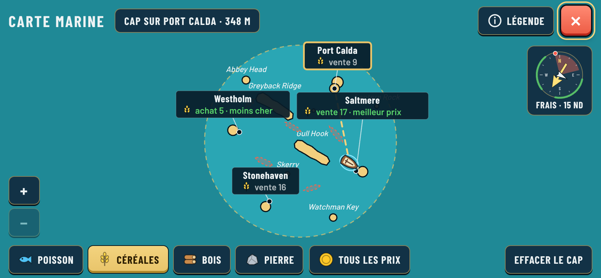

# Style D chart review

2026-10-20. Real game UI captures from the Vite app in headless Chromium, all six ports
discovered. See [decision 0058](../../../decisions/0058-chart-style-d-port-cards.md).

| Profile | Chart | With a course set |
| --- | --- | --- |
| Phone landscape 844×390 · English | [chart](chart-landscape.png) | [course](chart-course-landscape.png) |
| Phone landscape 844×390 · French | [chart](chart-fr-landscape.png) | [course](chart-course-fr-landscape.png) |
| Desktop 1280×720 · English | [chart](chart-desktop.png) | [course](chart-course-desktop.png) |
| Phone portrait 390×844 · English | [chart](chart-portrait.png) | [course](chart-course-portrait.png) |

Each port card shows the price of the good picked in the footer; green marks the cheapest buy
and the best sell. The picked card has a brass outline and a dashed course line from the boat.
Wind is shown only by the compass. Markers are gone.

Docked HUD with damaged hull and a single Trade button: [English](dock.png), [French](dock-fr.png);
hull icon close-up: [hull-crop.png](hull-crop.png).
