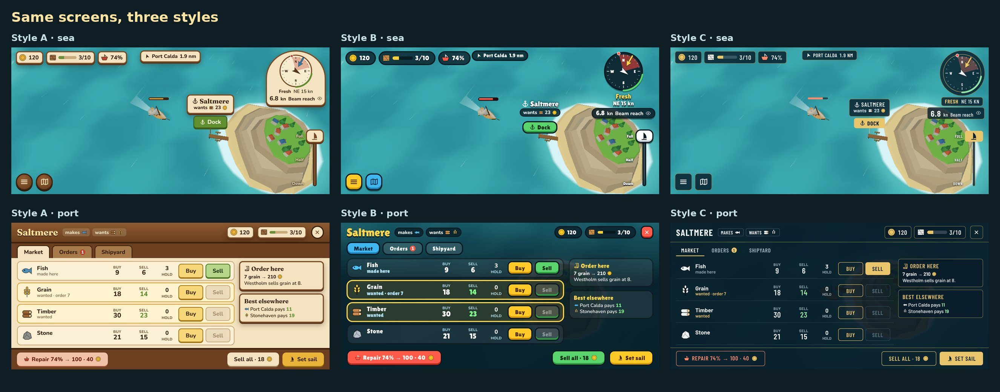
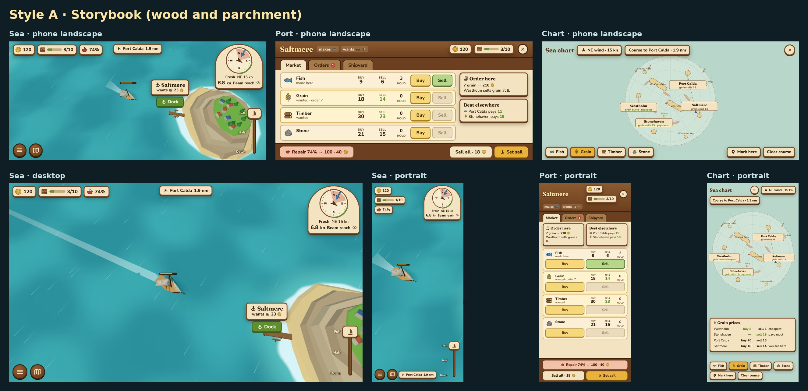
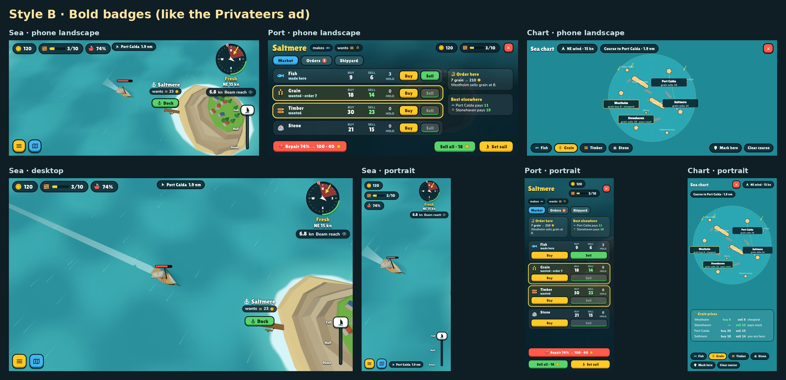
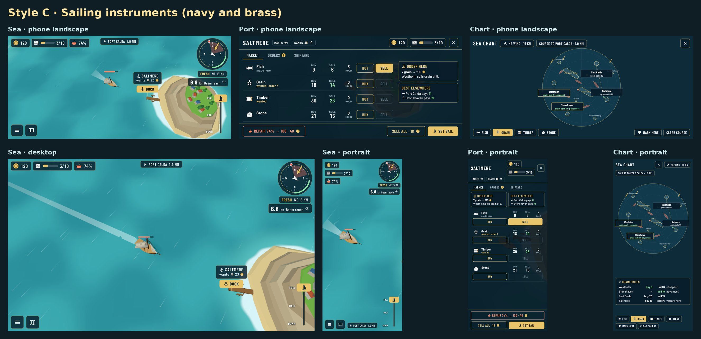

# UI mockups: three styles

*2026-10-20. Static mockups for the UI refactor ([analysis](../README.md)). Nothing is decided until Guillaume picks a style.*

All three styles use the **same layout and the same information**. Only the look changes. They are drawn over real captures of the game (the sea, Saltmere and the sloop), so the art style around them is the real one.

## What every style shares

- **Sea:** a resource strip at the top left (gold, cargo bar, hull only when damaged), the destination with its distance at the top, and a wind compass at the top right. The compass shows the no-go wedge, the wind arrow, your heading, the target dot and a green band for good sailing angles. Under the compass are the wind strength and **speed + point of sail, visible by default with a hide toggle (eye icon)**. The port sign sits over the pier with what the port wants and a **Dock** button. A hull bar floats above the boat when it is damaged. Menu and chart buttons are at the bottom left, and a **sail lever** (Down / Half / Full) is under the right thumb.
- **Port (full-screen):** the port name, what it makes and wants, gold and cargo, and the tabs **Market / Orders / Shipyard**. Each good is **one row**: icon, buy price, sell price (green when this port pays well), hold count, and **Buy** and **Sell** buttons. Each price appears once. A side panel shows this port's order and the best sale elsewhere. Repair, Sell all and Set sail sit along the bottom, and everything fits one screen with no scrolling. On desktop each row also shows the best price elsewhere.
- **Chart (full-screen):** the map fills the screen. Port signs show the selected good's price, and the cheapest and best-paying ports are outlined. The course is a dashed line, and wind arrows sit on the map. Goods chips, Mark here and Clear course are along the bottom. In portrait, the spare space under the map holds a price table.

## Style A: Storybook (wood and parchment)

Warm parchment panels in wooden frames, a soft serif title font (Fraunces) and full-colour icons. It matches the boats' storybook style D and the B2 islands. **Pros:** cosy, has its own identity, and reads well in sunlight. **Cons:** the panels are opaque and hide more sea, and it looks more "board game" than "sailing".

## Style B: Bold badges (like the Privateers ad)

Chunky rounded font (Lilita One), thick dark outlines, bright yellow, green and blue buttons with a pressed edge, and labels floating on the sea with almost no panels. It is the closest to the reference ad. **Pros:** the most "mobile game", the easiest to read at a glance on a small phone, and the sea stays the most visible. **Cons:** loud, generic among free-to-play games, and the least "sailor".

## Style C: Sailing instruments (navy and brass)

Navy glass panels with thin brass lines, a condensed uppercase font (Barlow Condensed) like a boat's instrument display, and single-colour line icons. The compass reads like a real wind instrument. **Pros:** speaks to people who like sailing, is calm and precise, and scales well to desktop. **Cons:** cooler and less playful, and the single-colour goods icons are harder to tell apart.

## My recommendation

**Style C for the sea HUD and chart, with the colour goods icons and the chunkier buttons from B.** The target players like sailing, so an instrument-like compass and chart fit them best, and the navy glass hides the least of the sea. B's coloured icons and pressed buttons make trading quicker to read on a phone. If you prefer one pure style, C is my pick, then A.

## Files

- `compare-styles.jpg`: Sea and Port in the three styles, phone landscape.
- `style-a.jpg`, `style-b.jpg`, `style-c.jpg`: each style on phone landscape (Sea, Port, Chart), desktop (Sea) and portrait (Sea, Port, Chart).
- `screens/`: every screen on its own: `<style>-<screen>-<size>.png`, with sizes landscape 844×390, desktop 1280×720 and portrait 390×844.
- `src/`: the mockup page (`mock.html?style=a|b|c&screen=sea|port|chart&size=landscape|desktop|portrait`), the map data, fonts (Google Fonts, OFL), the background captures, and the Playwright scripts used to capture backgrounds (`bg.mjs`) and render the screens (`render.mjs`). Both scripts point at the cloud container's Chromium and `playwright-core` paths.
