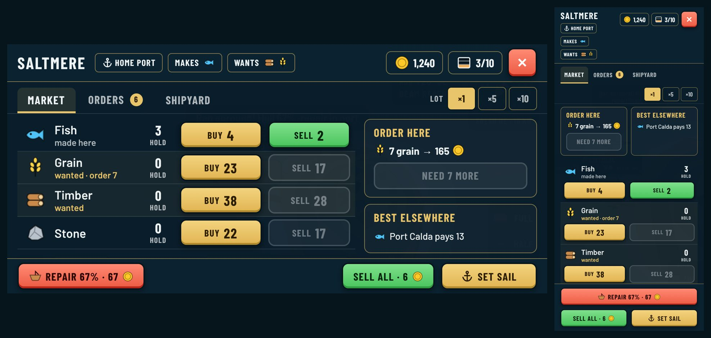

# Port screen in the game (style D)

*2026-10-20. The second screen of the UI redesign, built from [style D](../mockups/README.md#style-d-combined-proposal) and recorded in [ADR 0049](../../decisions/0049-ui-instrument-style.md#port-screen). Captured headless with software WebGL; gold, a little fish in the hold and a damaged hull are staged.*

| Tab | Phone landscape (844×390) | Desktop (1280×720) | Portrait (390×844) |
| --- | --- | --- | --- |
| Market | [port-landscape](port-landscape.png) | [port-desktop](port-desktop.png) | [port-portrait](port-portrait.png) |
| Orders | [orders-landscape](orders-landscape.png) | [orders-desktop](orders-desktop.png) | [orders-portrait](orders-portrait.png) |
| Shipyard | [shipyard-landscape](shipyard-landscape.png) | [shipyard-desktop](shipyard-desktop.png) | [shipyard-portrait](shipyard-portrait.png) |
| Market in French | [port-fr-landscape](port-fr-landscape.png) | | [port-fr-portrait](port-fr-portrait.png) |

What changed against the old trade panel:

- **Full screen**, with the header and the action bar pinned while the goods scroll.
- **Header:** port name, Home port / Makes / Wants tags with goods icons, gold and the hold (crate icon that fills up), close.
- **Tabs:** Market, Orders (with the number of open orders), Shipyard.
- **Market:** one row per good: icon, name and a note (made here, wanted, wanted · order 7), how many are in the hold, then a brass **Buy** and a green **Sell** button that carry today's price. The **Lot** picker (×1, ×5, ×10) sets how many each tap trades, clamped to gold, hold space and stock; the button shows the count when it is more than one. This replaces the old quantity stepper and is an addition beyond the mockup.
- **Side panel:** this port's delivery order with its Deliver button, and where your cargo (or what this port makes) sells best. On desktop each row also shows its best price elsewhere.
- **Bottom bar:** Repair with the % and price, Sell all with the total, and **Set sail**.
- **Portrait:** the side panel goes first as two cards, Buy and Sell sit under each good, the lot picker gets its own line and the actions stack.
- **Shipyard:** same cards as before, restyled with the brass buttons; prices read "300 gold" instead of the coin emoji.
