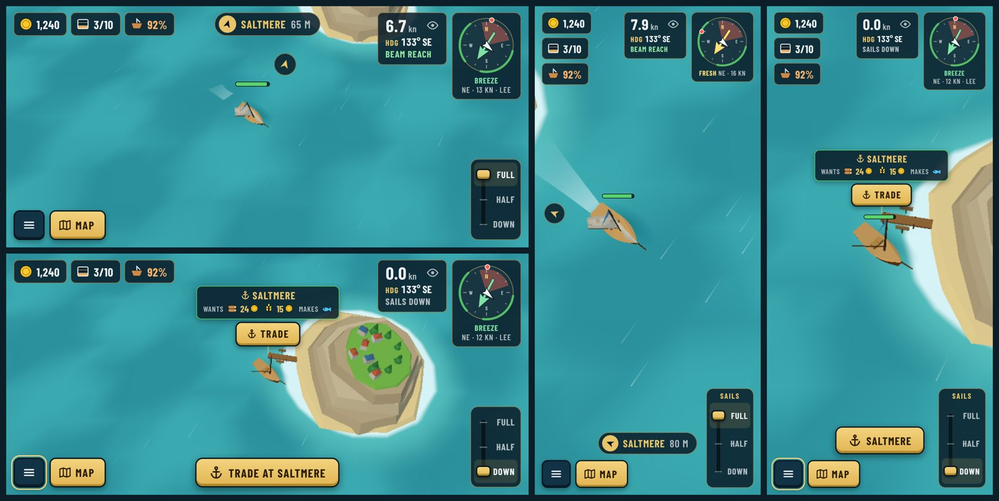

# Sea HUD in the game (style D)

*2026-10-20. The first screen of the UI redesign, built from [style D](../mockups/README.md#style-d-combined-proposal) and recorded in [ADR 0049](../../decisions/0049-ui-instrument-style.md). Captured headless with software WebGL; the damaged hull is staged to show the hull chip and bar.*

| Screen | Phone landscape (844×390) | Desktop (1280×720) | Portrait (390×844) |
| --- | --- | --- | --- |
| Sailing to a destination, cargo aboard, hull damaged | [sea-landscape](sea-landscape.png) | [sea-desktop](sea-desktop.png) | [sea-portrait](sea-portrait.png) |
| Moored at Saltmere: sign with Trade, "Trade at" button | [dock-landscape](dock-landscape.png) | [dock-desktop](dock-desktop.png) | [dock-portrait](dock-portrait.png) |
| Speed log folded with the eye button | [folded-landscape](folded-landscape.png) | | |
| First tutorial hint, in French | [tutorial-fr-landscape](tutorial-fr-landscape.png) | | [tutorial-fr-portrait](tutorial-fr-portrait.png) |

What changed against the old HUD:

- **Top left:** gold, cargo as "3/10" with a crate icon that fills up (tap for the hold list), hull % only when damaged. The ship name moved to the port screen.
- **Top centre:** the destination with an arrow pointing at it on screen and the distance. On narrow screens it sits above the menu and map buttons.
- **Top right:** the speed log (knots, heading in degrees and compass point, point of sail in green when fast), folded with the eye button and remembered; then the wind compass with a green band for the fast angles and the wind caption.
- **Port signs:** name, what the port buys today with its price, what it makes, the docking cue, and a brass **Dock** / **Trade** button when one tap away.
- **Hull bar** above the boat while damaged.
- **Bottom:** menu and map buttons on the left; on the right, the **sail lever** (Full / Half / Down), tapped or dragged. ↑ ↓ / W S still work.
- Fonts are Barlow and Barlow Condensed, self-hosted (`src/ui/fonts/`, SIL Open Font License).
