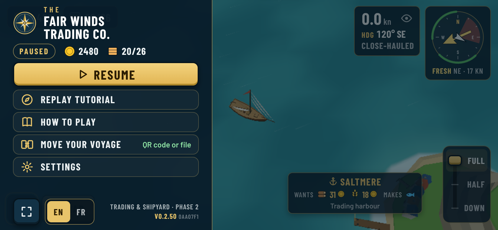
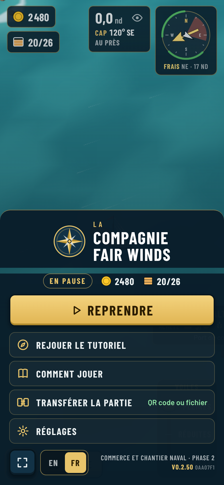
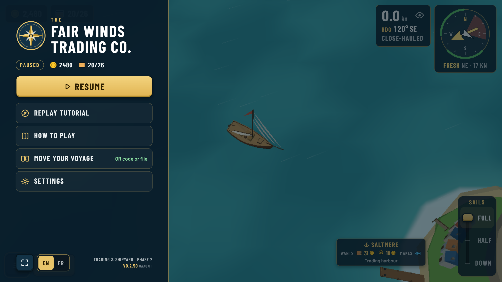
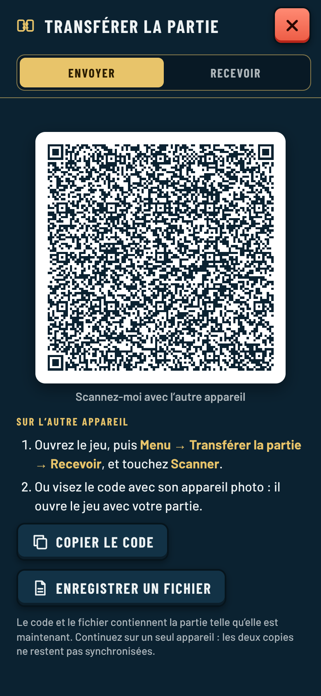
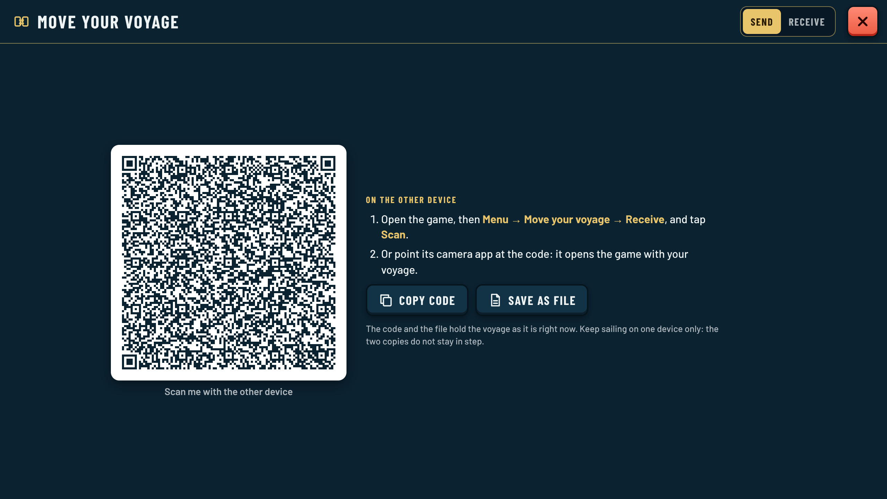
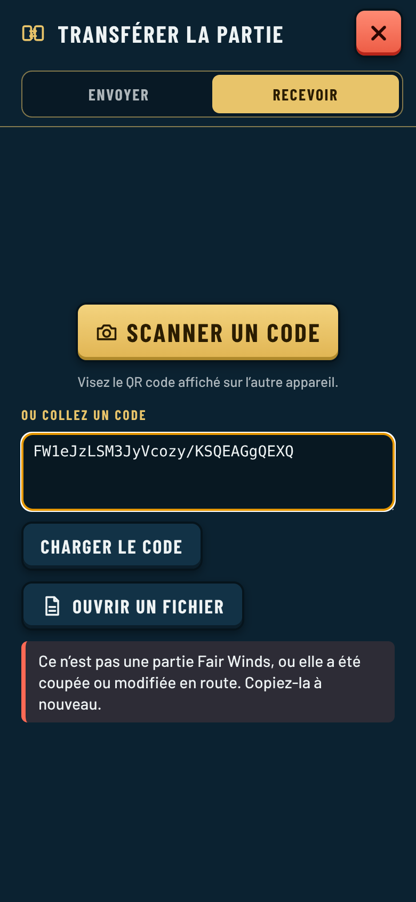
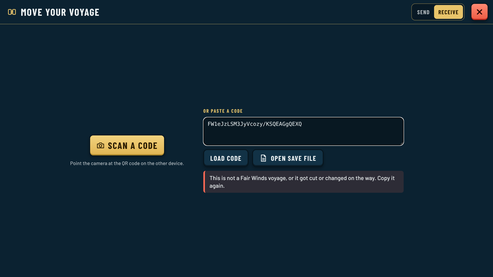
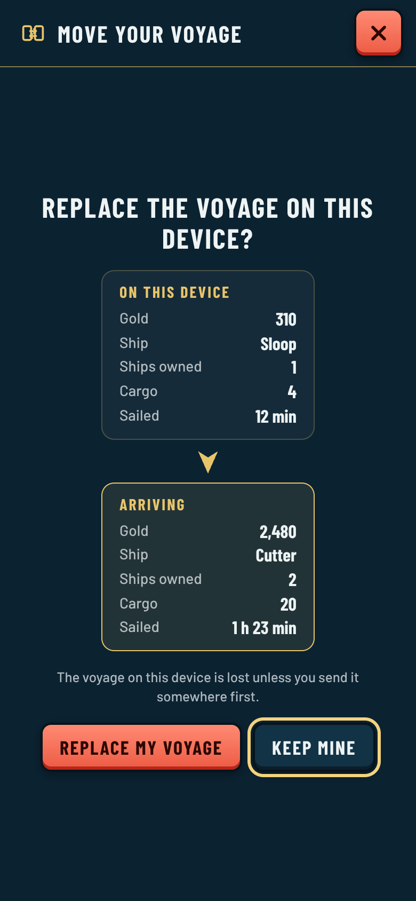
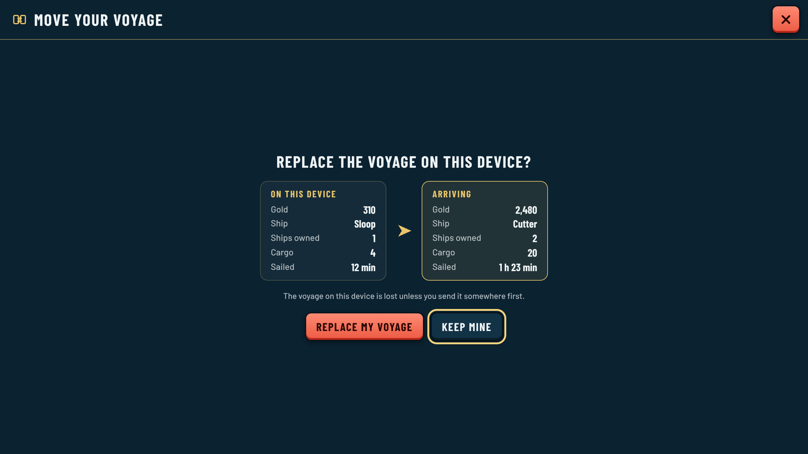
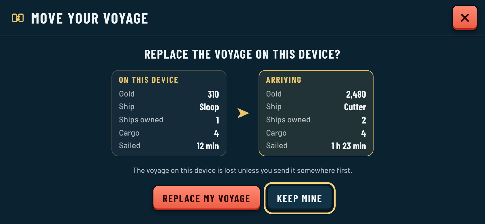

# Move your voyage: built screens

Screens of Menu → Move your voyage ([decision 0066](../../decisions/0066-move-voyage-between-devices.md)), captured from the real game by `capture.cjs` (run `node docs/ui-refactor/transfer/capture.cjs` from the repo root). The script also checks the whole path: device B scans device A's QR through a fake camera, confirms, and reloads into A's voyage.

| | Landscape phone | Portrait phone | Desktop |
| --- | --- | --- | --- |
| Menu row |  |  (FR) |  |
| Send (QR) |  |  (FR) |  |
| Receive, bad code |  |  (FR) |  |
| Replace? (after scanning) |  (FR) |  |  |
| Opened from a camera-app link |  | | |
